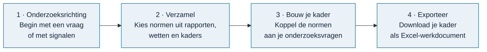

<h1 align="center">Omnibus</h1>

<p align="center">
  
</p>

<p align="center">
  Stel in een paar stappen een toetsingskader samen voor je onderzoek,<br>
  met normen uit echte rapporten, wetten en kaders. En exporteer het naar Excel.
</p>

<p align="center">
  <!--badge:database-->
  <a href="https://github.com/Robert-Worm/omnibus/releases/latest"></a>
  <!--/badge-->
  <a href="docs/bijdragen/voortgang.md"></a>
  <a href="skills/README.md"></a>
  <a href="#licentie"></a>
</p>

<p align="center">
  <a href="#zo-werkt-het"><strong>Zo werkt het</strong></a> ·
  <a href="docs/gebruiken/installeren.md">Installeren</a> ·
  <a href="docs/bijdragen/README.md">Meedoen</a> ·
  <a href="docs/README.md">Alle documentatie</a> ·
  <a href="docs/veelgestelde-vragen.md">Vragen</a> ·
  <a href="docs/routekaart.md">Routekaart</a>
</p>

---

| 👥 Voor wie | ❓ Het probleem | ✅ Wat je krijgt |
| --- | --- | --- |
| Auditors en onderzoekers die een onderzoek opzetten, bij de overheid of daarbuiten | Bruikbare normen staan verspreid over duizenden rapporten, wetten en kaders. Een toetsingskader samenstellen kost veel zoekwerk. | Een toetsingskader als Excel-werkdocument, met bij elke norm de bron waar hij vandaan komt |

## Wat is Omnibus?

Omnibus is een hulpmiddel voor **auditors en onderzoekers**. Het helpt je een *toetsingskader* te maken: de lijst met normen en toetspunten waarmee je een organisatie onderzoekt.

Je begint niet met een leeg vel. Omnibus bevat normen uit eerdere onderzoeksrapporten, uit wetten en uit normenkaders. Jij kiest wat past bij jouw onderzoek. Bij elke norm kun je de oorspronkelijke bron lezen, zodat je altijd weet waar hij vandaan komt.


<a id="zo-werkt-het"></a>
## Zo werkt het



1. **Onderzoeksrichting.** Begin vanuit een vraag van je opdrachtgever, of vanuit signalen en zorgen.
2. **Verzamel.** Blader door rapporten, wetten, kaders en onderzoeksmodellen. Kies losse toetspunten, een norm of een hele groep.
3. **Bouw je kader.** Schrijf je onderzoeksvragen en koppel de gekozen normen eraan.
4. **Exporteer.** Kies een werkvorm (normtoetsing, risico-controlmatrix of interviewleidraad) en download het Excel-bestand.

Meer uitleg met schermafbeeldingen: [werken met Omnibus](docs/gebruiken/werken-met-omnibus.md).

> [!NOTE]
> Een norm kiezen betekent niet dat hij juridisch geldt voor de organisatie, of dat de organisatie eraan voldoet. Dat oordeel blijft bij jou als onderzoeker.

## Wat zit erin?

Omnibus bestaat uit twee delen die je los downloadt:

| Deel | Wat het is | Waar |
| --- | --- | --- |
| **De applicatie** | De code van Omnibus. Draait lokaal in je browser. | Deze repository |
| **De database** | De inhoud: <!--n:rapporten-->27<!--/n--> rapporten van de Auditdienst Rijk, <!--n:kaders-->7<!--/n--> wetten en kaders en <!--n:modellen-->14<!--/n--> onderzoeksmodellen. | [Releases](https://github.com/Robert-Worm/omnibus/releases/latest) (zip van 10 MB) |

Wat er precies in de database zit en wat er nog komt, staat in de [voortgang](docs/bijdragen/voortgang.md).

<a id="aan-de-slag"></a>
## Aan de slag

Je hebt Git, Node 24 en ongeveer tien minuten nodig. In het kort:

```text
git clone https://github.com/Robert-Worm/omnibus.git
cd omnibus
npm ci --ignore-scripts --no-audit --no-fund
```

Pak daarna de database-zip uit in `local-data/runtime/`, bouw de applicatie en open hem in je browser. Alle stappen staan in [Omnibus installeren](docs/gebruiken/installeren.md).

<a id="meedoen"></a>
## Meedoen

Omnibus wordt beter met elke bron die erbij komt. Je zet een rapport, wet of kader op je naam, verwerkt hem met een [AI-skill](skills/README.md) en levert hem in; hoe dat gaat, lees je in [meedoen](docs/bijdragen/README.md). Kijk in de [voortgang](docs/bijdragen/voortgang.md) wat er nog open staat. Vragen en ideeën kun je kwijt in [Discussions](https://github.com/Robert-Worm/omnibus/discussions).

## Wat komt er nog?

Vanaf de lokale versie lopen vier paden:

| Pad | Doel |
| --- | --- |
| 🌐 [Online versie](docs/routekaart.md#pad-a--online-versie) | Omnibus gebruiken zonder installatie; eerst een online demo |
| 🤖 [AI aan de database](docs/routekaart.md#pad-b--ai-rechtstreeks-aan-de-database) | Je AI-assistent laten zoeken en een opzet laten voorbereiden |
| 🗂️ [Eigen databases](docs/routekaart.md#pad-c--eigen-databases-bouwen) | Eigen documenten en een eigen database naast de openbare |
| 🤝 [Samen bijdragen](docs/routekaart.md#pad-d--samen-bijdragen) | De openbare database samen uitbreiden |

Zie de [routekaart](docs/routekaart.md).

## Verwant project

Omnibus hoort bij de [Rijksmap](https://www.rijksmap.nl): een kaart van de rijksoverheid met ruim 9.000 rapporten van auditors, inspecties en onderzoekers. De Rijksmap laat zien wát er is onderzocht. Omnibus helpt je een nieuw onderzoek op te zetten.

<a id="licentie"></a>
## Licentie

- **Code, documentatie en skills:** [PolyForm Noncommercial 1.0.0](LICENSE). Je mag ze vrij gebruiken, aanpassen en delen, maar niet commercieel.
- **Database:** eigen uitwerkingen (normen, toetspunten, vragen) vallen onder dezelfde licentie. Bronteksten van rapporten, wetten en kaders blijven van hun uitgevers; de licentie geeft daar geen rechten op. De vier IIA Topical Requirements staan met hun volledige tekst in de database; de rechten blijven bij The Institute of Internal Auditors, en de teksten gaan eruit als de IIA daarom vraagt. Zie [NOTICE](NOTICE).

Omnibus is een persoonlijk, niet-commercieel initiatief van Robert Worm. Het is geen officiële uitgave van de rijksoverheid of van de uitgevers van de gebruikte kaders.
