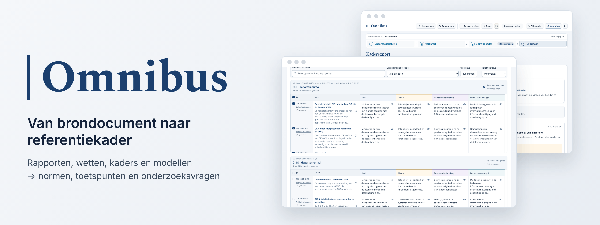
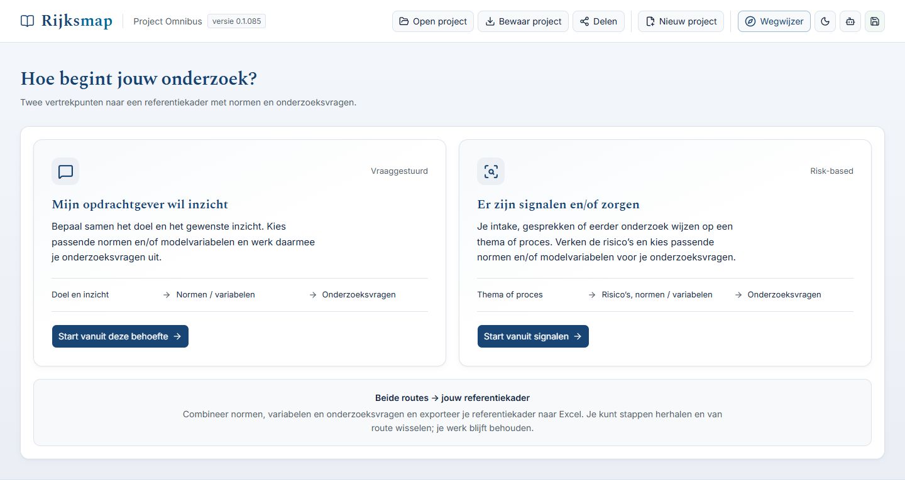
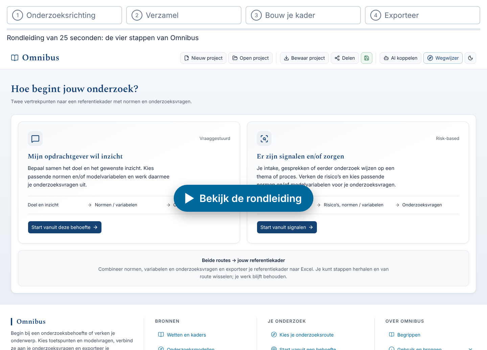

<h1 align="center">
  <picture>
    <source media="(prefers-color-scheme: dark)" srcset="docs/images/omnibus-banner-donker.png">
    
  </picture>
</h1>

<p align="center">
  Stel in een paar stappen een referentiekader samen voor je onderzoek, met normen uit echte rapporten, wetten en kaders. En exporteer het naar Excel.
</p>

<p align="center">
  <!--badge:database-->
  <a href="https://github.com/Robert-Worm/omnibus/releases/latest"></a>
  <!--/badge-->
  <a href="skills/README.md"></a>
  <a href="#licentie"></a>
</p>

<p align="center">
  <a href="https://omnibus.sliplane.app"><strong>Probeer online</strong></a> &nbsp;·&nbsp;
  <a href="docs/gebruiken/installeren.md"><strong>Installeren</strong></a> &nbsp;·&nbsp;
  <a href="docs/bijdragen/README.md"><strong>Meedoen</strong></a>
</p>

## Wat is Omnibus?

- **Voor wie:** auditors en onderzoekers die een onderzoek opzetten, bij de overheid of daarbuiten.
- **Het probleem:** bruikbare normen staan verspreid over duizenden rapporten, wetten en kaders. Een referentiekader samenstellen kost veel zoekwerk.
- **Wat je krijgt:** een *referentiekader*, de normen en toetspunten waarmee je een organisatie onderzoekt, als Excel-werkdocument. Bij elke norm staat de bron waar hij vandaan komt.

Je begint niet met een leeg vel. Omnibus bevat normen uit eerdere onderzoeksrapporten, uit wetten en uit normenkaders. Jij kiest wat past bij jouw onderzoek. Bij elke norm kun je de oorspronkelijke bron lezen, zodat je altijd weet waar hij vandaan komt.

## Kies je route

| Je wilt… | Lees |
| --- | --- |
| Omnibus gebruiken voor je onderzoek | [Omnibus gebruiken](docs/gebruiken/README.md): installeren, de vier stappen en de veelgestelde vragen |
| Een bron toevoegen aan de database | [Meedoen](docs/bijdragen/README.md): een bron claimen, verwerken met een AI-skill en inleveren |
| Pakketten controleren en databases uitbrengen | [Omnibus beheren](docs/beheer/README.md): het beheerhandboek, releases en storingen |

Alle pagina's staan in de [wegwijzer](docs/README.md). Een vraag? Kijk bij de [veelgestelde vragen](docs/veelgestelde-vragen.md) of stel hem in [Discussions](https://github.com/Robert-Worm/omnibus/discussions).

<details lang="en">
<summary>🇬🇧 <strong>In English</strong></summary>

Omnibus helps auditors and researchers build a *reference framework* (in Dutch: *referentiekader*): the set of norms and test points used to assess an organisation. Instead of starting from a blank page, you pick norms from earlier audit reports of the Dutch government's Audit Service (Auditdienst Rijk), from laws and from established frameworks, link them to your research questions and export the result to Excel. Every norm keeps a link to its original source.

Omnibus is free for non-commercial use and runs in your browser; projects stay on your own computer. The content and documentation are in Dutch. [Try it online](https://omnibus.sliplane.app), watch the [25-second tour](#zo-werkt-het), or run it yourself with Docker (see [Aan de slag](#aan-de-slag)). Questions are welcome in [Discussions](https://github.com/Robert-Worm/omnibus/discussions), in English too.

</details>

<picture>
  <source media="(prefers-color-scheme: dark)" srcset="docs/images/omnibus-overview-donker.png">
  
</picture>

*Het startscherm: begin vanuit een vraag of vanuit signalen.*

<a id="zo-werkt-het"></a>
## Zo werkt het

<a href="docs/images/rondleiding.gif">
  <picture>
    <source media="(prefers-color-scheme: dark)" srcset="docs/images/rondleiding-donker.png">
    
  </picture>
</a>

*Klik op het beeld voor de rondleiding van 25 seconden (bewegend beeld, 0,8 MB). De vier stappen staan hieronder.*

1. **Onderzoeksrichting.** Begin vanuit een vraag van je opdrachtgever, of vanuit signalen en zorgen.
2. **Verzamel.** Blader door rapporten, wetten, kaders en onderzoeksmodellen. Kies losse toetspunten, een norm of een hele groep.
3. **Bouw je kader.** Schrijf je onderzoeksvragen en koppel de gekozen normen eraan.
4. **Exporteer.** Kies een werkvorm (normtoetsing, risico-controlmatrix of interviewleidraad) en download het Excel-bestand.

Wil je het meteen proberen? Open de [proefversie online](https://omnibus.sliplane.app). Je werk blijft daar in je eigen browser; de server bewaart niets van je onderzoek. Gebruik **Bewaar project** om het mee te nemen. Of bekijk eerst het resultaat: download het [voorbeeld](https://github.com/Robert-Worm/omnibus/releases/download/database-2026-10-19/omnibus-voorbeeld.zip) (0,5 MB): een fictief onderzoek naar de CIO-functie bij een ministerie, met de drie Excel-werkvormen en een projectbestand.

Meer uitleg met schermafbeeldingen: [werken met Omnibus](docs/gebruiken/werken-met-omnibus.md).

> [!NOTE]
> **Goed om te weten:** een norm kiezen betekent niet dat hij juridisch geldt voor de organisatie, of dat de organisatie eraan voldoet. Dat oordeel blijft bij jou als onderzoeker.

## Wat zit erin?

Omnibus bestaat uit twee delen. Online en met Docker krijg je ze samen; bij een eigen installatie haalt de installatieopdracht de database op.

| Deel | Wat het is | Waar |
| --- | --- | --- |
| De applicatie | De code van Omnibus. Draait lokaal in je browser. | Deze repository; vaste versies bij de [releases](https://github.com/Robert-Worm/omnibus/releases/tag/v0.1.0) |
| De database | De inhoud: <!--n:rapporten-->27<!--/n--> rapporten van de Auditdienst Rijk, <!--n:kaders-->7<!--/n--> wetten en kaders en <!--n:modellen-->14<!--/n--> onderzoeksmodellen. | [Releases](https://github.com/Robert-Worm/omnibus/releases/latest) (zip van 10 MB) |

Applicatie 0.1.0 en de database van 19 oktober 2026 zijn samen getest. Wat er precies in de database zit en wat er nog komt, staat in de [voortgang](docs/bijdragen/voortgang.md).

<a id="aan-de-slag"></a>
## Aan de slag

**Met Docker** zijn twee opdrachten genoeg; open daarna `http://localhost:8080`:

```text
docker build -t omnibus -f hosting/container/Dockerfile https://github.com/Robert-Worm/omnibus.git#v0.1.0
docker run --rm -p 8080:8080 omnibus
```

**Zonder Docker** heb je Git en Node 24 nodig. Eén opdracht installeert, haalt de database op, controleert, bouwt en start:

```text
git clone https://github.com/Robert-Worm/omnibus.git
cd omnibus
node scripts/installeer.mjs
```

Open daarna `http://127.0.0.1:4319/`. Alle stappen staan in [Omnibus installeren](docs/gebruiken/installeren.md). Vastgelopen? Kijk bij [problemen oplossen](docs/gebruiken/problemen-oplossen.md) of [vraag om hulp](https://github.com/Robert-Worm/omnibus/discussions/new?category=hulp).

## Wat komt er nog?

Vanaf de huidige versie, lokaal en online, lopen vier paden:

| Pad | Doel |
| --- | --- |
| 🌐 [Online versie](docs/routekaart.md#pad-a--online-versie) | Omnibus gebruiken zonder installatie. Een proefversie staat al op [omnibus.sliplane.app](https://omnibus.sliplane.app); de officiële demo volgt |
| 🤖 [AI aan de database](docs/routekaart.md#pad-b--ai-rechtstreeks-aan-de-database) | Je AI-assistent laten zoeken en een opzet laten voorbereiden |
| 🗂️ [Eigen databases](docs/routekaart.md#pad-c--eigen-databases-bouwen) | Eigen documenten en een eigen database naast de openbare |
| 🤝 [Samen bijdragen](docs/routekaart.md#pad-d--samen-bijdragen) | De openbare database samen uitbreiden |

Zie de [routekaart](docs/routekaart.md).

## Verwant project

Omnibus hoort bij de [Rijksmap](https://www.rijksmap.nl): een kaart van de rijksoverheid met ruim 9.000 rapporten van auditors, inspecties en onderzoekers. De Rijksmap laat zien wát er is onderzocht. Omnibus helpt je een nieuw onderzoek op te zetten.

<a id="licentie"></a>
## Licentie

- **Code, documentatie en skills:** [PolyForm Noncommercial 1.0.0](LICENSE). Je mag ze vrij gebruiken, aanpassen en delen, maar niet commercieel.
- **Database:** eigen uitwerkingen (normen, toetspunten, vragen) vallen onder dezelfde licentie. Bronteksten van rapporten, wetten en kaders blijven van hun uitgevers; de licentie geeft daar geen rechten op. De vier IIA Topical Requirements staan met hun volledige tekst in de database; de rechten blijven bij The Institute of Internal Auditors, en de teksten gaan eruit als de IIA daarom vraagt. Zie [NOTICE](NOTICE).

Omnibus is een persoonlijk, niet-commercieel initiatief van Robert Worm. Het is geen officiële uitgave van de rijksoverheid of van de uitgevers van de gebruikte kaders.
