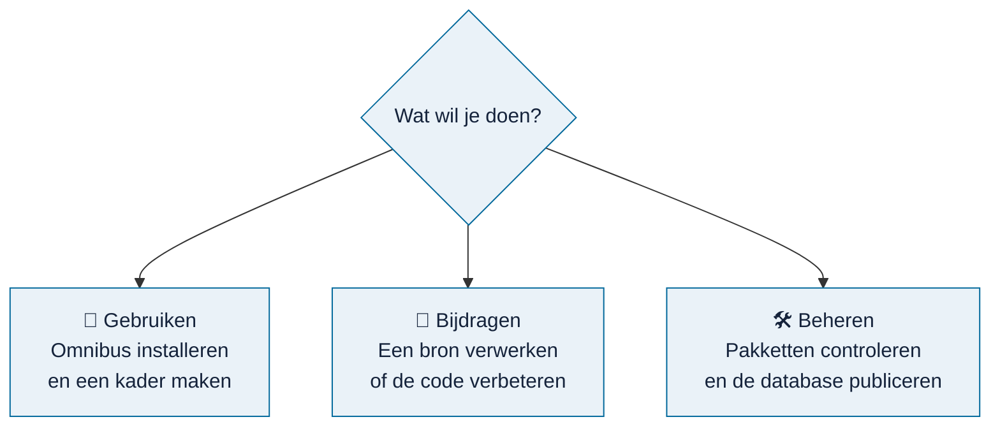

# Wegwijzer

> **In het kort:** alle documentatie van Omnibus, ingedeeld naar wat je wilt doen. Kies hieronder je route.

## 🧭 Gebruiken

Voor auditors en onderzoekers die Omnibus willen gebruiken.

| Ik wil… | Lees |
| --- | --- |
| Omnibus op mijn computer zetten | [Installeren](gebruiken/installeren.md) |
| Weten hoe de vier stappen werken | [Werken met Omnibus](gebruiken/werken-met-omnibus.md) |
| Met mijn eigen documenten werken | [Eigen documenten](gebruiken/eigen-documenten.md) |
| Mijn eigen AI-assistent laten meewerken | [AI-koppeling](gebruiken/ai-koppeling.md) |

## 🤝 Bijdragen

Voor iedereen die Omnibus wil helpen groeien.

| Ik wil… | Lees |
| --- | --- |
| Weten hoe ik kan helpen | [Meedoen](bijdragen/README.md) |
| Zien wat er al is en wat nog open staat | [Voortgang](bijdragen/voortgang.md) |
| Een rapport, wet of kader verwerken | [Een bron verwerken](bijdragen/bron-verwerken.md) |
| Een wet of kader kiezen dat openbaar mag | [Werklijst wetten en kaders](bijdragen/werklijst-wetten-en-kaders.md) |
| De code verbeteren | [Ontwikkelen](bijdragen/ontwikkelen.md) en [architectuur](bijdragen/architectuur.md) |

## 🛠️ Beheren

Voor de beheerder, die ingeleverde pakketten controleert en nieuwe databases uitbrengt.

| Ik wil… | Lees |
| --- | --- |
| Een overzicht van het beheerwerk | [Beheer](beheer/README.md) |
| Een ingeleverd pakket controleren | [Pakket controleren](beheer/pakket-controleren.md) |
| Een nieuwe database maken en uitbrengen | [Database publiceren](beheer/database-publiceren.md) |

## Overig

- [Routekaart](routekaart.md): wat er nog komt.
- [AI-skills](../skills/README.md): de zes werkwijzen voor AI-assistenten.
- [Versiegeschiedenis](../CHANGELOG.md), [beveiliging](../SECURITY.md), [toegankelijkheid](../ACCESSIBILITY.md) en [gedragscode](../CODE_OF_CONDUCT.md).

## Waar vind je wat in de repository?

| Map | Wat erin staat |
| --- | --- |
| `docs/` | Deze documentatie, in drie routes: `gebruiken/`, `bijdragen/` en `beheer/` |
| `skills/` | Zes AI-skills om bronnen te verwerken en te controleren |
| `app/`, `components/`, `hooks/` | De schermen van de applicatie |
| `lib/` | Gedeelde regels: selecties, vragen, projecten en Excel-export |
| `local-data/` | De koppeling met de database |
| `agent-tools/` | De koppeling voor AI-assistenten |
| `content-tools/`, `content-workbench/` | Hulpmiddelen voor de beheerder |
| `scripts/`, `hosting/` | Bouwen, testen en voorbereiden op hosting |

Elke map heeft een eigen README met uitleg.

## Volgende stap

Nieuw hier? Begin met [Omnibus installeren](gebruiken/installeren.md).
