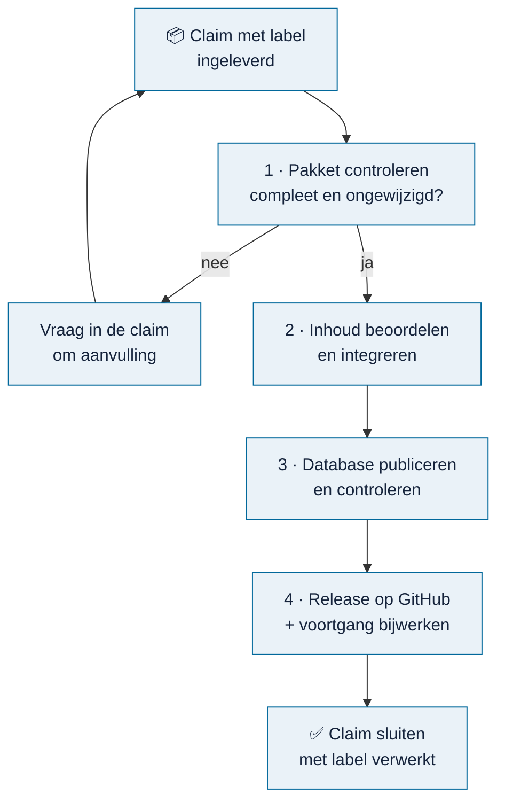

# Beheer

> **In het kort:** de beheerder controleert ingeleverde bronnen, neemt ze op in een nieuwe database en brengt die uit als release. Deze pagina geeft het overzicht; de details staan in de pagina's eronder.

## De beheercyclus

1. **Pakket controleren.** Is het ingeleverde pakket compleet, en zijn de bestanden ongewijzigd aangekomen? Zie [pakket controleren](pakket-controleren.md).
2. **Inhoud beoordelen en integreren.** Klopt de inhoud, en past hij in de bestaande weergaven? Dit gebeurt in de private verwerkingsomgeving. Zie [inhoud toevoegen](inhoud-toevoegen.md).
3. **Database publiceren.** Maak een nieuwe database, vergelijk hem met de vorige en test hem. Zie [database publiceren](database-publiceren.md).
4. **Uitbrengen.** Zet de database als zip bij een nieuwe release en werk `.github/voortgang/verwerkt.json` bij. De voortgang past zich daarna vanzelf aan. Zie [een release uitbrengen](database-publiceren.md#een-release-uitbrengen).
5. **Claims sluiten.** Geef de verwerkte claims het label **verwerkt** en sluit ze. Doe dit pas ná het bijwerken van `verwerkt.json`; anders staat de bron even weer als open.

## Alle beheerpagina's

| Pagina | Waarover |
| --- | --- |
| [Pakket controleren](pakket-controleren.md) | Een ingeleverd pakket technisch controleren |
| [Inhoud toevoegen](inhoud-toevoegen.md) | Van pakket naar inhoud in de applicatie, en welke reviews nodig zijn |
| [Database publiceren](database-publiceren.md) | Een nieuwe database maken, vergelijken, uitbrengen en herstellen |
| [Actieve inventaris controleren](actieve-inventaris-controleren.md) | Controleren dat een nieuwe database alleen goedgekeurde inhoud bevat |
| [Content Workbench](content-workbench.md) | Lokaal werkbord om de verwerking van veel bronnen bij te houden |
| [Runtimepakket](runtime-pakket.md) | Omnibus verpakken voor een andere computer of voor hosting |
| [Storingen en herstel](storingen-en-herstel.md) | Back-up, herstel en wat te doen bij een storing |
| [Checklist live demo](live-demo-checklist.md) | Wat er nog moet gebeuren voor een online demo |
| [Acceptatiecontracten](acceptatiecontracten.md) | De afspraken waaraan de applicatie moet blijven voldoen |

## Vaste regels

- **Een technische controle is geen goedkeuring.** Een geslaagde controle zegt dat bestanden compleet en ongewijzigd zijn, niet dat de inhoud klopt.
- **HOLD blijft HOLD.** Ontbreekt bewijs of een review, dan wordt een punt niet goedgekeurd om verder te kunnen.
- **Nooit een hash aanpassen** om een controle te laten slagen.
- **Databases, bronarchieven en reviewdossiers blijven buiten Git.** Alleen de openbare database gaat als zip in een release.
- **Niets publiceren zonder bewust besluit** van de beheerder.

## Samengevat

Controleren, beoordelen, publiceren, uitbrengen, claims sluiten. Bij twijfel: HOLD.

## Volgende stap

Is er een claim met het label **ingeleverd**? Begin bij [pakket controleren](pakket-controleren.md).

---

[↑ Wegwijzer](../README.md) · [Begrippen](../begrippen.md) · [Routekaart](../routekaart.md)
