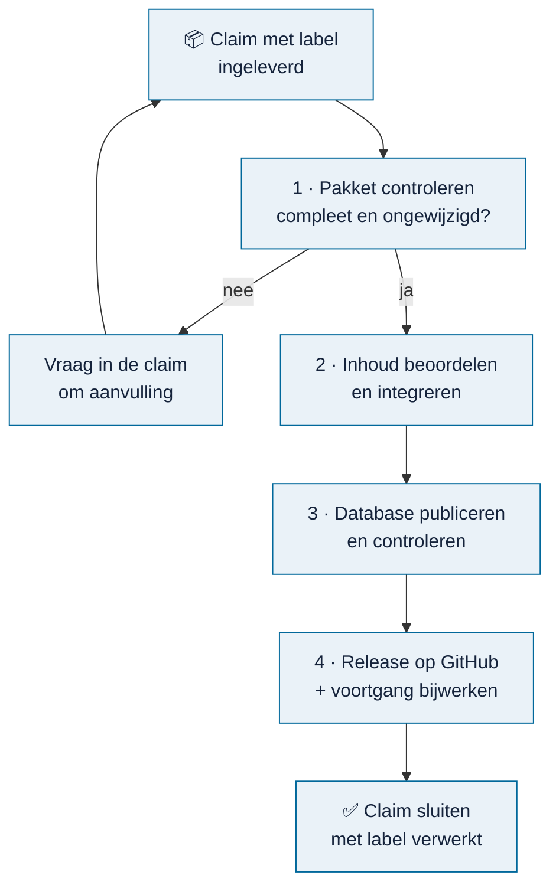

# Beheer

<!-- paginatype: start -->

> **In het kort:** de beheerder controleert ingeleverde bronnen, neemt ze op in een nieuwe database en brengt die uit als release. Deze pagina geeft het overzicht; de details staan in de pagina's eronder.

## Begin hier

| Stap | Lees | Wat je daarna kunt |
| --- | --- | --- |
| 1 | [Beheerhandboek](handboek.md) | Je weet welke taken er per dag, week en release zijn |
| 2 | [Database publiceren](database-publiceren.md) | Je brengt een nieuwe database uit |
| 3 | [Storingsdraaiboek](draaiboek.md) | Je weet wat je doet als er iets misgaat |

## De beheercyclus

1. **Pakket controleren.** Is het ingeleverde pakket compleet, en zijn de bestanden ongewijzigd aangekomen? Zie [pakket controleren](pakket-controleren.md).
2. **Inhoud beoordelen en integreren.** Klopt de inhoud, en past hij in de bestaande weergaven? Dit gebeurt in de private verwerkingsomgeving. Zie [inhoud toevoegen](inhoud-toevoegen.md).
3. **Database publiceren.** Maak een nieuwe database, vergelijk hem met de vorige en test hem. Zie [database publiceren](database-publiceren.md).
4. **Uitbrengen.** Zet de database als zip bij een nieuwe release en werk `.github/voortgang/verwerkt.json` bij. De voortgang past zich daarna vanzelf aan. Zie [een release uitbrengen](database-publiceren.md#een-release-uitbrengen).
5. **Claims sluiten.** Geef de verwerkte claims het label **verwerkt** en sluit ze. Doe dit pas ná het bijwerken van `verwerkt.json`; anders staat de bron even weer als open.

## Alle beheerpagina's

**Dagelijks en wekelijks**

| Pagina | Waarover |
| --- | --- |
| [Beheerhandboek](handboek.md) | Welke taken er per dag, week, release en kwartaal zijn |

**Per pakket**

| Pagina | Waarover |
| --- | --- |
| [Pakket controleren](pakket-controleren.md) | Een ingeleverd pakket technisch controleren |
| [Inhoud toevoegen](inhoud-toevoegen.md) | Van pakket naar inhoud in de applicatie, en welke reviews nodig zijn |

**Per release**

| Pagina | Waarover |
| --- | --- |
| [Database publiceren](database-publiceren.md) | Een nieuwe database maken, vergelijken, uitbrengen en herstellen |
| [Actieve inventaris controleren](actieve-inventaris-controleren.md) | Controleren dat een nieuwe database alleen goedgekeurde inhoud bevat |
| [Runtimepakket](runtime-pakket.md) | Omnibus verpakken voor een andere computer of voor hosting |
| [Checklist live demo](live-demo-checklist.md) | Wat er nog moet gebeuren voor een online demo |

**Bij storingen**

| Pagina | Waarover |
| --- | --- |
| [Storingsdraaiboek](draaiboek.md) | Zes situaties rond claims, releases en GitHub, en wat je dan doet |
| [Back-up en herstel](storingen-en-herstel.md) | Een back-up van de database maken, herstellen, en wat te doen als de server faalt |

**Naslag**

| Pagina | Waarover |
| --- | --- |
| [Besluiten](besluiten.md) | Welke besluiten al genomen zijn, en waarom |
| [Acceptatiecontracten](acceptatiecontracten.md) | De afspraken waaraan de applicatie moet blijven voldoen |

## Vaste regels

Deze regels gelden altijd. Ze staan alleen hier; andere beheerpagina's verwijzen hiernaar.

**Altijd**

- **Een technische controle is geen goedkeuring.** Een geslaagde controle zegt dat bestanden compleet en ongewijzigd zijn, niet dat de inhoud klopt.
- **HOLD blijft HOLD.** Ontbreekt bewijs of een review, dan wordt een punt niet goedgekeurd om verder te kunnen.
- **Nooit een hash aanpassen** om een controle te laten slagen.
- **Databases, bronarchieven en reviewdossiers blijven buiten Git.** Alleen de openbare database gaat als zip in een release.
- **Niets publiceren zonder bewust besluit** van de beheerder.

**Bij nieuwe inhoud**

- Bronpassages, citaten en markeringen blijven ongewijzigd.
- Een technische controle is geen inhoudelijke goedkeuring.
- Een correctie op bestaande inhoud wordt de nieuwe actuele tekst; er komen geen parallelle oude versies bij.
- Gedeelde onderdelen die je niet mag breken: `app/law-point-source.tsx` (bronweergave), `app/report-library.tsx` (bronpagina's en markeringen), `app/viewer-readability.css` en `app/workflow-patterns.tsx` (opmaak), en de modelweergave in `lib/model-presentation.mjs`.

**Bij het publiceren**

- De publicatie wijzigt de actieve database niet. Overstappen is een bewuste stap.
- Een bestaande uitvoermap wordt nooit overschreven.
- Hashes, manifesten en HOLD-statussen worden nooit aangepast om een fout weg te werken.
- Uitvoer van mislukte pogingen blijft staan en wordt niet gebruikt.

## Volgende stap

Is er een claim met het label **ingeleverd**? Begin bij [pakket controleren](pakket-controleren.md).

---

[↑ Wegwijzer](../README.md) · [Begrippen](../begrippen.md) · [Routekaart](../routekaart.md)
