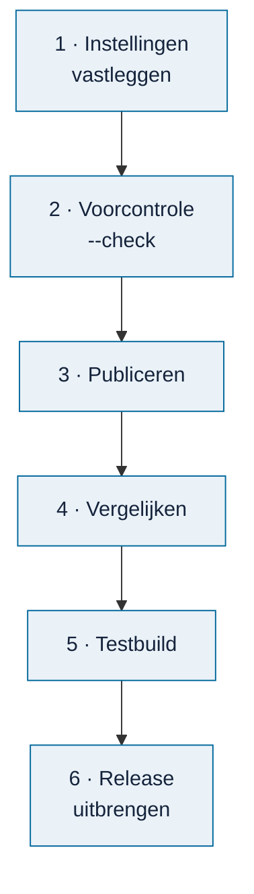
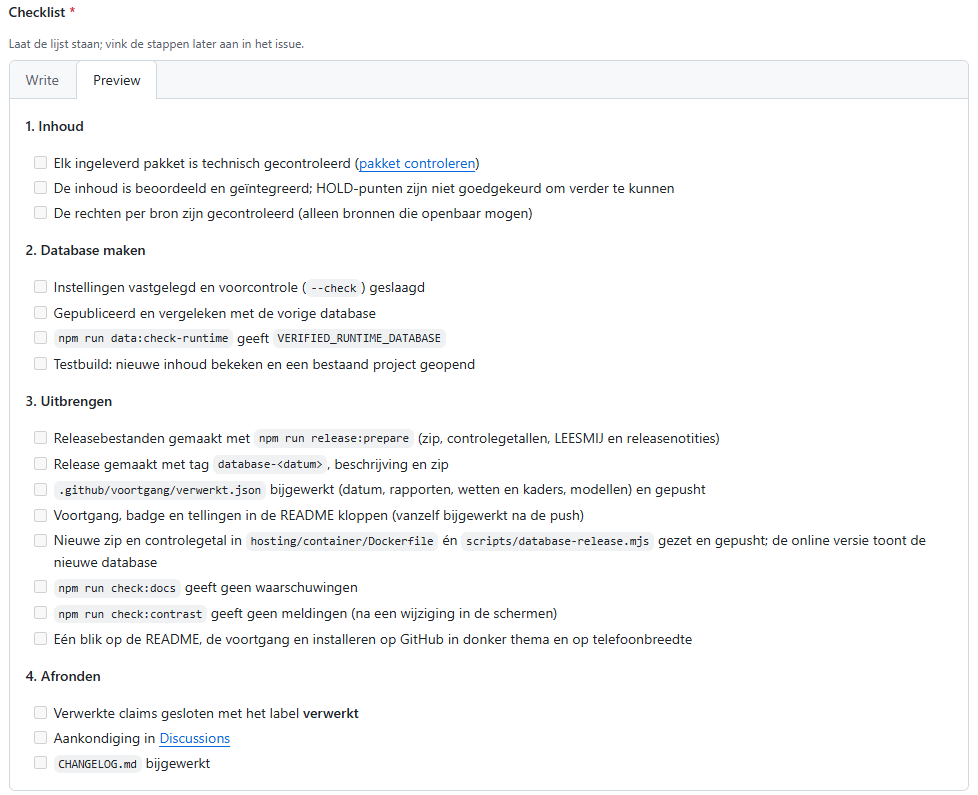

# Database publiceren

<!-- paginatype: taak -->

> **In het kort:** je maakt een nieuwe database in de private verwerkingsomgeving. Je vergelijkt en test hem, en brengt hem uit als zip bij een GitHub-release. De huidige database blijft staan tot je bewust overstapt.

## Wat heb je nodig?

Voor een nieuwe database met echte inhoud heb je onderstaande private invoer nodig. Met alleen de openbare repository kun je wel een ontvangen runtime-database controleren en verpakken, of de [fictieve overdrachtsproef](#oefenen-met-volledig-fictieve-data) uitvoeren. Die proef vervangt de bronreview en de private publicatiestappen niet.

- De **private verwerkingsomgeving**: een schone checkout van de broncode, met de broncollectie, reviewdossiers en Python. Deze omgeving staat niet op GitHub.
- Een **goedgekeurde bronrelease** (een hash van 64 tekens) en de bijbehorende **commit** (40 tekens).
- Node 24.21 en deze repository, met geïnstalleerde onderdelen.

## Stap voor stap



### 1. Leg de instellingen vast

Maak buiten Git een `publication-settings.json`:

```json
{
  "sourceRoot": <private-verwerkingscheckout>,
  "sourceDatabase": <private-brondatabase.sqlite>,
  "sourceCommit": <40-tekens-commit>,
  "release": <64-tekens-bronrelease>
}
```

Vervang de waarden tussen `<…>` door de goedgekeurde invoer als JSON-tekstwaarden, dus tussen dubbele aanhalingstekens. Relatieve paden gelden vanaf de map van dit bestand. Gebruik UTF-8 (UTF-16 werkt niet).

### 2. Doe de voorcontrole

```text
npm run data:publish-runtime -- --settings <publication-settings.json> --out "work/publication-01" --check
```

Dit controleert alleen of de invoer klopt: schone commit, bronrelease, bestanden en een nieuwe uitvoermap. Er wordt niets gemaakt.

**Gelukt als:** de voorcontrole zonder foutmelding eindigt.

### 3. Publiceer

```text
npm run data:publish-runtime -- --settings <publication-settings.json> --out "work/publication-01"
```

De opdracht draait de bestaande reviewcontroles, maakt de nieuwe database en controleert hem volledig. Pas als alles slaagt, verschijnen `publication-receipt.json` en `local-build.json` in de uitvoermap. Er is geen optie om controles over te slaan.

**Gelukt als:** `publication-receipt.json` en `local-build.json` allebei in de uitvoermap staan.

### 4. Vergelijk met de huidige database

```text
npm run data:compare-runtime -- --before local-data/runtime/local-build.json --after work/publication-01/local-build.json
```

Je ziet welke pakketten en documenten zijn toegevoegd, gewijzigd of verwijderd. Voeg je alleen nieuwe bronnen toe? Gebruik dan:

```text
npm run data:compare-runtime -- --before local-data/runtime/local-build.json --after work/publication-01/local-build.json --expect-addition report:FGFIN25
```

| Uitkomst | Betekenis | Wat je doet |
| --- | --- | --- |
| `MATCH` | Precies de verwachte toevoegingen, verder niets veranderd | Ga verder met de testbuild |
| `HOLD` | Er is iets anders veranderd | Verklaar dat eerst |

`MATCH` keurt de inhoud niet goed; het bevestigt alleen dat er niets onverwachts is veranderd.

Controleer daarna de inhoud van de nieuwe database zelf:

```text
npm run check:passages -- --database work/publication-01/catalogue.sqlite
npm run check:questions -- --database work/publication-01/catalogue.sqlite
```

| Controle | Wat hij nagaat | Bij een melding |
| --- | --- | --- |
| Bronpassages | Staat elke bronpassage letterlijk in de bron, op de opgeslagen positie? | Een HOLD verklaar of herstel je vóór de release; verschuif nooit zelf een markering |
| Vragen | Heeft een vraag een vormfout? | Zie [vraagcontrole](inhoud-toevoegen.md#1-beoordeel-de-inhoud) |

**Gelukt als:** je `MATCH` ziet en de bronpassages geen HOLD hebben.

### 5. Test in een aparte build

```text
npm run build -- --settings work/publication-01/local-build.json --out work/review-01
npm start -- --settings work/publication-01/local-build.json --web-root work/review-01 --port 4320
```

Controleer de nieuwe inhoud en een kopie van een bestaand project. Zie [inhoud toevoegen, stap 4](inhoud-toevoegen.md#4-test-in-een-aparte-build).

**Gelukt als:** de nieuwe inhoud klopt en de kopie van het bestaande project onveranderd werkt.

<a id="een-release-uitbrengen"></a>
### 6. Een release uitbrengen

Als de nieuwe database is goedgekeurd, open je een [checklist voor de databaserelease](https://github.com/Robert-Worm/omnibus/issues/new?template=databaserelease.yml). Daarin staan alle stappen, van controle tot aankondiging, om af te vinken.

<picture>
  <source media="(prefers-color-scheme: dark)" srcset="../images/releasechecklist-donker.png">
  
</picture>

*De releasechecklist. Je vinkt de stappen af in het issue.*

In het kort:

1. **Maak de releasebestanden** met één opdracht:

   ```text
   npm run release:prepare -- --settings work/publication-01/local-build.json --out work/release-<jjjj-mm-dd> --date <jjjj-mm-dd> --claims 12,15 --rapport <rijksmap-id>=<bron-id>
   ```

   Die controleert de database eerst en maakt met de bestaande SQLite-back-upfunctie een consistente kopie, inclusief wijzigingen die nog in het journaal staan. Ook die kopie wordt gecontroleerd. Daarna maakt hij `omnibus-database-<jjjj-mm-dd>.zip` (met database, instellingen, `LEESMIJ.txt` en `SHA256SUMS.txt`), de controlegetallen, de releasenotities (`releasenotities.md`) en een voorstel voor `verwerkt.json`. Een mislukte databasecontrole levert geen releasebundel op.

   - **Nieuw in deze release** vult hij zelf in: nieuwe en verdwenen rapporten en kaders, en de claims uit `--claims`.
   - Geef elk nieuw rapport mee met `--rapport <rijksmap-id>=<bron-id>`; de Rijksmap-ID staat in de link van de claim. Ontbreekt er een, dan meldt hij **HOLD** met de bron-ID en eindigt de opdracht met exitcode 1. De gemaakte bestanden zijn dan alleen concepten: publiceer ze niet. Vul de koppeling aan en draai opnieuw met een nieuwe uitvoermap.
   - **Gelukt als:** de opdracht eindigt met exitcode 0 en `Lokaal voorbereid`. Dit bevestigt de technische voorbereiding; de inhoudelijke goedkeuring en het publicatiebesluit blijven afzonderlijke stappen.
2. **Controleer de rechten.** Staan er alleen bronnen in die openbaar mogen? Zie de [werklijst wetten en kaders](../bijdragen/werklijst-wetten-en-kaders.md).
3. **Maak een release** op GitHub met tag `database-<jjjj-mm-dd>`. Beschrijf wat erin zit en wat er nieuw is, en voeg de zip toe.
4. **Zet de nieuwe database online en in de installatieopdracht.** Pas de zip-link en het controlegetal aan in `hosting/container/Dockerfile` én `scripts/database-release.mjs`, en push. De online versie bouwt dan opnieuw; controleer daarna of hij de nieuwe database toont.
5. **Werk de voortgang bij:** vervang `.github/voortgang/verwerkt.json` door het bestand uit de uitvoermap, bekijk de wijziging met `git diff` en push. De voortgangspagina's, de badge *database* en alle tellingen in de README, de routekaart en de werklijsten werken zich daarna vanzelf bij.
6. **Sluit de verwerkte claims** met het label **verwerkt**.

> [!NOTE]
> **Goed om te weten:** aantallen in de documentatie staan tussen onzichtbare markeringen, zoals `<!--n:rapporten-->27<!--/n-->`. Het voortgangsscript vult ze in. Pas het getal niet met de hand aan; gebruik een markering als je een aantal ergens nieuw noemt. Beschikbaar: `rapporten`, `kaders`, `modellen`, `alle`, `aanbevolen` en `aanbevolenInDatabase`.

### Met een AI-agent

Een AI-agent mag de lokale voorbereiding uitvoeren: instellingen vastleggen, voorcontrole, private publicatie, vergelijking en een aparte testbuild. Daarna mag hij `release:prepare` draaien en de voorstellen bekijken. Dit zijn de stappen **1 tot en met 5 onder Stap voor stap**, plus **alleen de eerste deelstap van Een release uitbrengen**. Laat de agent de checklist in het release-issue alleen bijwerken als je dat afzonderlijk hebt gevraagd.

Wat niet terug te draaien is, doet de agent pas na jouw akkoord in de chat:

| Stap | Waarom eerst akkoord |
| --- | --- |
| De release op GitHub maken | Iedereen kan de zip dan downloaden |
| `verwerkt.json`, de Dockerfile en `database-release.mjs` pushen | De online versie en de voortgang veranderen meteen |
| Claims sluiten en de aankondiging plaatsen | Bijdragers krijgen een melding |

## Oefenen met volledig fictieve data

Deze lokale proef kan met uitsluitend de openbare repository en Node 24.21. De oefenfixture bevat één fictief rapport, een wet, een kader en een model, vijf records met status HOLD en twee fictieve bronpagina's, waaronder Unicode-tekst. De bestaande import- en publicatiefuncties berekenen de hashes; je vult zelf geen goedkeuring of hash in. De gewone runtimevalidator controleert de echte SQLite-database. Er wordt geen `publication-receipt.json` van een inhoudelijke review gemaakt.

1. **Maak de oefendatabase** vanuit de hoofdmap van je eigen checkout:

   ```text
   node scripts/prepare-release-fixture.mjs work/overdracht-01
   npm run data:check-runtime -- --settings work/overdracht-01/local-build.json
   npm run check:passages -- --database work/overdracht-01/catalogue.sqlite
   npm run check:questions -- --database work/overdracht-01/catalogue.sqlite
   ```

   Verwacht `VERIFIED_RUNTIME_DATABASE`, vier pakketten, vijf records, één document, twee bronpagina's en `newContentApproval: false`. De passagecontrole moet één passage zonder HOLD vinden; de vraagcontrole één vraag. HOLD op de fictieve records blijft behouden.

2. **Bereid de bundel voor**. De datum en Rijksmap-koppeling hieronder zijn uitsluitend oefenwaarden:

   ```text
   npm run release:prepare -- --settings work/overdracht-01/local-build.json --out work/overdracht-release-01 --date 2026-10-24 --rapport fictief-oefenrapport=FICTIEF-RAPPORT
   ```

   Verwacht `Lokaal voorbereid`, exitcode 0 en de zip, `SHA256SUMS.txt`, `LEESMIJ.txt`, `releasenotities.md` en `verwerkt.json`. De laatste twee zijn oefenconcepten. Omdat de opdracht vergelijkt met de openbare voortgang, meldt het voorstel ook dat de echte bronnen ontbreken. Neem dit voorstel nooit over in `.github/voortgang/verwerkt.json`.

3. **Controleer de ontvangen bestanden**. Pak de zip uit in een nieuwe, lege map `work/overdracht-ontvangen-01`, dus buiten `local-data/runtime/`. Dat kan met de verkenner of met deze opdracht:

   **Windows (PowerShell)**

   ```powershell
   Expand-Archive -LiteralPath work/overdracht-release-01/omnibus-database-2026-10-24.zip -DestinationPath work/overdracht-ontvangen-01
   ```

   **macOS en Linux (bash)**

   ```bash
   unzip work/overdracht-release-01/omnibus-database-2026-10-24.zip -d work/overdracht-ontvangen-01
   ```

   Vergelijk de SHA-256 van de zip met `SHA256SUMS.txt` naast de zip, en de drie uitgepakte bestanden met de controlegetallen in de zip. Gebruik bijvoorbeeld `Get-FileHash -Algorithm SHA256 <bestand>` in PowerShell of `sha256sum <bestand>` op Linux. Voer daarna uit:

   ```text
   npm run data:check-runtime -- --settings work/overdracht-ontvangen-01/local-build.json
   npm run check:passages -- --database work/overdracht-ontvangen-01/catalogue.sqlite
   npm run check:questions -- --database work/overdracht-ontvangen-01/catalogue.sqlite
   npm run test:release-prepare
   ```

   **Gelukt als:** de hashes overeenkomen, de uitgepakte database opnieuw dezelfde aantallen en `VERIFIED_RUNTIME_DATABASE` geeft, en de gerichte tests slagen. De tests controleren ook een publicatie die nog in het SQLite-journaal staat, gewijzigde inhoud, verkeerde hashes, ontbrekende koppelingen en een bestaande uitvoermap.

Stop hier. Upload of activeer deze oefenbundel niet; volg de installatieaanwijzingen in de gegenereerde `LEESMIJ.txt` niet voor deze testgegevens. Een nieuwe poging krijgt nieuwe mappen. Dit bewijst technische overdraagbaarheid van het verpakken en ontvangen. De minimale runtime-modules zijn alleen testgegevens: deze proef bewijst geen bruikbare viewer, projectherstel, inhoudelijke review, private bronpublicatie of werkende hosting. Zie het [reviewverslag van de overdrachtsproef](overdrachtsproef-183.md) voor de aangetroffen struikelpunten en de resterende grens.

## Herstellen na een publicatiefout

De foutmelding noemt de stap waar het misging. Bewaar de melding en gebruik de mislukte uitvoer niet.

- **`INPUT_CHECK`:** corrigeer paden, een verkeerd overgenomen hash of de uitvoermap. Kies geen andere commit of release alleen om de controle te laten slagen.
- **`CONTENT_REVIEW`:** herstel de gemelde reviewvoorwaarde in de verwerkingsomgeving, bijvoorbeeld ontbrekend bewijs of Python. Verandert er inhoud, dan volgt een nieuwe review en een nieuwe release-hash.
- **`FINAL_VERIFICATION`:** de eindcontrole of het wegschrijven is mislukt. Zoek de oorzaak in de invoer of de omgeving. Bewerk nooit de gegenereerde database.

Probeer daarna opnieuw, **met een nieuwe uitvoermap**:

```text
npm run data:publish-runtime -- --settings <publication-settings.json> --out "work/publication-02" --check
npm run data:publish-runtime -- --settings <publication-settings.json> --out "work/publication-02"
```

Alleen `publication-receipt.json` zonder `local-build.json` is geen geslaagde publicatie. Hervatten of handmatig aanvullen kan niet.

## Een kopie van de database maken

Om een database over te zetten naar een andere computer:

```text
npm run data:runtime-backup -- --from <absoluut-pad/catalogue.sqlite> --to <nieuw-bestand.sqlite> --release <bronrelease> --publication <runtimepublicatie>
```

De opdracht maakt een gecontroleerde kopie en weigert een bestaand doelbestand. Kopieer een SQLite-bestand dat in gebruik is nooit met de verkenner.

## Goed om te weten

Lees vóór je begint de [vaste regels](README.md#vaste-regels) in het beheeroverzicht, onder *Bij het publiceren*. Ze staan op één plek, zodat ze nergens van elkaar afwijken.

## Samengevat

Instellingen, `--check`, publiceren, vergelijken, testen, en pas dan de release uitbrengen en de voortgang bijwerken.

## Volgende stap

Na de release: sluit de verwerkte claims en kondig de nieuwe database aan in [Discussions](https://github.com/Robert-Worm/omnibus/discussions).

---

[↑ Beheer](README.md) · [Wegwijzer](../README.md) · [Begrippen](../begrippen.md) · [Routekaart](../routekaart.md)
