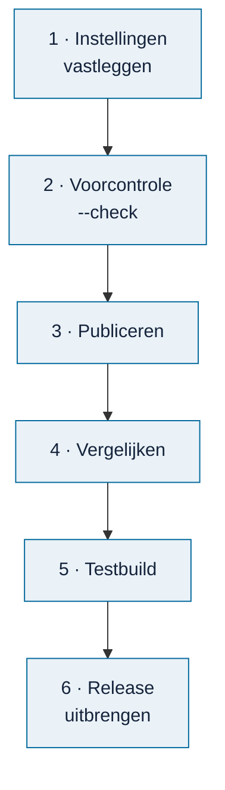

# Database publiceren

<!-- paginatype: taak -->

> **In het kort:** je maakt een nieuwe database in de private verwerkingsomgeving. Je vergelijkt en test hem, en brengt hem uit als zip bij een GitHub-release. De huidige database blijft staan tot je bewust overstapt.

## Wat heb je nodig?

- De **private verwerkingsomgeving**: een schone checkout van de broncode, met de broncollectie, reviewdossiers en Python. Deze omgeving staat niet op GitHub.
- Een **goedgekeurde bronrelease** (een hash van 64 tekens) en de bijbehorende **commit** (40 tekens).
- Node 24.21 en deze repository, met geïnstalleerde onderdelen.

## Stap voor stap



### 1. Leg de instellingen vast

Maak buiten Git een `publication-settings.json`:

```json
{
  "sourceRoot": <private-verwerkingscheckout>,
  "sourceDatabase": <private-brondatabase.sqlite>,
  "sourceCommit": <40-tekens-commit>,
  "release": <64-tekens-bronrelease>
}
```

Relatieve paden gelden vanaf de map van dit bestand. Gebruik UTF-8 (UTF-16 werkt niet).

### 2. Doe de voorcontrole

```text
npm run data:publish-runtime -- --settings <publication-settings.json> --out "work/publication-01" --check
```

Dit controleert alleen of de invoer klopt: schone commit, bronrelease, bestanden en een nieuwe uitvoermap. Er wordt niets gemaakt.

**Gelukt als:** de voorcontrole zonder foutmelding eindigt.

### 3. Publiceer

```text
npm run data:publish-runtime -- --settings <publication-settings.json> --out "work/publication-01"
```

De opdracht draait de bestaande reviewcontroles, maakt de nieuwe database en controleert hem volledig. Pas als alles slaagt, verschijnen `publication-receipt.json` en `local-build.json` in de uitvoermap. Er is geen optie om controles over te slaan.

**Gelukt als:** `publication-receipt.json` en `local-build.json` allebei in de uitvoermap staan.

### 4. Vergelijk met de huidige database

```text
npm run data:compare-runtime -- --before local-data/runtime/local-build.json --after work/publication-01/local-build.json
```

Je ziet welke pakketten en documenten zijn toegevoegd, gewijzigd of verwijderd. Voeg je alleen nieuwe bronnen toe? Gebruik dan:

```text
npm run data:compare-runtime -- --before local-data/runtime/local-build.json --after work/publication-01/local-build.json --expect-addition report:FGFIN25
```

| Uitkomst | Betekenis | Wat je doet |
| --- | --- | --- |
| `MATCH` | Precies de verwachte toevoegingen, verder niets veranderd | Ga verder met de testbuild |
| `HOLD` | Er is iets anders veranderd | Verklaar dat eerst |

`MATCH` keurt de inhoud niet goed; het bevestigt alleen dat er niets onverwachts is veranderd.

**Gelukt als:** je `MATCH` ziet.

### 5. Test in een aparte build

```text
npm run build -- --settings work/publication-01/local-build.json --out work/review-01
npm start -- --settings work/publication-01/local-build.json --web-root work/review-01 --port 4320
```

Controleer de nieuwe inhoud en een kopie van een bestaand project. Zie [inhoud toevoegen, stap 4](inhoud-toevoegen.md#4-test-in-een-aparte-build).

**Gelukt als:** de nieuwe inhoud klopt en de kopie van het bestaande project onveranderd werkt.

<a id="een-release-uitbrengen"></a>
### 6. Een release uitbrengen

Als de nieuwe database is goedgekeurd, open je een [checklist voor de databaserelease](https://github.com/Robert-Worm/omnibus/issues/new?template=databaserelease.yml). Daarin staan alle stappen, van controle tot aankondiging, om af te vinken. In het kort:

1. **Maak de releasebestanden** met één opdracht:

   ```text
   npm run release:prepare -- --settings work/candidate/local-build.json --out work/release-<jjjj-mm-dd> --date <jjjj-mm-dd>
   ```

   Die controleert de database eerst. Daarna maakt hij `omnibus-database-<jjjj-mm-dd>.zip` (met database, instellingen, `LEESMIJ.txt` en `SHA256SUMS.txt`), de controlegetallen en een concept van de releasenotities (`releasenotities.md`). Haalt de database de controle niet, dan maakt hij niets.
2. **Controleer de rechten.** Staan er alleen bronnen in die openbaar mogen? Zie de [werklijst wetten en kaders](../bijdragen/werklijst-wetten-en-kaders.md).
3. **Maak een release** op GitHub met tag `database-<jjjj-mm-dd>`. Beschrijf wat erin zit en wat er nieuw is, en voeg de zip toe.
4. **Zet de nieuwe database online en in de installatieopdracht.** Pas de zip-link en het controlegetal aan in `hosting/container/Dockerfile` én `scripts/database-release.mjs`, en push. De online versie bouwt dan opnieuw; controleer daarna of hij de nieuwe database toont.
5. **Werk de voortgang bij:** pas `.github/voortgang/verwerkt.json` aan (datum, nieuwe rapporten en kaders) en push. De voortgangspagina's, de badge *database* en alle tellingen in de README, de routekaart en de werklijsten werken zich daarna vanzelf bij.
6. **Sluit de verwerkte claims** met het label **verwerkt**.

> [!NOTE]
> **Goed om te weten:** aantallen in de documentatie staan tussen onzichtbare markeringen, zoals `<!--n:rapporten-->27<!--/n-->`. Het voortgangsscript vult ze in. Pas het getal niet met de hand aan; gebruik een markering als je een aantal ergens nieuw noemt. Beschikbaar: `rapporten`, `kaders`, `modellen`, `alle`, `aanbevolen` en `aanbevolenInDatabase`.

## Herstellen na een publicatiefout

De foutmelding noemt de stap waar het misging. Bewaar de melding en gebruik de mislukte uitvoer niet.

| Stap | Wat te doen |
| --- | --- |
| `INPUT_CHECK` | Corrigeer paden, een verkeerd overgenomen hash of de uitvoermap. Kies geen andere commit of release alleen om de controle te laten slagen. |
| `CONTENT_REVIEW` | Herstel de gemelde reviewvoorwaarde in de verwerkingsomgeving, bijvoorbeeld ontbrekend bewijs of Python. Verandert er inhoud, dan volgt een nieuwe review en een nieuwe release-hash. |
| `FINAL_VERIFICATION` | De eindcontrole of het wegschrijven is mislukt. Zoek de oorzaak in de invoer of de omgeving. Bewerk nooit de gegenereerde database. |

Probeer daarna opnieuw, **met een nieuwe uitvoermap**:

```text
npm run data:publish-runtime -- --settings <publication-settings.json> --out "work/publication-02" --check
npm run data:publish-runtime -- --settings <publication-settings.json> --out "work/publication-02"
```

Alleen `publication-receipt.json` zonder `local-build.json` is geen geslaagde publicatie. Hervatten of handmatig aanvullen kan niet.

## Een kopie van de database maken

Om een database over te zetten naar een andere computer:

```text
npm run data:runtime-backup -- --from <absoluut-pad/catalogue.sqlite> --to <nieuw-bestand.sqlite> --release <bronrelease> --publication <runtimepublicatie>
```

De opdracht maakt een gecontroleerde kopie en weigert een bestaand doelbestand. Kopieer een SQLite-bestand dat in gebruik is nooit met de verkenner.

## Goed om te weten

Lees vóór je begint de [vaste regels](README.md#vaste-regels) in het beheeroverzicht, onder *Bij het publiceren*. Ze staan op één plek, zodat ze nergens van elkaar afwijken.

## Samengevat

Instellingen, `--check`, publiceren, vergelijken, testen, en pas dan de release uitbrengen en de voortgang bijwerken.

## Volgende stap

Na de release: sluit de verwerkte claims en kondig de nieuwe database aan in [Discussions](https://github.com/Robert-Worm/omnibus/discussions).

---

[↑ Beheer](README.md) · [Wegwijzer](../README.md) · [Begrippen](../begrippen.md) · [Routekaart](../routekaart.md)
