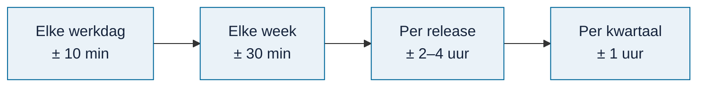

# Beheerhandboek

<!-- paginatype: naslag -->

> **In het kort:** welke taken de beheerder heeft, hoe vaak, hoe lang ze duren en waar de uitleg staat. Begin hier als je het beheer overneemt.

## Wat doet de beheerder?

De beheerder houdt de openbare database actueel en betrouwbaar. Bijdragers verwerken bronnen; de beheerder controleert hun werk, brengt nieuwe databases uit en lost problemen op. Bijna alles gebeurt op GitHub: de claims, de voortgang en de releases.

## Elke werkdag (± 10 minuten)

| Taak | Waarom | Hoe |
| --- | --- | --- |
| Kijk welke claims op je wachten | Bijdragers horen graag snel of hun pakket goed is | De sectie *Wacht op de beheerder* op de [voortgang](../bijdragen/voortgang.md), of de claims met het label [ingeleverd](https://github.com/Robert-Worm/omnibus/issues?q=is%3Aopen+label%3Aingeleverd) |
| Beantwoord vragen in claims en Discussions | Een vraag zonder antwoord kost een bijdrager | [Discussions](https://github.com/Robert-Worm/omnibus/discussions) |
| Kijk of de online versie gezond is | Een mislukte uitrol of fout zie je eerst bij de host | De service events en runtime-logs bij Sliplane; zie [het logboek van de online versie](storingen-en-herstel.md#het-logboek-van-de-online-versie) |
| Kijk of de automatische controles slagen | Een mislukte controle kan betekenen dat de voortgang niet bijwerkt | [Actions](https://github.com/Robert-Worm/omnibus/actions); bij een rode regel: zie het [draaiboek](draaiboek.md) |

## Elke week (± 30 minuten)

| Taak | Waarom | Hoe |
| --- | --- | --- |
| Lees de wekelijkse samenvatting | Je ziet in één keer wat er is geclaimd, ingeleverd en verwerkt | Het bericht in Discussions, elke maandag |
| Controleer ingeleverde pakketten | Zo blijft de wachttijd voor bijdragers kort | [Pakket controleren](pakket-controleren.md) |
| Bekijk beveiligingsmeldingen | Kwetsbare onderdelen of gelekte sleutels wil je snel weten | Tabblad *Security* op GitHub. Beoordeel een melding binnen 7 dagen, *critical* of *high* binnen 2 werkdagen; zie [automatische meldingen](../../SECURITY.md#automatische-meldingen) |
| Bekijk de linkcontrole | Een kapotte link naar een wet of rapport maakt de uitleg onbetrouwbaar | Het issue met het label [kapotte-links](https://github.com/Robert-Worm/omnibus/issues?q=is%3Aopen+label%3Akapotte-links), als de controle van maandag er een heeft gemaakt. Zelf draaien: `npm run check:links` |

## Per databaserelease (± 2 tot 4 uur)

Een nieuwe database volgt bij 5 ingeleverde bronnen, of een maand na de vorige als er minstens één klaarligt ([besluit B-017](besluiten.md#b-017)). De [voortgang](../bijdragen/voortgang.md) toont hoeveel bronnen klaarliggen.

1. Open een [checklist voor de databaserelease](https://github.com/Robert-Worm/omnibus/issues/new?template=databaserelease.yml).
2. Beoordeel de inhoud en maak de database: [inhoud toevoegen](inhoud-toevoegen.md) en [database publiceren](database-publiceren.md).
3. Maak de releasebestanden met `npm run release:prepare` en zet ze bij een nieuwe release.
4. Werk `verwerkt.json` bij. Tellingen, badge en voortgang volgen vanzelf.
5. Sluit de verwerkte claims en meld de release in Discussions.

## Per kwartaal (± 1 uur)

| Taak | Waarom | Hoe |
| --- | --- | --- |
| Herstelproef met een back-up | Een back-up die niet terug te zetten is, is geen back-up | [Back-up en herstel](storingen-en-herstel.md) |
| Node-versie en onderdelen bijwerken | Beveiligingsupdates | Pas `.nvmrc` en `package.json` samen aan; de documentatiecheck bewaakt dat ze gelijk blijven |
| Werklijst van de Rijksmap verversen | Nieuwe rapporten komen erbij | Vervang `.github/voortgang/rapporten.csv` door een nieuwe export |
| Besluitenlijst nalopen | Kloppen de afspraken nog? | [Besluiten](besluiten.md) |

## Goed om te weten

- **Een technische controle is geen goedkeuring.** Een geslaagde pakketcontrole zegt dat de bestanden compleet zijn, niet dat de inhoud klopt.
- **Leg elk nieuw besluit vast** in de [besluitenlijst](besluiten.md), met de reden.
- **Twijfel je?** Kies de veilige weg: niet publiceren, en eerst navragen.

## Samengevat

Dagelijks claims en controles bekijken, wekelijks pakketten en meldingen afhandelen, per release de checklist volgen en elk kwartaal herstel en onderhoud. De meeste tijd zit in het beoordelen van ingeleverde bronnen.

## Volgende stap

Lees wat je doet als er iets misgaat: het [storingsdraaiboek](draaiboek.md).

---

[↑ Beheer](README.md) · [Wegwijzer](../README.md) · [Begrippen](../begrippen.md) · [Routekaart](../routekaart.md)
