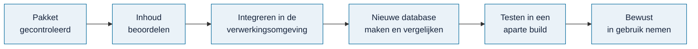

# Inhoud toevoegen

> **In het kort:** na een geslaagde pakketcontrole beoordeel je de inhoud en zet je hem in de private verwerkingsomgeving. Daarna test je of hij goed in de applicatie verschijnt. Pas daarna kies je bewust voor de nieuwe versie.

## Van pakket naar applicatie



| Stap | Wie | Resultaat |
| --- | --- | --- |
| Voorbereiden | Bijdrager, met een skill | Een pakket met bouwstenen, bronpassages en review |
| Controleren en beoordelen | Beheerder | Een pakket dat compleet is en inhoudelijk klopt |
| Integreren en testen | Beheerder | Een kandidaat-database en een testbuild naast de huidige versie |
| In gebruik nemen | Beheerder, na acceptatie | De nieuwe database; de vorige blijft bewaard voor herstel |

## Waar gebeurt wat?

| Plek | Wat |
| --- | --- |
| Deze repository | De applicatie, de skills en de controle- en publicatiehulpmiddelen |
| De private verwerkingsomgeving | De broncollectie, de reviewdossiers en de bron-specifieke controles |
| `work/content-inbox/` | Ontvangen pakketten (buiten Git) |

Kopieer nooit private bestanden naar Git om een ontbrekende import op te lossen.

## 1. Beoordeel de inhoud

Elke soort bron heeft eigen kwaliteitsvragen:

| Soort | Wat je beoordeelt |
| --- | --- |
| Rapport | Volledig gelezen? Kloppen normen en toetspunten met de bevindingen? Is het praktisch bruikbaar? |
| Wet of kader | Kloppen de passages, adressaten, voorwaarden en uitzonderingen? Is de juridische betekenis behouden? |
| Model | Is de theorie goed gebruikt? Zijn de interviewvragen helder en neutraal? |

Hulp hierbij:

- [`omnibus-review-audit-quality`](../../skills/omnibus-review-audit-quality/README.md): beoordeelt de hele keten van doel, risico, beheersing, norm en toetspunten, met een score van 1 tot 10 en verbetervoorstellen.
- [`omnibus-build-questions`](../../skills/omnibus-build-questions/README.md): ontwerpt of beoordeelt onderzoeks- en interviewvragen.
- [`omnibus-curate-themes`](../../skills/omnibus-curate-themes/README.md): ordent te grote thema's en zoekt overlap.

Een AI-review is een hulpmiddel, geen menselijke goedkeuring. Twijfels blijven zichtbaar als HOLD.

Bij een selecteerbare kadernorm horen een ingevuld doel, risico,
beheersdoelstelling en beheersmaatregel. Staat een onderdeel niet letterlijk in
de bron, werk het dan brongebonden uit vanuit het risico en benoem het als
analytisch voorstel. Beoordeel ook deze afleidingen; alleen goedgekeurde normtekst
is niet voldoende. Onvoldoende onderbouwing vraagt herstel vóór toelating,
niet een leeg veld of standaardtekst. De flat-kaderpublisher controleert deze
volledigheid bij nieuwe publicaties; bestaande publicaties blijven leesbaar.

## 2. Controleer of het past

Past het pakket in de bestaande weergaven, zonder nieuwe code?

- Rapporten gebruiken de bestaande rapportweergave; wetten en kaders de gedeelde kaderweergave (het CIO-ontwerp). Een andere titel of groep is gegevenswerk, geen reden voor een nieuwe weergave.
- Een onbekend veld wordt niet stilletjes weggelaten. Past iets echt niet, dan blijft het pakket in HOLD tot de gedeelde code is aangepast en getest.

## 3. Maak een nieuwe database en vergelijk

Volg [database publiceren](database-publiceren.md). Belangrijk bij nieuwe inhoud:

- Noteer **vooraf** welke pakketten je verwacht toe te voegen.
- Gebruik bij de vergelijking `--expect-addition <soort>:<pakket-id>`, bijvoorbeeld `--expect-addition report:FGFIN25`. De vergelijking stopt dan als er iets anders verandert dan je verwacht.
- Een onverwachte wijziging of verwijdering verklaar je eerst, voordat je verdergaat.

## 4. Test in een aparte build

```text
npm run build -- --settings <nieuwe-map>/local-build.json --out work/review-01
npm start -- --settings <nieuwe-map>/local-build.json --web-root work/review-01 --port 4320
```

Controleer twee dingen:

- **De nieuwe inhoud:** staat de bron in de catalogus, met de verwachte normen, toetspunten, bronpassages en beperkingen? Verschijnt een rapport onder de juiste thema's?
- **Bestaand werk:** open een kopie van een bestaand project. Zijn selecties, vragen, eigen tekst, bronmarkeringen en de Excel-export nog hetzelfde? Het script `scripts/review-portable-runtime.mjs` helpt bij deze vergelijking.

## 5. Neem in gebruik

Pas als beide controles goed zijn, kies je de nieuwe database. Bewaar de vorige database en build, zodat je kunt terugvallen. Daarna volgt [een release uitbrengen](database-publiceren.md#een-release-uitbrengen).

## Vaste regels

- Bronpassages, citaten en markeringen blijven ongewijzigd.
- Een technische controle is geen inhoudelijke goedkeuring.
- Een correctie op bestaande inhoud wordt de nieuwe actuele tekst; er komen geen parallelle oude versies bij.
- Gedeelde onderdelen die je niet mag breken: `app/law-point-source.tsx` (bronweergave), `app/report-library.tsx` (bronpagina's en markeringen), `app/viewer-readability.css` en `app/workflow-patterns.tsx` (opmaak), en de modelweergave in `lib/model-presentation.mjs`.

## Samengevat

Beoordelen, controleren of het past, database maken met `--expect-addition`, testen in een aparte build, en dan pas bewust in gebruik nemen.

## Volgende stap

Ga naar [database publiceren](database-publiceren.md).

---

[↑ Wegwijzer](../README.md) · [Begrippen](../begrippen.md) · [Routekaart](../routekaart.md)
