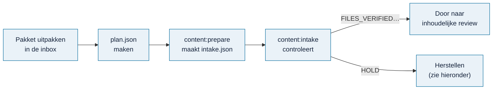

# Pakket controleren

> **In het kort:** met twee opdrachten controleer je of een ingeleverd pakket compleet is en of de bestanden ongewijzigd zijn aangekomen. De controle schrijft niets naar de database en keurt de inhoud niet goed.

## Wat is een pakket?

Een map met de bestanden die een skill heeft gemaakt, plus een **manifest** (`intake.json`). Het manifest noemt elk bestand, zijn rol en zijn controlegetal (SHA-256).

```text
work/content-inbox/<pakket-id>/<versie>/
├── plan.json      welke bestanden erin horen en welke rol ze hebben
├── intake.json    het manifest, met controlegetallen (gemaakt door content:prepare)
└── payload/       de bestanden zelf: bron, bouwstenen, reviews
```

`work/` staat buiten Git. Gebruik voor elke nieuwe versie een nieuwe map.

## Stap voor stap



### 1. Zet het pakket in de inbox

Pak de zip uit de claim uit in `work/content-inbox/<pakket-id>/<versie>/`.

### 2. Maak een plan

Begin met het voorbeeld dat bij de bron hoort:

- [rapportplan](../../skills/omnibus-add-report/assets/intake-plan.json.example)
- [kaderplan](../../skills/omnibus-add-framework/assets/intake-plan.json.example)

Vul de echte pakketgegevens in, en geef elk bestand de rol die het werkelijk vervult. Een kort voorbeeld voor een model:

```json
{
  "format": "omnibus-intake-plan",
  "schemaVersion": 1,
  "package": {"id": "voorbeeldmodel", "kind": "model", "version": "1", "title": "Voorbeeldmodel"},
  "contract": "model-review-1",
  "files": [
    {"id": "contract", "path": "payload/contract.md", "roles": ["contract"]},
    {"id": "bron", "path": "payload/bron.txt", "roles": ["source", "source-text"]},
    {"id": "model", "path": "payload/model.json", "roles": ["viewer-content", "context", "limitations"]},
    {"id": "reviewbasis", "path": "payload/reviewbasis.json", "roles": ["review-basis"]},
    {"id": "review", "path": "payload/review.json", "roles": ["review"]}
  ]
}
```

### 3. Maak het manifest en controleer

```text
npm run content:prepare -- <map>/plan.json --output <map>/intake.json
npm run content:intake -- <map>/intake.json
```

Bewaar de **manifesthash** die `content:prepare` toont apart, buiten het pakket. Bij een latere controle gebruik je die:

```text
npm run content:intake -- <map>/intake.json --expect-sha256 <bewaarde-manifesthash>
```

### 4. Lees de uitkomst

| Uitkomst | Betekenis | Volgende stap |
| --- | --- | --- |
| `FILES_VERIFIED_REVIEW_REQUIRED` | Bestanden compleet en ongewijzigd | [Inhoud beoordelen](inhoud-toevoegen.md) |
| `HOLD` | Er ontbreekt iets of er is iets gewijzigd | Zie hieronder |

`publishable`, `contentValidated` en `reviewValidated` blijven altijd `false`: deze controle keurt nooit inhoud goed.

## HOLD herstellen

Bij een HOLD geeft de controle een `diagnostic` met de oorzaak, een herstelactie (`action`) en de opdracht voor daarna (`nextCommand`).

| `diagnostic.code` | Betekenis | Herstel |
| --- | --- | --- |
| `INTAKE_FIELDS` | Een object mist velden, of heeft er te veel | Vul de ontbrekende velden aan in het plan. Bij een ontvangen manifest: vraag de inzender om een gecorrigeerde versie. |
| `INTAKE_OBJECT` | Op die plek hoort een object | Vul echte gegevens in; maak geen leeg object om door de controle te komen. |
| `INTAKE_FILE_MISSING` | Een bestand ontbreekt | Vraag het oorspronkelijke bestand op bij de inzender. |

`location: "files[1]"` betekent het tweede bestand in de lijst; `$` is het hele manifest.

**Nooit doen:** checksums opnieuw berekenen om een afgekeurd pakket te laten slagen, bewijsstukken weglaten, of het ontvangen manifest aanpassen. Een inhoudelijke correctie krijgt een nieuwe pakketversie in een nieuwe map.

## Welke rollen zijn verplicht?

Alle pakketten hebben `contract`, `source`, `source-text`, `limitations`, `review-basis` en `review` nodig. Daarnaast:

| Soort (`kind`) | Contract | Extra verplichte rollen |
| --- | --- | --- |
| `report` | `report-kit-1.1` | `source-bank`, `viewer-content`, `catalogue`, `source-links`, `context`, `receipt` |
| `framework` | `framework-cio-0.1+addendum-01` | `source-bank`, `catalogue`, `source-links`, `context`, `migration` |
| `model` | `model-review-1` | `viewer-content`, `context` |

Overige bestanden krijgen de rol `supporting`. De controle kijkt of de rollen aanwezig zijn, niet of de inhoud ze waarmaakt.

## Grenzen

- Maximaal 256 bestanden, 256 MiB per bestand en 512 MiB in totaal; het manifest maximaal 1 MiB.
- Geweigerd: dubbele namen, paden buiten de map, snelkoppelingen en onbruikbare Windows-bestandsnamen.
- Voor oude, bevroren rapportarchieven met meer bestanden is er `--historical-report` (maximaal 1.024 bestanden, alleen voor rapporten, altijd met `--expect-sha256`).
- De controle voert nooit code uit het pakket uit en maakt geen netwerkverbinding. Het is geen uploaddienst voor internet.

## Samengevat

Pakket in de inbox, plan maken, `content:prepare`, `content:intake`. Een geslaagde controle betekent: compleet en ongewijzigd. De inhoud wordt daarna apart beoordeeld.

## Volgende stap

Geslaagd? Ga naar [inhoud toevoegen](inhoud-toevoegen.md).

---

[↑ Wegwijzer](../README.md) · [Begrippen](../begrippen.md) · [Routekaart](../routekaart.md)
