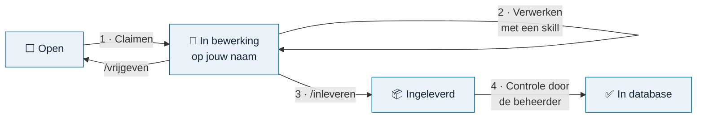

# Meedoen

> **In het kort:** de belangrijkste manier om te helpen is een bron verwerken: een rapport, wet of kader omzetten naar normen en toetspunten. Je zet de bron op je naam (check-out), verwerkt hem met een AI-skill en levert hem in (check-in).

## Manieren om te helpen

| Wat | Voor wie | Hoe begin je |
| --- | --- | --- |
| **Een bron verwerken** | Auditors en onderzoekers met een AI-assistent | Kies een bron in de [voortgang](voortgang.md) |
| **Een bron voorstellen** | Iedereen | Noem hem in [Discussions](https://github.com/Robert-Worm/omnibus/discussions) |
| **Een fout melden** | Iedereen | Open een [issue](https://github.com/Robert-Worm/omnibus/issues/new/choose) |
| **De uitleg verbeteren** | Iedereen | Stel een wijziging voor via een pull request |
| **De code verbeteren** | Ontwikkelaars | Lees [ontwikkelen](ontwikkelen.md) |

## Zo werkt een bron verwerken

1. **Claimen (check-out).** Kies een open bron in de [voortgang](voortgang.md) of een van de werklijsten, en klik op *Claimen*. Er opent een kort formulier, waarin je ook invult met welk AI-model je werkt. Na verzenden staat de bron op jouw naam, zichtbaar voor iedereen.
2. **Verwerken.** Volg [een bron verwerken](bron-verwerken.md). Je AI-assistent doet het meeste werk; jij controleert.
3. **Inleveren (check-in).** Voeg je concept toe aan je claim en schrijf `/inleveren` in een reactie.
4. **Controle.** De beheerder controleert het pakket. In de volgende databaserelease staat de bron op ✅ en wordt je claim gesloten.

Lukt het niet? Schrijf `/vrijgeven` bij je claim. Dan komt de bron weer vrij voor iemand anders. Geen probleem.

## Welke bron kies je?

| Werklijst | Wat erin staat |
| --- | --- |
| [Voortgang](voortgang.md) | Het overzicht, met een paar aanbevolen rapporten om mee te beginnen |
| [Aanbevolen rapporten](werklijst-aanbevolen.md) | 542 adviesrapporten van de Auditdienst Rijk, per ministerie, met een claimlink: veel bruikbare normen |
| [Alle rapporten](werklijst-rapporten.csv) | Alle 9.116 rapporten van de [Rijksmap](https://www.rijksmap.nl) (CSV-bestand om te downloaden) |
| [Wetten en kaders](werklijst-wetten-en-kaders.md) | Wetten, regels en normenkaders, met per bron of je hem openbaar mag verwerken |

Begin bij voorkeur met een **aanbevolen rapport**: die leveren de meeste bruikbare normen op.

## Afspraken

- **Eén bron tegelijk.** Claim pas een volgende als je de vorige hebt ingeleverd.
- **Blijf in contact.** Na 30 dagen zonder reactie krijg je een herinnering; na 60 dagen komt de bron automatisch weer vrij.
- **Geen vertrouwelijk materiaal** in issues, reacties of pull requests.
- **Wees eerlijk over twijfels.** Een onzekere norm met een duidelijke vraag is beter dan een stellige fout.
- **Respectvol samenwerken.** Zie de [gedragscode](../../CODE_OF_CONDUCT.md).
- Wat je bijdraagt valt onder dezelfde [licentie](../../LICENSE) als het project.

## Samengevat

Claim een bron, verwerk hem met een skill, lever hem in. De voortgang werkt zichzelf bij, zodat iedereen ziet wie waaraan werkt.

## Volgende stap

Open de [voortgang](voortgang.md) en kies je eerste bron.
