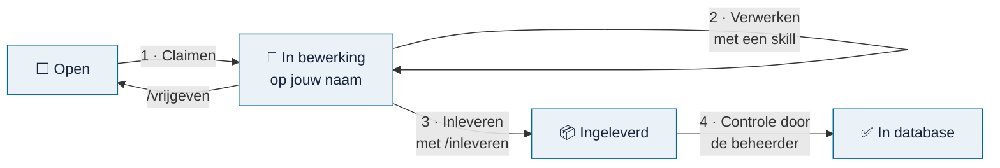
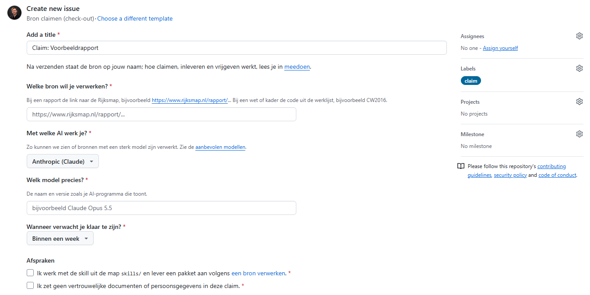
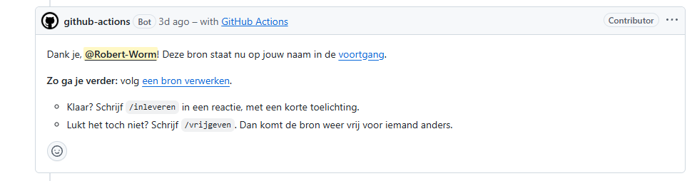
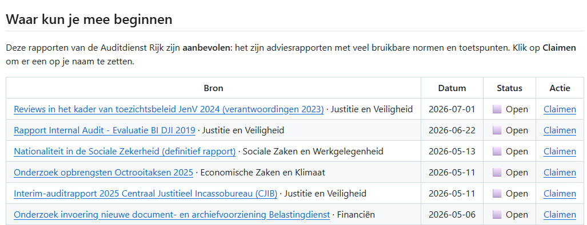

# Meedoen

<!-- paginatype: start -->

> **In het kort:** de belangrijkste manier om te helpen is een bron verwerken: een rapport, wet of kader omzetten naar normen en toetspunten. Je zet de bron op je naam (check-out), verwerkt hem met een AI-skill en levert hem in (check-in).

## Begin hier

| Stap | Lees | Wat je daarna kunt |
| --- | --- | --- |
| 1 · Claimen | [Voortgang](voortgang.md) | Je kiest een open bron en zet hem op je naam |
| 2 · Verwerken | [Een bron verwerken](bron-verwerken.md) | Je maakt met een AI-skill een conceptpakket |
| 3 · Inleveren | [Lever in](bron-verwerken.md#5-lever-in) | Je levert het pakket in bij je claim |

Hoe die drie stappen samenhangen, lees je hieronder bij [zo werkt een bron verwerken](#zo-werkt-een-bron-verwerken).

## Manieren om te helpen

| Wat | Voor wie | Hoe begin je |
| --- | --- | --- |
| Een bron verwerken | Auditors en onderzoekers met een AI-assistent | Kies een bron in de [voortgang](voortgang.md) |
| Een bron voorstellen | Iedereen | Noem hem in [Discussions](https://github.com/Robert-Worm/omnibus/discussions) |
| Een fout melden | Iedereen | Open een [issue](https://github.com/Robert-Worm/omnibus/issues/new/choose) |
| De uitleg verbeteren | Iedereen | Stel een wijziging voor via een pull request |
| De code verbeteren | Ontwikkelaars | Lees [ontwikkelen](ontwikkelen.md) |

## Zo werkt een bron verwerken

1. **Claimen (check-out).** Je hebt een gratis [GitHub-account](https://github.com/signup) nodig. Kies een open bron in de [voortgang](voortgang.md) of een van de werklijsten, en klik op *Claimen*. Er opent een kort formulier, waarin je ook invult met welk AI-model je werkt. Na verzenden staat de bron op jouw naam, zichtbaar voor iedereen.
2. **Verwerken.** Volg [een bron verwerken](bron-verwerken.md). Je AI-assistent doet het meeste werk; jij controleert.
3. **Inleveren (check-in).** Voeg je concept toe aan je claim en schrijf `/inleveren` in een reactie.
4. **Controle.** De beheerder controleert het pakket. In de volgende databaserelease staat de bron op ✅ en wordt je claim gesloten.

Lukt het niet? Schrijf `/vrijgeven` bij je claim. Dan komt de bron weer vrij voor iemand anders. Geen probleem. Sluit de claim niet zelf; de bot doet dat en bevestigt het.

**Zo ziet het eruit.** Het claimformulier vraagt welke bron je kiest, met welk AI-model je werkt en wanneer je klaar denkt te zijn:

<picture>
  <source media="(prefers-color-scheme: dark)" srcset="../images/claimformulier-donker.png">
  
</picture>

*Het claimformulier. De titel en het label claim staan al ingevuld.*

Binnen een paar minuten reageert de bot in je claim:

<picture>
  <source media="(prefers-color-scheme: dark)" srcset="../images/botreactie-donker.png">
  
</picture>

*De bot bevestigt je claim en zegt wat je daarna doet.*

**Gelukt als:** de bot binnen een paar minuten antwoordt met *Deze bron staat nu op jouw naam*.

**Weigert de bot je claim?** Hij zegt altijd waarom:

- **Al geclaimd of al in de database:** kies een andere bron.
- **Al vijf bronnen op je naam:** lever er eerst een in, of geef er een vrij met `/vrijgeven`.
- **Bron niet gevonden:** zet de link naar het rapport op de Rijksmap, of de code uit de werklijst, in je eerste bericht.
- **Model niet op de lijst:** je claim gaat door, maar krijgt het label `model-controleren`. Gebruik als het kan een aanbevolen model.

## Welke bron kies je?

| Werklijst | Wat erin staat |
| --- | --- |
| [Voortgang](voortgang.md) | Het overzicht, met een paar aanbevolen rapporten om mee te beginnen |
| [Aanbevolen rapporten](werklijst-aanbevolen.md) | <!--n:aanbevolen-->542<!--/n--> adviesrapporten van de Auditdienst Rijk, per ministerie, met een claimlink: veel bruikbare normen |
| [Alle rapporten](werklijst/README.md) | Alle <!--n:alle-->9.116<!--/n--> rapporten van de [Rijksmap](https://www.rijksmap.nl), per soort bron en ministerie, met auteur en een claimlink |
| [Wetten en kaders](werklijst-wetten-en-kaders.md) | Wetten, regels en normenkaders, met wat er voor overheidsaudit het meest toe doen bovenaan |

Begin bij voorkeur met een **aanbevolen rapport**: die leveren de meeste bruikbare normen op.

<picture>
  <source media="(prefers-color-scheme: dark)" srcset="../images/voortgang-beginnen-donker.png">
  
</picture>

*In de voortgang staan aanbevolen rapporten om mee te beginnen, elk met een link om te claimen.*

## Afspraken

- **Hooguit vijf bronnen tegelijk.** Zo kun je bronnen naast elkaar verwerken, zonder dat er veel op jouw naam blijft liggen. Een zesde claim wordt gesloten, met uitleg.
- **Blijf in contact.** Na 30 dagen zonder reactie krijg je een herinnering; na 60 dagen komt de bron automatisch weer vrij.
- **Een nieuwe database bij 5 bronnen.** Zodra er 5 bronnen zijn ingeleverd, of een maand na de vorige database, volgt een nieuwe. Zo zie je je werk snel terug in Omnibus.
- **Ook de beheerder heeft een termijn.** Wacht je ingeleverde pakket 7 dagen zonder reactie? Dan krijgt de beheerder automatisch een herinnering. Wat er wacht, zie je op de [voortgang](voortgang.md), onder *Wacht op de beheerder*.
- **Elke maandag een weekoverzicht.** In [Discussions, categorie General](https://github.com/Robert-Worm/omnibus/discussions/categories/general) staat wat er is geclaimd, ingeleverd en verwerkt. Alleen GitHub-namen en bronnen, nooit inhoud.
- **Geen vertrouwelijk materiaal** in issues, reacties of pull requests.
- **Wees eerlijk over twijfels.** Een onzekere norm met een duidelijke vraag is beter dan een stellige fout.
- **Respectvol samenwerken.** Zie de [gedragscode](../../CODE_OF_CONDUCT.md).
- Wat je bijdraagt valt onder dezelfde [licentie](../../LICENSE) als het project.

## Volgende stap

Open de [voortgang](voortgang.md) en kies je eerste bron.

---

[↑ Wegwijzer](../README.md) · [Begrippen](../begrippen.md) · [Routekaart](../routekaart.md)
