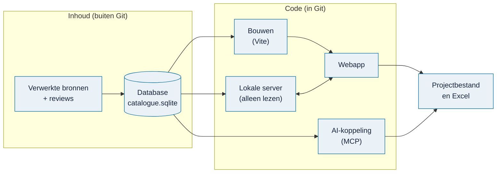

# Architectuur

> **In het kort:** Omnibus is een React-applicatie die in je browser draait. Een kleine lokale server levert de app en leest de database. Code en inhoud zijn strikt gescheiden: de code staat in Git, de inhoud in een aparte database.

## Hoe de onderdelen samenhangen

1. **De database** bevat de verwerkte bronnen. Hij komt los van de code, via de [releases](https://github.com/Robert-Worm/omnibus/releases/latest).
2. **Bij het bouwen** leest Omnibus de database en maakt de webapp.
3. **De lokale server** levert de app en geeft brongegevens door. Hij kan de database alleen lezen, niet wijzigen.
4. **In de browser** kies je bouwstenen, schrijf je vragen en exporteer je naar Excel. Je project blijft in je browser en in bestanden die jij bewaart.
5. **De AI-koppeling** gebruikt dezelfde database en dezelfde exportlogica, voor je eigen AI-assistent.

## Twee controlegetallen

Elke database hoort bij twee controlegetallen (hashes) in `local-build.json`:

| Hash | Wat het vastlegt |
| --- | --- |
| `release` | Welke bronnen, in welke versie |
| `publication` | De gegevens zoals de applicatie ze gebruikt |

Omnibus weigert te starten als database, hashes en code niet bij elkaar passen. Een hash bewijst dat er niets is veranderd, niet dat de inhoud goed is.

## Codekaart

| Onderdeel | Begin bij | Wat het doet |
| --- | --- | --- |
| Startpunt | [database.html](../../database.html), [offline.tsx](../../offline.tsx) | De pagina en het opstarten van React |
| Werkstappen | [app/framework-editor.tsx](../../app/framework-editor.tsx), [app/workflow-patterns.tsx](../../app/workflow-patterns.tsx) | De vier stappen en gedeelde keuzepanelen |
| Bronviewers | [app/law-point-source.tsx](../../app/law-point-source.tsx), [app/database-report-library.tsx](../../app/database-report-library.tsx) | Bronnen lezen met gemarkeerde passages; opmaak in [viewer-readability.css](../../app/viewer-readability.css) |
| Gegevens laden | [lib/catalogue-runtime.mjs](../../lib/catalogue-runtime.mjs), [lib/database-source-client.mjs](../../lib/database-source-client.mjs) | Gegevens ophalen wanneer ze nodig zijn |
| Selecties en vragen | [lib/framework-model.mjs](../../lib/framework-model.mjs), [lib/research-plan.mjs](../../lib/research-plan.mjs) | Wat je kiest en hoe het aan vragen hangt |
| Projecten opslaan | [lib/project-session.mjs](../../lib/project-session.mjs), [lib/project-codec.mjs](../../lib/project-codec.mjs) | Browseropslag en projectbestanden |
| Excel | [app/export-creator.tsx](../../app/export-creator.tsx), [lib/excel-export.mjs](../../lib/excel-export.mjs) | De drie werkvormen |
| Bouwen | [scripts/build-database-web.mjs](../../scripts/build-database-web.mjs), [vite.database.config.ts](../../vite.database.config.ts) | De app bouwen tegen een database |
| Bronlogica | [lib/runtime-contract.mjs](../../lib/runtime-contract.mjs), [lib/content-adapters/](../../lib/content-adapters/) | Hoe brongegevens worden omgezet voor de app |
| Database en server | [local-data/repository.mjs](../../local-data/repository.mjs), [local-data/server.mjs](../../local-data/server.mjs) | Database lezen en de lokale server |
| AI-koppeling | [agent-tools/server.mjs](../../agent-tools/server.mjs), [agent-tools/workflow.mjs](../../agent-tools/workflow.mjs) | De MCP-tools |
| Beheer | [content-tools/](../../content-tools/), [content-workbench/](../../content-workbench/) | Pakketten controleren en voortgang bijhouden |

Tests staan meestal naast de code die ze controleren (`*.test.mjs`). Fictieve testgegevens staan in [local-data/test-support/](../../local-data/test-support/).

## Wat wijzigingen moeten respecteren

- **Bronnen, selecties en projecten zijn drie verschillende dingen.** Een bronpassage houdt altijd zijn oorspronkelijke tekst en positie. Een selectie verandert niets aan een bron of aan de HOLD-status.
- **Eén ontwerp voor alle bronnen.** Hergebruik de bestaande viewers en opmaak. Wat per bron verschilt, hoort in een adapter in `lib/content-adapters/`.
- **Projecten blijven werken.** Een wijziging in de weergave mag opgeslagen selecties, vragen en koppelingen niet veranderen.

De volledige afspraken staan in [AGENTS.md](../../AGENTS.md) en de [acceptatiecontracten](../beheer/acceptatiecontracten.md).

## Wat waar hoort

| Gegevens | Waar |
| --- | --- |
| Code, documentatie, skills, fictieve testdata | In Git |
| De database | In de [releases](https://github.com/Robert-Worm/omnibus/releases/latest), niet in Git |
| Originele brondocumenten en reviewdossiers | Bij de beheerder |
| Onderzoeksprojecten | In je browser en in bestanden die je zelf bewaart |
| Wachtwoorden en sleutels | Nergens in Git, builds of logs |

## Licentie

Eigen code, documentatie en skills vallen onder de [PolyForm Noncommercial License 1.0.0](../../LICENSE). Onderdelen van derden houden hun eigen licentie, zoals de [stylesheetlicentie](../../app/vendor/shadcn-LICENSE.txt) en de lettertypen; zie [NOTICE](../../NOTICE).

## Samengevat

Eén database, één lokale server die alleen leest, één webapp en één AI-koppeling, die allemaal dezelfde logica delen. Code in Git, inhoud erbuiten.

## Volgende stap

Klaar om iets te veranderen? Lees [ontwikkelen](ontwikkelen.md).

---

[↑ Wegwijzer](../README.md) · [Begrippen](../begrippen.md) · [Routekaart](../routekaart.md)
