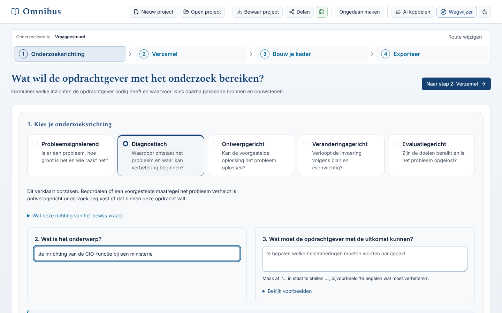

# Bouwstenen van een pagina

<!-- paginatype: naslag -->
<!-- check-docs: geen-woordcontrole -->

> **In het kort:** de vaste onderdelen waarmee je een pagina in Omnibus opbouwt: paginatypen, tabellen, statuslabels, meldingen, stappen, opdrachten en de paginarand. Dit is deel 2 van de [stijlgids](stijlgids.md); deel 1 gaat over taal en woorden.

## Zo gebruik je deze pagina

Kies eerst het [paginatype](#paginatypen). Bouw de pagina daarna op met de bouwstenen hieronder. Kopieer een voorbeeld en vul het in. Wat de documentatiecheck (`npm run check:docs`) al bewaakt, staat bij elke bouwsteen.

| Bouwsteen | Waarvoor |
| --- | --- |
| [Paginatypen](#paginatypen) | De vaste volgorde van een pagina |
| [Tabellen](#tabellen) | Zes vaste vormen, en wanneer je géén tabel gebruikt |
| [Statuslabels](#statuslabels) | Hoe je een stand van zaken toont |
| [Meldingen](#meldingen) | Waarschuwingen, tips en voorwaarden |
| [Stappen](#stappen) | Een taak die de lezer uitvoert |
| [Opdrachten](#opdrachten) | Codeblokken en plaatshouders |
| [Uitklapblokken](#uitklapblokken) | Details die niet iedereen nodig heeft |
| [Afbeeldingen en schema's](#afbeeldingen-en-schemas) | Schermafbeeldingen, de rondleiding en mermaid-schema's |
| [Paginarand](#paginarand) | Hoe elke pagina eindigt |

## Paginatypen

Elke pagina in `docs/` is van één type. Zet het type in een verborgen regel direct onder de titel:

```text
# Omnibus installeren

<!-- paginatype: taak -->

> **In het kort:** …
```

| Type | Waarvoor | Vaste volgorde |
| --- | --- | --- |
| `start` | Het begin van een route, zoals de wegwijzer en de README van gebruiken, bijdragen en beheren | In het kort · Begin hier · Verder · Volgende stap. **Geen** Samengevat. |
| `taak` | Iets wat de lezer doet, zoals installeren | In het kort · Kies je route\* · Wat heb je nodig? · Stap voor stap · Goed om te weten · Technische details · Samengevat · Volgende stap |
| `naslag` | Iets wat je opzoekt, zoals begrippen, afspraken of foutmeldingen | In het kort · Zo gebruik je deze pagina · de inhoud · Volgende stap. Samengevat mag. |
| `data` | Een pagina die een script maakt, zoals de voortgang en de werklijsten | In het kort · de stand · wat je kunt doen · de lijsten · Volgende stap. Met de regel *Automatisch bijgewerkt*. |
| `logboek` | Een lijst die groeit, zoals de besluiten en de checklist live demo | In het kort · Zo gebruik je deze lijst · de tabel · Volgende stap |

\* Alleen als er meer dan één route is.

**Wat de check bewaakt:** elke pagina in `docs/` heeft een geldig type. Een `start`-pagina heeft geen Samengevat. Een `taak`-pagina heeft Samengevat en genummerde stappen. Een `data`-pagina zegt dat hij automatisch wordt bijgewerkt. Een `logboek` heeft een tabel.

## Tabellen

Gebruik een tabel alleen voor informatie die je naast elkaar vergelijkt. Er zijn zes vaste vormen. Gebruik de kolomkoppen precies zo.

| Vorm | Kolommen | Gebruik je voor |
| --- | --- | --- |
| Wegwijzer | `Je wilt… \| Lees` | Doorverwijzen naar een pagina |
| Overzicht | `<Ding> \| Wat het is` | Begrippen, mappen, pagina's of opties uitleggen |
| Leesroute | `Stap \| Lees \| Wat je daarna kunt` | De volgorde waarin je pagina's leest |
| Status | `Onderdeel \| Status \| Toelichting` | Laten zien hoe ver iets is. Is de toelichting meestal leeg? Laat de kolom weg en zet een korte toelichting achter het onderdeel |
| Werklijst | `Bron \| Status \| Actie` | Bronnen die je kunt claimen of volgen. Datum of code staat onder de titel, na `<br>` |
| Uitkomst | `Uitkomst \| Betekenis \| Wat je doet` | Meldingen of uitkomsten van een controle |

**Regels voor elke tabel**

- Elke kolom heeft een kop. Een lege cel krijgt `–`.
- Hooguit vier kolommen. Alleen gegenereerde standtabellen en de besluitenlijst (`ID | Datum | Besluit | Reden | Gevolg`) mogen er vijf hebben.
- Een cel is kort: hooguit 25 woorden en één gedachte.
- Getallen staan rechts (`---:`). Datums in een tabel schrijf je als `2026-10-21`; in lopende tekst als *21 oktober 2026*.
- De eerste kolom is gewone tekst, een link of `code`. Niet vet.
- Een telefoon is 390 pixels breed. Zet een actie, zoals *Claimen*, nooit achter een lange kolom, want dan valt hij buiten beeld. Een code die niet kan afbreken, zoals `FINAL_VERIFICATION`, zet je liever in een lijst.

**Voorbeelden**

Wegwijzer:

| Je wilt… | Lees |
| --- | --- |
| Omnibus op je computer zetten | [Installeren](../gebruiken/installeren.md) |

Overzicht:

| Begrip | Wat het is |
| --- | --- |
| Referentiekader | De normen en toetspunten waarmee je een organisatie onderzoekt |

Leesroute:

| Stap | Lees | Wat je daarna kunt |
| --- | --- | --- |
| 1 | [Installeren](../gebruiken/installeren.md) | Omnibus draait op je eigen computer |

Status:

| Onderdeel | Status | Toelichting |
| --- | --- | --- |
| Proefversie online | ✅ Klaar | Sinds 21 oktober 2026 |
| Back-up en herstel online | ⬜ Gepland | Zie de [checklist live demo](../beheer/live-demo-checklist.md) |

Werklijst:

| Bron | Status | Actie |
| --- | --- | --- |
| Voorbeeldrapport<br>2026-03-01 | ⬜ Open | Claimen |

Uitkomst:

| Uitkomst | Betekenis | Wat je doet |
| --- | --- | --- |
| `MATCH` | Precies de verwachte toevoegingen | Ga verder met de testbuild |

**Wat de check bewaakt:** een lege kopcel is een fout. Een waarschuwing krijg je bij meer dan vier kolommen, een lege cel, een cel van meer dan 25 woorden, getallen die niet rechts staan, een datum als 21-10-2026 in een tabel, een statuscel die geen vast label is, en een vette eerste kolom.

**Geen tabel als:**

- een cel meer dan 25 woorden of als-dan-uitleg nodig heeft: gebruik een lijst of een [kaart](#kaarten);
- de tabel maar één zinvolle kolom heeft, of geen kop: gebruik een lijst met vette woorden vooraan;
- er minder dan drie rijen zijn: schrijf een zin of een lijst;
- je voor- en nadelen vergelijkt: gebruik twee lijsten;
- je stappen beschrijft: gebruik [stappen](#stappen).

## Statuslabels

Een status is altijd **icoon plus woord**. Zo is hij ook zonder kleur of icoon te begrijpen, en leest een schermlezer hem goed voor.

| Label | Betekenis | Ook gebruikt als |
| --- | --- | --- |
| ✅ Klaar | Af, of werkend | ✅ In database (op datapagina's) |
| 🔄 Bezig | Er wordt nu aan gewerkt | 🔄 In bewerking (op datapagina's) |
| 📦 Ingeleverd | Wacht op controle door de beheerder | – |
| ⬜ Open | Nog niet begonnen | ⬜ Gepland (op de routekaart) |
| 🔒 Niet beschikbaar | Kan niet, bijvoorbeeld niet openbaar | 🔒 Niet openbaar, 🔒 Toestemming nodig |
| 🔁 Mogelijk dubbel | Lijkt hetzelfde als een andere bron | – |
| ➖ Niet van toepassing | Hoort niet bij deze route of dit hulpmiddel | – |

- Een statuscel bevat alleen het label. Uitleg en links staan in de kolom *Toelichting*.
- Gebruik geen andere iconen als status. ⬜ betekent nooit *bewust niet*; daarvoor is ➖.
- Twee signalen mogen op datapagina's naast een gewone waarde staan, met uitleg in de legenda: ⚠️ (niet-aanbevolen AI-model) en ⏰ (wacht langer dan zeven dagen).

## Meldingen

Gebruik de meldingen van GitHub voor wat de lezer niet mag missen. GitHub zet er zelf een Engelse kop boven (*Note*, *Tip*, *Important*, *Warning*). Begin daarom met een vet Nederlands woord.

| Melding | Gebruik je voor | Begin met |
| --- | --- | --- |
| `[!NOTE]` | Achtergrond die helpt, zoals de stand van zaken | **Goed om te weten:** of **Stand:** |
| `[!TIP]` | Een snellere of makkelijkere route | **Tip:** |
| `[!IMPORTANT]` | Een voorwaarde voordat je begint | **Eerst:** |
| `[!WARNING]` | Iets onomkeerbaars, dataverlies of vertrouwelijkheid | **Nooit:** of **Let op:** |

```text
> [!WARNING]
> **Nooit:** pas een controlegetal aan om een controle te laten slagen.
```

- Hooguit twee meldingen per scherm, en nooit twee direct onder elkaar.
- Geen kop *Let op* en geen losse zinnen die met *Let op:* of *Nooit doen:* beginnen. Maak er een melding van.
- `[!CAUTION]` gebruik je niet.
- *In het kort* bovenaan een pagina is geen melding, maar een gewoon citaatblok.

## Stappen

Een taak beschrijf je onder `## Stap voor stap`. Elke stap is een kop met een nummer en een werkwoord in de gebiedende wijs. Een stap met een zichtbare uitkomst eindigt met **Gelukt als**.

```text
### 4. Controleer en bouw

npm run data:check-runtime -- --settings local-data/runtime/local-build.json

**Gelukt als:** je `VERIFIED_RUNTIME_DATABASE` ziet.
```

Situaties die je opzoekt, zoals storingen, nummer je niet: de lezer volgt ze niet op volgorde.

**Wat de check bewaakt:** een stap als `## 1.`-kop, en een genummerde kop op een pagina die geen taakpagina is.

<a id="kaarten"></a>
**Kaarten.** Een situatie (een storing of een foutmelding) krijgt altijd dezelfde kaart: een kop, eventueel de melding in een codeblok, en dan een lijst met deze vette woorden, in deze volgorde:

```text
### De claimbot reageert niet

- **Herkennen:** …
- **Oorzaak:** …
- **Eerst doen:** …
- **Herstellen:** …
- **Nazorg:** …
```

- Laat een woord weg als er niets over te zeggen is. De volgorde blijft.
- Staat de melding in een codeblok, dan is dat het herkennen; begin dan met **Oorzaak**.
- Gebruik geen tabel als kaart.

**Wat de check bewaakt:** de volgorde van de woorden op een kaart, en de oude woorden *Wat het betekent* en *Wat je doet*.

## Opdrachten

- Een codeblok heeft altijd een taal: `text` voor opdrachten die overal werken, `bash` of `powershell` als het verschilt, en verder `json` of `mermaid`.
- Verschilt het per systeem? Geef beide, met precies deze labels: **Windows (PowerShell)** en **macOS en Linux (bash)**.
- Een plaatshouder schrijf je als `<kleine-letters-met-streepjes>`, zonder aanhalingstekens eromheen.
- Heeft een opdracht een npm-script? Schrijf dan `npm run …`.

**Wat de check bewaakt:** de taal van elk codeblok (ook buiten `docs/`), plaatshouders tussen aanhalingstekens, andere labels voor Windows en macOS, en `node scripts/…` waar een npm-script voor bestaat.

## Uitklapblokken

Klap alleen in wat niet iedereen nodig heeft. Wat de lezer nodig heeft om de taak te doen, klap je nooit in.

```text
<details><summary><b>Technische details</b> · opdrachten en uitvoer</summary>

…

</details>
```

- De kop is **Technische details** met een korte aanvulling, of de naam van een groep met een aantal: `<b>Rapporten</b> · 12 open van 40`. Herhaal de kop erboven niet.
- Laat na `</summary>` een lege regel, anders toont GitHub de opmaak niet.
- Zet geen `#`-koppen in een uitklapblok; GitHub toont ze niet in de inhoudsopgave. Gebruik vette woorden.

**Vaste namen.** Hetzelfde soort blok heet overal hetzelfde:

| Naam | Wat erin staat |
| --- | --- |
| Wat heb je nodig? | Programma's, bestanden en rechten vóór je begint |
| Goed om te weten | Achtergrond en valkuilen na de stappen |
| Vaste regels | Regels die altijd gelden; alleen op beheerpagina's |
| Waar staat dit? | Waar bestanden, gegevens of instellingen staan |
| Technische details | Opdrachten en uitvoer die niet iedereen nodig heeft |

**Wat de check bewaakt:** koppen in een uitklapblok, de vorm van de kop van een uitklapblok, andere namen voor deze vaste blokken (zoals *Technische referentie*), *Vaste regels* buiten beheer, en dubbele koppen op één pagina.

## Afbeeldingen en schema's

**Afbeeldingen.** Elke schermafbeelding komt uit `npm run docs:screenshots`. Dat script maakt elk scherm in licht en donker (`-donker.png`), de banner en de rondleiding. Alleen de beelden van GitHub zelf (`claimformulier`, `botreactie`, `voortgang-beginnen` en `releasechecklist`) maak je met de hand: neem het beeld in licht, zet GitHub in de pagina op donker en neem het opnieuw. Zet een afbeelding altijd zo neer, met een kort bijschrift eronder:

```text
<picture>
  <source media="(prefers-color-scheme: dark)" srcset="../images/stap-1-onderzoeksrichting-donker.png">
  
</picture>

*Stap 1: kies de onderzoeksrichting en vul het onderwerp in.*
```

- De alt-tekst beschrijft wat je ziet, in 10 tot 150 tekens. Het bijschrift zegt waarom het beeld er staat.
- Een PNG is hooguit 300 KB, een GIF hooguit 1 MB. Het script verkleint te grote PNG's.
- Bewegend beeld speelt nooit vanzelf af. De rondleiding staat er als stilstaand beeld met een afspeelknop, dat naar de animatie linkt; de stappen staan als tekst eronder.

<a id="schemas"></a>
**Schema's.** Gebruik mermaid, met de vaste kleuren hieronder. Een schema met meer dan vier vakken loopt van boven naar beneden (`flowchart TD`), zodat het ook op een telefoon past. Zet na een schema dezelfde informatie als tekst, bijvoorbeeld als genummerde stappen. Teken geen schema dat alleen naar andere pagina's verwijst: gebruik daarvoor een wegwijzertabel.

| Klasse | Gebruik je voor | Stijl |
| --- | --- | --- |
| `default` | Elk gewoon vak | `fill:#eaf2f8,stroke:#01689b,color:#15233b;` |
| `groep` | Een groep (`subgraph`) | `fill:#f6f8fb,stroke:#9fb3c8,color:#15233b;` |
| `klaar` | Iets wat af is | `fill:#e8f5ec,stroke:#2e7d4f,color:#15233b;` |
| `open` | Iets wat nog moet | `fill:#ffffff,stroke:#8a97a6,color:#15233b,stroke-dasharray:4 3;` |

De vakken blijven ook in donker thema licht, met donkere tekst. Zo blijven ze overal goed leesbaar.

**Wat de check bewaakt:** afbeeldingen zonder donkere variant of bijschrift, de lengte van de alt-tekst, de grootte van beeldbestanden, de kleuren van schema's, losse `style`-regels, en schema's met meer dan vier vakken van links naar rechts.

## Paginarand

Elke pagina eindigt zo:

```text
## Volgende stap

Lees [werken met Omnibus](werken-met-omnibus.md).

---

[↑ Gebruiken](README.md) · [Wegwijzer](../README.md) · [Begrippen](../begrippen.md) · [Routekaart](../routekaart.md)
```

- *Volgende stap* wijst vooruit, met één link. Begin niet met *Terug naar…*.
- De voetregel begint met de pagina erboven (↑), gevolgd door de wegwijzer, de begrippen en de routekaart. Een link naar de pagina zelf, of twee keer dezelfde, laat je weg. Dit geldt voor elke pagina voor lezers, ook buiten `docs/`, zoals `hosting/`, de skills en CONTRIBUTING.
- *Samengevat* staat alleen op taakpagina's en pagina's van 60 regels of meer. Op een startpagina of een korte pagina laat je hem weg.

**Nette tekst**

- Geen emoji in koppen: het anker wordt dan onleesbaar.
- Een alinea staat op één regel. Breek hem niet af over meerdere regels.
- HTML alleen voor afbeeldingen, uitklapblokken en de kop van de README: `a`, `b`, `br`, `details`, `h1`, `img`, `kbd`, `p`, `picture`, `source`, `strong`, `sub`, `summary` en `sup`.
- Twee links met dezelfde tekst wijzen naar dezelfde pagina. Wijzen ze ergens anders heen, maak de tekst dan verschillend, of geef de link een titel.

**Wat de check bewaakt:** de hele voetregel en de streep erboven, *Volgende stap* die terugwijst, *Samengevat* op een korte pagina, emoji in koppen, afgebroken alinea's, andere HTML en gelijke linkteksten naar verschillende pagina's.

## Samengevat

Kies een paginatype en bouw de pagina op met vaste bouwstenen: zes tabelvormen, statuslabels met icoon en woord, meldingen met een vaste betekenis, stappen met *Gelukt als*, opdrachten met een taal, uitklapblokken met een vaste kop en dezelfde paginarand.

## Volgende stap

Lees de [stijlgids](stijlgids.md) voor taal en woorden, en controleer je pagina met `npm run check:docs`.

---

[↑ Meedoen](README.md) · [Wegwijzer](../README.md) · [Begrippen](../begrippen.md) · [Routekaart](../routekaart.md)
