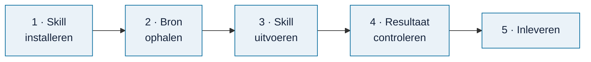

# Een bron verwerken

> **In het kort:** je laat een AI-assistent met een Omnibus-skill een rapport, wet of kader omzetten naar normen en toetspunten. Jij controleert het resultaat en levert het in bij je claim als **concept**. De beheerder maakt het af en neemt het op in de database.

## Wat heb je nodig?

- Een **claim** op de bron. Nog niet geclaimd? Doe dat eerst in de [voortgang](voortgang.md).
- Een **AI-assistent die bestanden kan lezen en schrijven**, zoals Codex of Claude Code.
- Een **kopie van deze repository**, voor de skills. Zie [installeren](../gebruiken/installeren.md), stap 1 en 2.

## Welk AI-model gebruik je?

De kwaliteit van een verwerkte bron hangt sterk af van het AI-model. Gebruik daarom het sterkste model dat je hebt. Aanbevolen:

| Aanbieder | Aanbevolen modellen |
| --- | --- |
| Anthropic | Claude Opus, Claude Fable of Claude Mythos |
| OpenAI | GPT-5 of Codex |

Bij je claim vul je in met welk model je werkt. Staat het niet op deze lijst, dan krijgt je claim het label **model-controleren** en beoordeelt de beheerder of het resultaat bruikbaar is. Kleine of snelle modellen ("mini", "flash", "haiku") zijn meestal niet goed genoeg voor dit werk.

Wissel je tijdens het werk van model? Pas dan het veld in je claim aan, of noem het bij het inleveren.

## Stap voor stap



### 1. Installeer de skill

Kies de skill die bij je bron past:

| Bron | Skill |
| --- | --- |
| Rapport | `omnibus-add-report` |
| Wet of kader | `omnibus-add-framework` |
| Onderzoeksmodel | `omnibus-add-model` |

Voor Codex installeer je hem vanuit de repository:

```text
npm run skills:install -- --skill omnibus-add-report
```

Gebruik je een andere assistent? Geef hem de map `skills/omnibus-add-report/` en vraag hem `SKILL.md` te volgen. Meer uitleg: [AI-skills](../../skills/README.md).

### 2. Haal de bron op

Download het document via de link in je claim: de Rijksmap-pagina verwijst naar de officiële publicatie. Noteer de datum en versie.

### 3. Voer de skill uit

Geef je assistent een opdracht als:

> Gebruik `$omnibus-add-report` voor dit rapport. Maak een conceptpakket met normen, toetspunten en bronpassages. Behoud bronverwijzingen en beperkingen. Niet integreren of publiceren.

De skill leest het hele document, stelt normen en toetspunten voor en legt bij elk punt vast waar het in de bron staat. Dit kan even duren.

### 4. Controleer het resultaat

Loop het resultaat zelf na. Let vooral op:

- **Klopt de bronpassage?** Staat het echt zo in het document?
- **Is de norm begrijpelijk?** Kan een collega er direct mee werken?
- **Zijn twijfels zichtbaar?** Onzekere punten horen gemarkeerd te blijven (*HOLD*), niet weggepoetst.

Wil je een tweede mening? De skill [`omnibus-review-audit-quality`](../../skills/omnibus-review-audit-quality/README.md) beoordeelt de kwaliteit van de bouwstenen.

### 5. Lever in

1. Zet de map die de skill heeft gemaakt in een zip. Wat erin hoort, staat hieronder.
2. Voeg de zip toe aan je claim: sleep hem in een reactie (maximaal 25 MB). Te groot? Zet hem online en deel de link.
3. Schrijf in dezelfde reactie, **op een eigen regel**, `/inleveren`. Zet erbij wat goed ging en waar je twijfelt.

De claim krijgt dan het label **ingeleverd** en de voortgang werkt zich bij.

## Wat lever je in?

Je levert een **concept** in. Een paar laatste stappen (zoals de formele bronkoppeling met de interne rapportkit en een tweede, onafhankelijke lezing) doet de beheerder. Daarvoor heb je geen speciale tools nodig.

Een goed conceptpakket bevat:

| Onderdeel | Wat het is |
| --- | --- |
| De bron | Het document zelf, of de link en de exacte versie of datum |
| De bouwstenen | De normen en toetspunten die de skill maakte, met bij elk punt de bronpassage (pagina en citaat) |
| De beperkingen | Wat er níet uit de bron te halen is, en waar je twijfelt (punten met HOLD) |
| Je eigen controle | Een korte notitie: wat heb je nagelopen, wat heb je aangepast? |
| Het AI-model | Welk model je gebruikte, als dat anders is dan in je claim |

Laat de bestanden zoals de skill ze maakte; hernoem of verwijder niets. Twijfel je wat er hoort? Vraag het in je claim.

## Wat gebeurt er daarna?

De beheerder:

1. controleert of het pakket compleet en ongewijzigd is;
2. beoordeelt de inhoud, en stelt zo nodig vragen in je claim;
3. neemt de bron op in de volgende databaserelease.

Daarna staat de bron op ✅ in de voortgang en wordt je claim gesloten. Hoe de beheerder dat doet, staat in [beheer](../beheer/README.md).

## Veelgestelde vragen

**Moet ik zelf de technische controles draaien?**
Nee. Ben je technisch onderlegd, dan kun je met `npm run content:prepare` en `npm run content:intake` alvast een controlebestand maken; zie [pakket controleren](../beheer/pakket-controleren.md). Het hoeft niet.

**Wat als de AI fouten maakt?**
Dat gebeurt. Daarom controleer jij, en daarna de beheerder. Meld twijfels gewoon in je toelichting.

**Mag ik elke bron verwerken?**
Bijna. Een paar rapporten op de Rijksmap zijn niet openbaar; die hebben geen claimlink. Bij kaders met auteursrecht staat 🔒 *toestemming nodig* in de [werklijst wetten en kaders](werklijst-wetten-en-kaders.md); overleg dan eerst in Discussions.

**Wat betekent HOLD?**
Een punt dat nog niet goed genoeg onderbouwd is: er ontbreekt bewijs of een controle. HOLD-punten blijven zichtbaar en worden niet stilletjes goedgekeurd. Zie de [begrippenlijst](../begrippen.md).

## Samengevat

Skill installeren, bron ophalen, skill uitvoeren, zelf controleren, het concept als zip bij je claim zetten en `/inleveren` schrijven. De beheerder maakt het af.

## Volgende stap

Nog geen claim? Kies een bron in de [voortgang](voortgang.md).

---

[↑ Wegwijzer](../README.md) · [Begrippen](../begrippen.md) · [Routekaart](../routekaart.md)
