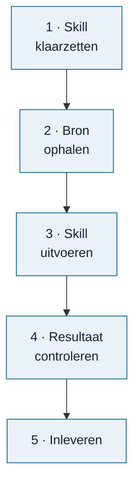

# Een bron verwerken

<!-- paginatype: taak -->

> **In het kort:** je laat een AI-assistent met een Omnibus-skill een rapport, wet of kader omzetten naar normen en toetspunten. Je levert bij je claim een compleet pakket met bronbewijs en onafhankelijke reviews in. De beheerder controleert de toelating en neemt goedgekeurde inhoud op in de database.

## Wat heb je nodig?

- Een **claim** op de bron. Nog niet geclaimd? Doe dat eerst in de [voortgang](voortgang.md).
- Een **AI-assistent die de skillbestanden en je bron kan lezen en bestanden kan opleveren**. Zie [skills gebruiken](skills-gebruiken.md) voor Codex, Claude Code, de Claude-app en ChatGPT.
- De **hele map van de gekozen skill**. Begin bij [een skill downloaden zonder terminal](skills-gebruiken.md#1-download-de-skill-zonder-terminal). Je hebt hiervoor geen Git, terminal of database nodig.

## Welk AI-model gebruik je?

De kwaliteit van een verwerkte bron hangt sterk af van het AI-model. Gebruik daarom het sterkste model dat je hebt. Aanbevolen:

| Aanbieder | Aanbevolen modellen |
| --- | --- |
| Anthropic | Claude Opus, Claude Fable of Claude Mythos |
| OpenAI | GPT-5 of Codex |

Bij je claim vul je in met welk model je werkt. Staat het niet op deze lijst, dan krijgt je claim het label **model-controleren** en beoordeelt de beheerder of het resultaat bruikbaar is. Kleine of snelle modellen ("mini", "flash", "haiku") zijn meestal niet goed genoeg voor dit werk.

Wissel je tijdens het werk van model? Pas dan het veld in je claim aan, of noem het bij het inleveren.

## Stap voor stap

### 1. Zet de skill klaar

Kies de skill die bij je bron past:

| Bron | Skill |
| --- | --- |
| Rapport | `omnibus-add-report` |
| Wet of kader | `omnibus-add-framework` |
| Onderzoeksmodel | `omnibus-add-model` |

Volg [skills gebruiken met je AI-assistent](skills-gebruiken.md). Voor de Claude-app en ChatGPT download je de bestanden via **Code** → **Download ZIP** op GitHub. Daarna pak je de download uit en maak je een zip van de gekozen skillmap met Verkenner of Finder.

Dezelfde handleiding bevat aparte routes voor Codex en Claude Code. Controleer bij elke route of je assistent alle nodige bestanden kan lezen.

De zelfstandige rapportroute zonder private rapportkit is nog in ontwikkeling in [#225](https://github.com/Robert-Worm/omnibus/issues/225). Ontbreekt een verplicht contract, hulpmiddel of onafhankelijke rol, bewaar dan een tussenresultaat met `HOLD`. De stappen hieronder maken dat ontbrekende onderdeel niet beschikbaar.

**Gelukt als:** je assistent de skillbestanden heeft gelezen en ontbrekende hulpmiddelen of reviews noemt.

### 2. Haal de bron op

Download het document via de link in je claim: de Rijksmap-pagina verwijst naar de officiële publicatie. Noteer de datum en versie; die zet je straks in je toelichting bij het inleveren.

### 3. Voer de skill uit

Geef je assistent eerst het document. In de Claude-app of ChatGPT voeg je de PDF toe aan het gesprek; in Codex of Claude Code zet je hem in je werkmap. Geef daarna een opdracht als:

> Gebruik de skill omnibus-add-report voor dit rapport.
> Bron: [titel], [uitgever], [link], [datum].
> Taak: nieuwe extractie, als volledig overdraagbaar pakket van een bijdrager.
> Omgeving: [welke bestanden en hulpmiddelen zijn beschikbaar]. Budget: hooguit [aantal] deelagenten, of afzonderlijke gesprekken als dit niet kan.
> Controleer eerst of alle contracten, hulpmiddelen en onafhankelijke rollen beschikbaar zijn. Maak het pakket met de vaste bestandsnamen uit de skill, bronbewijs en werkelijk uitgevoerde reviews. Ontbreekt iets, meld HOLD en het ontbrekende onderdeel. Niet integreren of publiceren.

Vul de delen tussen haken in. Daarmee beantwoord je meteen de vragen die de skill anders zelf stelt. Een ontbrekende tweede, blinde lezing moet nog plaatsvinden voordat het pakket compleet is. Eén gesprek dat meerdere lezers naspeelt, voldoet niet.

In Codex schrijf je de naam van de skill met een dollarteken ervoor: `$omnibus-add-report`. De skill leest het hele document, stelt normen en toetspunten voor en legt bij elk punt vast waar het in de bron staat. Dit kan even duren.

**Gelukt als:** het pakket de normen en toetspunten, exacte bronpassages, beperkingen, vereiste onafhankelijke reviews en bijbehorende bewijsbestanden bevat. Gebruik de namen uit het uitvoercontract en het [intakeplan van de skill](../../skills/omnibus-add-report/assets/intake-plan.json.example). Een ontbrekende review betekent dat het pakket nog niet compleet is.

- **Codex en Claude Code** maken een map in je werkmap. De assistent noemt de naam.
- **De Claude-app en ChatGPT:** vraag om het pakket als zip om te downloaden. Dit kan alleen als jouw omgeving bestanden kan maken. Ontbreekt die functie, gebruik dan een omgeving die dat wel kan.

Ontbrekende bronlezingen en onafhankelijke reviews blijven `PENDING_REVIEW` of `HOLD`, zoals de skill voorschrijft. Een downloadbaar pakket is nog geen goedgekeurde bron.

### 4. Controleer het resultaat

Loop het resultaat zelf na. Let vooral op:

- **Klopt de bronpassage?** Staat het echt zo in het document?
- **Is de norm begrijpelijk?** Kan een collega er direct mee werken?
- **Zijn twijfels zichtbaar?** Onzekere punten horen gemarkeerd te blijven (*HOLD*), niet weggepoetst.

Wil je een tweede mening? De skill [`omnibus-review-audit-quality`](../../skills/omnibus-review-audit-quality/README.md) beoordeelt de kwaliteit van de bouwstenen.

### 5. Lever in

1. Zet de map die de skill heeft gemaakt in een zip. Kreeg je al een zip van de app, gebruik die dan. Wat erin hoort, staat hieronder.
2. Voeg de zip toe aan je claim: sleep hem in een reactie (maximaal 25 MB). Te groot? Zet hem online en deel de link.
3. Schrijf in dezelfde reactie, **op een eigen regel**, `/inleveren`. Zet erbij wat goed ging en waar je twijfelt.

Binnen een paar minuten kijkt een automatische controle in je zip. Is hij te openen? Staan de belangrijkste onderdelen erin? Zitten er geen programma's of scripts in? Je ziet het resultaat als reactie bij je claim, met de kop *Automatische eerste controle van je pakket*:

- **Alleen ✅ en ⚠️:** goed. Een ⚠️ betekent dat de controle een onderdeel niet herkent aan de bestandsnaam. Zit het erin, noem het dan in je toelichting.
- **Een ❌:** de controle keurt de zip af, bijvoorbeeld omdat er een script in zit. Pas de zip aan en zet hem in een nieuwe reactie, weer met `/inleveren` op een eigen regel.

Je claim krijgt het label `ingeleverd`. Wat er daarna gebeurt, staat in [meedoen](README.md#zo-werkt-een-bron-verwerken).

**Gelukt als:** de controle bij je claim staat zonder ❌ en eventuele waarschuwingen zijn verklaard. Dit is alleen een eerste bestandscontrole; het bewijst geen volledigheid van de reviews of inhoudelijke toelating.

## Wat lever je in?

Je levert een **compleet pakket** in. De beheerder controleert de bronkoppeling, de werkelijk uitgevoerde onafhankelijke reviews en de formele toelating. Volg het uitvoercontract van jouw skill; de tabel hieronder toont de hoofdonderdelen, niet ieder bewijsbestand.

Een compleet pakket bevat:

| Onderdeel | Wat het is | Zo heten ze in het voorbeeldpakket |
| --- | --- | --- |
| De bron | De link en de exacte versie of datum | `bron.json`, `source-text.json` |
| De bouwstenen | De normen en toetspunten, met bij elk punt de bronpassage | `APP-FINAL.json`, `CATALOGUE.json`, `APP-SOURCE-LINKS.json`, `RECONCILED-SOURCE.json`, `context.json` |
| De beperkingen | Wat er níet uit de bron te halen is, en waar je twijfelt (HOLD) | `beperkingen.md` |
| Je eigen controle | Wat je hebt nagelopen en aangepast | `controle.md` |
| Onafhankelijke lezingen en reviews | Eerste inzendingen, leeslogs, reconciliatie, reviewbasis en de afzonderlijke reviewuitkomsten | De vaste namen uit het uitvoercontract; gebruik in het intakeplan de rollen `review-basis` en `review` |
| Ontvangstbewijs | Bewijs voor precies de overgedragen versie | De rol `receipt` uit het intakeplan; nooit een zelfgeschreven goedkeuringsvlag |
| Het AI-model | Als dat anders is dan in je claim | In je toelichting |

De automatische controle na `/inleveren` zoekt naar de eerste vier onderdelen: bron, bouwstenen, beperkingen en eigen controle. Ziet hij er een niet aan de bestandsnamen, dan krijg je een ⚠️.

Laat de bestanden zoals de skill ze maakte; hernoem of verwijder niets. Twijfel je wat er hoort? Vraag het in je claim.

## Een voorbeeld bekijken

Wil je de bouwstenen bekijken? Download het [voorbeeldpakket ADR 2018](https://github.com/Robert-Worm/omnibus/releases/download/voorbeeld-adr-2018-v1/omnibus-voorbeeld-adr-2018-v1.zip) en begin bij `LEESMIJ.md`. Dit voorbeeld vervangt de verplichte lezingen, reviews en bewijsbestanden van jouw eigen pakket niet. Wat er precies in zit, staat bij [het voorbeeldpakket](voorbeeldpakket.md).

## Wat gebeurt er daarna?

De beheerder:

1. controleert of het pakket compleet en ongewijzigd is;
2. beoordeelt de inhoud, en stelt zo nodig vragen in je claim;
3. neemt de bron op in de volgende databaserelease.

Daarna staat de bron op ✅ in de voortgang en wordt je claim gesloten. Hoe de beheerder dat doet, staat in [beheer](../beheer/README.md).

## Veelgestelde vragen

### Moet ik zelf de technische controles draaien?

Een ontvangende omgeving kan de opdrachten uitvoeren als jouw app dat niet kan. Je moet wel alle vereiste bestanden en reviewbewijzen aanleveren. `Missing file roles` betekent dat er iets ontbreekt en is geen geslaagde controle. Zie [pakket controleren](../beheer/pakket-controleren.md). `FILES_VERIFIED_REVIEW_REQUIRED` bevestigt alleen compleet en ongewijzigd transport, geen inhoudelijke goedkeuring.

### Wat als de AI fouten maakt?

Dat gebeurt. Daarom controleer jij, en daarna de beheerder. Meld twijfels gewoon in je toelichting.

### Mag ik elke bron verwerken?

Bijna. Een paar rapporten op de Rijksmap zijn niet openbaar; die hebben geen claimlink. Bij kaders met auteursrecht staat 🔒 *toestemming nodig* in de [werklijst wetten en kaders](werklijst-wetten-en-kaders.md); overleg dan eerst in Discussions.

### Wat betekent HOLD?

Een punt dat nog niet goed genoeg onderbouwd is: er ontbreekt bewijs of een controle. HOLD-punten blijven zichtbaar en worden niet stilletjes goedgekeurd. Zie de [begrippenlijst](../begrippen.md).

## Samengevat

Skill klaarzetten, bron ophalen, de vereiste onafhankelijke stappen uitvoeren en het complete pakket als zip bij je claim inleveren. De beheerder beoordeelt toelating en integratie.

## Volgende stap

Nog geen claim? Kies een bron in de [voortgang](voortgang.md).

---

[↑ Meedoen](README.md) · [Wegwijzer](../README.md) · [Begrippen](../begrippen.md) · [Routekaart](../routekaart.md)
