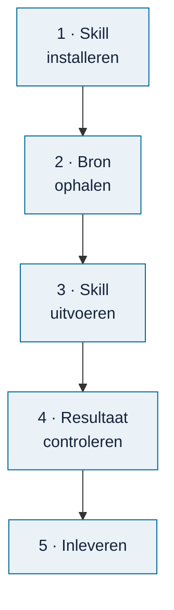

# Een bron verwerken

<!-- paginatype: taak -->

> **In het kort:** je laat een AI-assistent met een Omnibus-skill een rapport, wet of kader omzetten naar normen en toetspunten. Jij controleert het resultaat en levert het in bij je claim als **concept**. De beheerder maakt het af en neemt het op in de database.

## Wat heb je nodig?

- Een **claim** op de bron. Nog niet geclaimd? Doe dat eerst in de [voortgang](voortgang.md).
- Een **AI-assistent die bestanden kan lezen en schrijven**, zoals Codex of Claude Code.
- Een **kopie van deze repository**, voor de skills. Zie [installeren](../gebruiken/installeren.md), stap 1 en 2.

## Welk AI-model gebruik je?

De kwaliteit van een verwerkte bron hangt sterk af van het AI-model. Gebruik daarom het sterkste model dat je hebt. Aanbevolen:

| Aanbieder | Aanbevolen modellen |
| --- | --- |
| Anthropic | Claude Opus, Claude Fable of Claude Mythos |
| OpenAI | GPT-5 of Codex |

Bij je claim vul je in met welk model je werkt. Staat het niet op deze lijst, dan krijgt je claim het label **model-controleren** en beoordeelt de beheerder of het resultaat bruikbaar is. Kleine of snelle modellen ("mini", "flash", "haiku") zijn meestal niet goed genoeg voor dit werk.

Wissel je tijdens het werk van model? Pas dan het veld in je claim aan, of noem het bij het inleveren.

## Stap voor stap



### 1. Installeer de skill

Kies de skill die bij je bron past:

| Bron | Skill |
| --- | --- |
| Rapport | `omnibus-add-report` |
| Wet of kader | `omnibus-add-framework` |
| Onderzoeksmodel | `omnibus-add-model` |

Voor Codex installeer je hem vanuit de repository:

```text
npm run skills:install -- --skill omnibus-add-report
```

Gebruik je Claude Code, de Claude-app of ChatGPT? Volg dan [skills gebruiken met je AI-assistent](skills-gebruiken.md).

### 2. Haal de bron op

Download het document via de link in je claim: de Rijksmap-pagina verwijst naar de officiële publicatie. Noteer de datum en versie.

### 3. Voer de skill uit

Geef je assistent een opdracht als:

> Gebruik `$omnibus-add-report` voor dit rapport. Maak een conceptpakket met normen, toetspunten en bronpassages. Behoud bronverwijzingen en beperkingen. Niet integreren of publiceren.

De skill leest het hele document, stelt normen en toetspunten voor en legt bij elk punt vast waar het in de bron staat. Dit kan even duren.

**Gelukt als:** je assistent een map met het conceptpakket heeft gemaakt.

### 4. Controleer het resultaat

Loop het resultaat zelf na. Let vooral op:

- **Klopt de bronpassage?** Staat het echt zo in het document?
- **Is de norm begrijpelijk?** Kan een collega er direct mee werken?
- **Zijn twijfels zichtbaar?** Onzekere punten horen gemarkeerd te blijven (*HOLD*), niet weggepoetst.

Wil je een tweede mening? De skill [`omnibus-review-audit-quality`](../../skills/omnibus-review-audit-quality/README.md) beoordeelt de kwaliteit van de bouwstenen.

### 5. Lever in

1. Zet de map die de skill heeft gemaakt in een zip. Wat erin hoort, staat hieronder.
2. Voeg de zip toe aan je claim: sleep hem in een reactie (maximaal 25 MB). Te groot? Zet hem online en deel de link.
3. Schrijf in dezelfde reactie, **op een eigen regel**, `/inleveren`. Zet erbij wat goed ging en waar je twijfelt.

Binnen een paar minuten kijkt een automatische controle in je zip. Is hij te openen? Staan de belangrijkste onderdelen erin? Zitten er geen programma's of scripts in? Je ziet het resultaat als reactie bij je claim. Wat er daarna gebeurt, staat in [meedoen](README.md#zo-werkt-een-bron-verwerken).

**Gelukt als:** de uitkomst van de automatische controle als reactie bij je claim staat.

## Wat lever je in?

Je levert een **concept** in. Een paar laatste stappen (zoals de formele bronkoppeling met de interne rapportkit en een tweede, onafhankelijke lezing) doet de beheerder. Daarvoor heb je geen speciale tools nodig.

Een goed conceptpakket bevat:

| Onderdeel | Wat het is |
| --- | --- |
| De bron | Het document zelf, of de link en de exacte versie of datum |
| De bouwstenen | De normen en toetspunten die de skill maakte, met bij elk punt de bronpassage (pagina en citaat) |
| De beperkingen | Wat er níet uit de bron te halen is, en waar je twijfelt (punten met HOLD) |
| Je eigen controle | Een korte notitie: wat heb je nagelopen, wat heb je aangepast? |
| Het AI-model | Welk model je gebruikte, als dat anders is dan in je claim |

Laat de bestanden zoals de skill ze maakte; hernoem of verwijder niets. Twijfel je wat er hoort? Vraag het in je claim.

## Een echt voorbeeldpakket

Voor [issue #11](https://github.com/Robert-Worm/omnibus/issues/11) is een concept gemaakt met `omnibus-add-report`, op basis van [Hoofdlijnen auditrapporten ADR 2018](https://www.rijksoverheid.nl/documenten/2019/04/24/hoofdlijnen-auditrapporten-adr-2018). Deze bron staat in de [werklijst rapporten](werklijst-rapporten.csv), onder `2019-hoofdlijnen-auditrapporten-adr-2018`. Het is een openbaar gepubliceerde hoofdlijnennotitie van de Auditdienst Rijk met bevindingen en goede praktijkvoorbeelden. Het voorbeeld bevat echte bronpassages en eigen norm- en toetsvoorstellen.

De PDF en de officiële publicatiepagina noemen **24 april 2019**; de werklijst noemt 23 april. De PDF-datum bepaalt de gebruikte broneditie. De eerste online publicatiedatum is niet onafhankelijk vastgesteld. Het voorblad vermeldt **TER BESPREKING**. Die status blijft behouden: de publicatie wordt niet als een afzonderlijk vastgesteld assurancerapport voorgesteld.

**Download:** [voorbeeldpakket ADR 2018, versie 1](https://github.com/Robert-Worm/omnibus/releases/download/voorbeeld-adr-2018-v1/omnibus-voorbeeld-adr-2018-v1.zip) (circa 95 KiB), met [afzonderlijk SHA-256-controlegetal](https://github.com/Robert-Worm/omnibus/releases/download/voorbeeld-adr-2018-v1/omnibus-voorbeeld-adr-2018-v1.zip.sha256). De [bijbehorende release](https://github.com/Robert-Worm/omnibus/releases/tag/voorbeeld-adr-2018-v1) licht de controle en status toe. Begin na het uitpakken bij `LEESMIJ.md`.

De hele bron is gelezen. De praktische uitwerking bevat één norm met twee toetspunten over voortgangsinformatie bij de invoering van privacyregels. De punten gaan over verschillen tussen overlappende rapportages verklaren en de gemelde status onderbouwen. De overige bevindingen blijven verantwoord in de bronbank en de inclusiebesluiten. Het voorbeeld beweert niet alle onderwerpen uit het rapport tot normen uit te werken.

### Welke bestanden zitten erin?

Begin bij `LEESMIJ.md`. De bestanden hieronder vormen samen één concept; een losse norm zonder haar broncontext is geen volledige overdracht.

| Bestand | Wat je erin vindt en controleert |
| --- | --- |
| `LEESMIJ.md` | Leesvolgorde, pakketversie, afbakening en de nog open beoordeling. |
| `bron.json` | Titel, datum, officiële downloadlink, exacte PDF-hash, tekstextractiemethode en hergebruikrechten. Hiermee herken je de gebruikte broneditie. |
| `source.txt` | De ongewijzigde tekstextractie van alle zeven pagina's. Afbrekingen en bronformuleringen zijn behouden. |
| `source-text.json` | Dezelfde tekst per pagina, met paginagrenzen en hashes. Posities in citaten verwijzen naar deze vastgelegde extractie. |
| `RECONCILED-SOURCE.json` | De bronbank: bevindingen en afzonderlijke context, criteria en aanbevelingen. Ook positieve voorbeelden en bronbeperkingen blijven zichtbaar. |
| `APP-FINAL.json` | De uitgewerkte conceptnormen en toetspunten, met doel, risico, voorgestelde beheersing, vragen en uitvoerbare toetsen. `FINAL` betekent hier de overgedragen versie, niet goedgekeurde database-inhoud. |
| `CATALOGUE.json` | Het voorgestelde thema, de groepering en gemotiveerde proceskoppeling. Dit is een navigatievoorstel; het bewijst geen volledige dekking. |
| `INCLUSION-DECISIONS.json` | Per bronrecord waarom het een bouwsteen onderbouwt, alleen context biedt of buiten de praktische selectie blijft. |
| `APP-SOURCE-LINKS.json` | Welke bronrecords iedere norm onderbouwen. Controleer zowel deze koppelingen als het omgekeerde verband in de inclusiebesluiten. |
| `context.json` | Uitleg over het rapport, onderzoeksperiode en reikwijdte, plus de betekenis van de eigen voorstellen. |
| `beperkingen.md` | Bronbeperkingen en open HOLD-punten, waaronder formele toelating en beheerdersbevestiging. |
| `controle.md` | Wat daadwerkelijk is gelezen, gereviewd en technisch gecontroleerd; onderscheid tussen AI-review, zipcontrole en menselijke beoordeling. |
| `CHECKSUMS.sha256` | Controlegetallen van de overige bestanden. Deze helpen wijzigingen herkennen; ze keuren de inhoud niet goed. Bewaar de hash van de ontvangen zip apart. |

### Wat maakt dit een bruikbaar concept?

De ADR beschrijft historische bevindingen over 2018 en ontwikkelingen tot april 2019. In het voorbeeld blijven die herkenbaar als bronbevinding. Een voorgestelde norm voor een nieuw onderzoek is apart gelabeld; de oude bevinding bewijst geen huidige tekortkoming of actuele wettelijke verplichting. Ook een destijds genoemd voornemen is geen bewijs dat een maatregel later is uitgevoerd.

De tekst wordt hergebruikt op basis van de [CC0-verklaring van Rijksoverheid](https://www.rijksoverheid.nl/service/copyright). De bronvermelding blijft behouden en de eigen uitwerking wordt niet voorgesteld als instemming van de ADR of Rijksoverheid. De zip bevat een link en hash van de PDF; de oorspronkelijke PDF, logo's en pagina-afbeeldingen worden niet mee verspreid. Grafiekbeschrijvingen zijn herkenbare eigen transcripties, geen gekopieerde afbeeldingen.

### Welke controle is nog nodig?

De automatische controle bij `/inleveren` kijkt naar de zip en herkenbare onderdelen. Dat is een andere stap dan de formele beheerdersintake met `content:prepare` en `content:intake`, die onder meer een volledige kitbasis en reviewstukken verwacht. Dit voorbeeld is een **bijdragersconcept**, geen formeel vrijgegeven `report-kit-1.1`-pakket. Daarom bevat het geen nagebootst `intake.json` of goedkeuringsbewijs.

De zip is gecontroleerd met dezelfde bestandscontrole als bij `/inleveren`: alle 13 bestanden zijn leesbaar en de verwachte onderdelen zijn aanwezig. Ook de interne controlegetallen en letterlijke bronverwijzingen zijn gecontroleerd. De bevestiging van de beheerder voor het gebruik als voorbeeld wordt vastgelegd bij [issue #11](https://github.com/Robert-Worm/omnibus/issues/11). Een geslaagde zipcontrole of gunstige AI-review is op zichzelf geen beheerdersbevestiging.

De zip bewaart de voorbereidingsstatus van vóór publicatie. Daarom noemen de bestanden nog open publicatie en beheerdersacceptatie. De release en issue #11 geven de latere status; de gecontroleerde pakketinhoud blijft ongewijzigd. De inhoud blijft een concept voor verdere verwerking. Voor database-integratie zijn de formele toelatingsstukken en beoordeling nog nodig.

Wie het ontvangen voorbeeld opnieuw verpakt, bewaart alle bestanden en bestandsnamen, controleert eerst de meegeleverde hashes en maakt daarna een gewone zip van de pakketmap. Voeg geen ruwe reviewdossiers, lokale paden of uitvoerbare hulpmiddelen toe. Een inhoudelijke correctie krijgt een nieuwe versie met een nieuwe beoordeling.

## Wat gebeurt er daarna?

De beheerder:

1. controleert of het pakket compleet en ongewijzigd is;
2. beoordeelt de inhoud, en stelt zo nodig vragen in je claim;
3. neemt de bron op in de volgende databaserelease.

Daarna staat de bron op ✅ in de voortgang en wordt je claim gesloten. Hoe de beheerder dat doet, staat in [beheer](../beheer/README.md).

## Veelgestelde vragen

### Moet ik zelf de technische controles draaien?

Nee. Ben je technisch onderlegd, dan kun je met `npm run content:prepare` en `npm run content:intake` alvast een controlebestand maken; zie [pakket controleren](../beheer/pakket-controleren.md). Het hoeft niet.

### Wat als de AI fouten maakt?

Dat gebeurt. Daarom controleer jij, en daarna de beheerder. Meld twijfels gewoon in je toelichting.

### Mag ik elke bron verwerken?

Bijna. Een paar rapporten op de Rijksmap zijn niet openbaar; die hebben geen claimlink. Bij kaders met auteursrecht staat 🔒 *toestemming nodig* in de [werklijst wetten en kaders](werklijst-wetten-en-kaders.md); overleg dan eerst in Discussions.

### Wat betekent HOLD?

Een punt dat nog niet goed genoeg onderbouwd is: er ontbreekt bewijs of een controle. HOLD-punten blijven zichtbaar en worden niet stilletjes goedgekeurd. Zie de [begrippenlijst](../begrippen.md).

## Samengevat

Skill installeren, bron ophalen, skill uitvoeren, zelf controleren, het concept als zip bij je claim zetten en `/inleveren` schrijven. De beheerder maakt het af.

## Volgende stap

Nog geen claim? Kies een bron in de [voortgang](voortgang.md).

---

[↑ Meedoen](README.md) · [Wegwijzer](../README.md) · [Begrippen](../begrippen.md) · [Routekaart](../routekaart.md)
