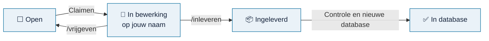

# Voortgang

> **In het kort:** wat er al in de Omnibus-database zit, wie waaraan werkt, en welke bronnen nog open staan. Deze pagina werkt zichzelf bij.

## Zo staat het ervoor

| | In database | In bewerking | Ingeleverd | Open |
| --- | ---: | ---: | ---: | ---: |
| **Aanbevolen rapporten** (ADR, advies) | 27 | 0 | 0 | 515 |
| **Alle rapporten op de Rijksmap** | 27 | 0 | 0 | 9089 |
| **Wetten en kaders** | 7 | 0 | 0 | 32 |
| **Onderzoeksmodellen** | 14 | | | |

Database van 2026-10-19.

## Nu in bewerking

Nog niemand. Wees de eerste: kies hieronder een bron.

## Waar kun je mee beginnen

Deze rapporten van de Auditdienst Rijk zijn **aanbevolen**: het zijn adviesrapporten met veel bruikbare normen en toetspunten. Klik op **Claimen** om er een op je naam te zetten.

| Rapport | Datum | Ministerie | |
| --- | --- | --- | --- |
| [Reviews in het kader van toezichtsbeleid JenV 2024 (verantwoordingen 2023)](https://www.rijksmap.nl/rapport/2026-reviews-in-het-kader-van-toezichtsbeleid-jenv-2024-verantwoordingen-2023/) | 2026-07-01 | Justitie en Veiligheid | [Claimen](https://github.com/Robert-Worm/omnibus/issues/new?template=bron-claimen.yml&title=Claim%3A%20Reviews%20in%20het%20kader%20van%20toezichtsbeleid%20JenV%202024%20(verantwoordingen%202023)&bron=https%3A%2F%2Fwww.rijksmap.nl%2Frapport%2F2026-reviews-in-het-kader-van-toezichtsbeleid-jenv-2024-verantwoordingen-2023%2F) |
| [Rapport Internal Audit - Evaluatie BI DJI 2019](https://www.rijksmap.nl/rapport/2026-rapport-internal-audit-evaluatie-bi-dji-2019/) | 2026-06-22 | Justitie en Veiligheid | [Claimen](https://github.com/Robert-Worm/omnibus/issues/new?template=bron-claimen.yml&title=Claim%3A%20Rapport%20Internal%20Audit%20-%20Evaluatie%20BI%20DJI%202019&bron=https%3A%2F%2Fwww.rijksmap.nl%2Frapport%2F2026-rapport-internal-audit-evaluatie-bi-dji-2019%2F) |
| [Nationaliteit in de Sociale Zekerheid (definitief rapport)](https://www.rijksmap.nl/rapport/2026-nationaliteit-in-de-sociale-zekerheid-definitief-rapport/) | 2026-05-13 | Sociale Zaken en Werkgelegenheid | [Claimen](https://github.com/Robert-Worm/omnibus/issues/new?template=bron-claimen.yml&title=Claim%3A%20Nationaliteit%20in%20de%20Sociale%20Zekerheid%20(definitief%20rapport)&bron=https%3A%2F%2Fwww.rijksmap.nl%2Frapport%2F2026-nationaliteit-in-de-sociale-zekerheid-definitief-rapport%2F) |
| [Onderzoek opbrengsten Octrooitaksen 2025](https://www.rijksmap.nl/rapport/2026-onderzoek-opbrengsten-octrooitaksen-2025/) | 2026-05-11 | Economische Zaken en Klimaat | [Claimen](https://github.com/Robert-Worm/omnibus/issues/new?template=bron-claimen.yml&title=Claim%3A%20Onderzoek%20opbrengsten%20Octrooitaksen%202025&bron=https%3A%2F%2Fwww.rijksmap.nl%2Frapport%2F2026-onderzoek-opbrengsten-octrooitaksen-2025%2F) |
| [Interim-auditrapport 2025 Centraal Justitieel Incassobureau (CJIB)](https://www.rijksmap.nl/rapport/2026-interim-auditrapport-2025-centraal-justitieel-incassobureau-cjib/) | 2026-05-11 | Justitie en Veiligheid | [Claimen](https://github.com/Robert-Worm/omnibus/issues/new?template=bron-claimen.yml&title=Claim%3A%20Interim-auditrapport%202025%20Centraal%20Justitieel%20Incassobureau%20(CJIB)&bron=https%3A%2F%2Fwww.rijksmap.nl%2Frapport%2F2026-interim-auditrapport-2025-centraal-justitieel-incassobureau-cjib%2F) |
| [Onderzoek invoering nieuwe document- en archiefvoorziening Belastingdienst](https://www.rijksmap.nl/rapport/2026-onderzoek-invoering-nieuwe-document-en-archiefvoorziening/) | 2026-05-06 | Financiën | [Claimen](https://github.com/Robert-Worm/omnibus/issues/new?template=bron-claimen.yml&title=Claim%3A%20Onderzoek%20invoering%20nieuwe%20document-%20en%20archiefvoorziening%20Belastingdienst&bron=https%3A%2F%2Fwww.rijksmap.nl%2Frapport%2F2026-onderzoek-invoering-nieuwe-document-en-archiefvoorziening%2F) |
| [Onderzoek naar de samenwerking in het vastgoedproces van CZSK](https://www.rijksmap.nl/rapport/2026-onderzoek-naar-de-samenwerking-in-het-vastgoedproces-van-czsk/) | 2026-04-28 | Defensie | [Claimen](https://github.com/Robert-Worm/omnibus/issues/new?template=bron-claimen.yml&title=Claim%3A%20Onderzoek%20naar%20de%20samenwerking%20in%20het%20vastgoedproces%20van%20CZSK&bron=https%3A%2F%2Fwww.rijksmap.nl%2Frapport%2F2026-onderzoek-naar-de-samenwerking-in-het-vastgoedproces-van-czsk%2F) |
| [Rapport Onderzoek Centraal Informatiepunt Onderzoek Telecommunicatie (CIOT) bij opsporing…](https://www.rijksmap.nl/rapport/2026-rapport-onderzoek-centraal-informatiepunt-onderzoek-telecommunicatie-2/) | 2026-03-31 | Justitie en Veiligheid | [Claimen](https://github.com/Robert-Worm/omnibus/issues/new?template=bron-claimen.yml&title=Claim%3A%20Rapport%20Onderzoek%20Centraal%20Informatiepunt%20Onderzoek%20Telecommunicatie%20(CIOT)%20bij%20opsporingsdienst%20Rijksrecherche%202025&bron=https%3A%2F%2Fwww.rijksmap.nl%2Frapport%2F2026-rapport-onderzoek-centraal-informatiepunt-onderzoek-telecommunicatie-2%2F) |
| [Rapport Onderzoek Centraal Informatiepunt Onderzoek Telecommunicatie (CIOT) bij opsporing…](https://www.rijksmap.nl/rapport/2026-rapport-onderzoek-centraal-informatiepunt-onderzoek-telecommunicatie/) | 2026-03-27 | Justitie en Veiligheid | [Claimen](https://github.com/Robert-Worm/omnibus/issues/new?template=bron-claimen.yml&title=Claim%3A%20Rapport%20Onderzoek%20Centraal%20Informatiepunt%20Onderzoek%20Telecommunicatie%20(CIOT)%20bij%20opsporingsdienst%20KMar%202025&bron=https%3A%2F%2Fwww.rijksmap.nl%2Frapport%2F2026-rapport-onderzoek-centraal-informatiepunt-onderzoek-telecommunicatie%2F) |
| [Onderzoek naar het convenant ter voorkoming recidive drugskoeriers](https://www.rijksmap.nl/rapport/2026-onderzoek-naar-het-convenant-ter-voorkoming-recidive-drugskoeriers/) | 2026-02-16 | Justitie en Veiligheid | [Claimen](https://github.com/Robert-Worm/omnibus/issues/new?template=bron-claimen.yml&title=Claim%3A%20Onderzoek%20naar%20het%20convenant%20ter%20voorkoming%20recidive%20drugskoeriers&bron=https%3A%2F%2Fwww.rijksmap.nl%2Frapport%2F2026-onderzoek-naar-het-convenant-ter-voorkoming-recidive-drugskoeriers%2F) |
| [Onderzoek database met administratieve vastleggingen van verzonden brieven en ontvangen r…](https://www.rijksmap.nl/rapport/2026-onderzoek-database-met-administratieve-vastleggingen-van-verzonden/) | 2026-02-04 | Financiën | [Claimen](https://github.com/Robert-Worm/omnibus/issues/new?template=bron-claimen.yml&title=Claim%3A%20Onderzoek%20database%20met%20administratieve%20vastleggingen%20van%20verzonden%20brieven%20en%20ontvangen%20reacties%20vanuit%20het%20massale%20uitv&bron=https%3A%2F%2Fwww.rijksmap.nl%2Frapport%2F2026-onderzoek-database-met-administratieve-vastleggingen-van-verzonden%2F) |
| [RAM-analyse Belastingdienst](https://www.rijksmap.nl/rapport/2026-ram-analyse-belastingdienst/) | 2026-01-21 | Financiën | [Claimen](https://github.com/Robert-Worm/omnibus/issues/new?template=bron-claimen.yml&title=Claim%3A%20RAM-analyse%20Belastingdienst&bron=https%3A%2F%2Fwww.rijksmap.nl%2Frapport%2F2026-ram-analyse-belastingdienst%2F) |
| [Accountantsrapport bij de Basisrapportage PALLAS-nieuwbouwprogramma](https://www.rijksmap.nl/rapport/2026-accountantsrapport-bij-de-basisrapportage-pallas-nieuwbouwprogramma/) | 2026-01-21 | Volksgezondheid, Welzijn en Sport | [Claimen](https://github.com/Robert-Worm/omnibus/issues/new?template=bron-claimen.yml&title=Claim%3A%20Accountantsrapport%20bij%20de%20Basisrapportage%20PALLAS-nieuwbouwprogramma&bron=https%3A%2F%2Fwww.rijksmap.nl%2Frapport%2F2026-accountantsrapport-bij-de-basisrapportage-pallas-nieuwbouwprogramma%2F) |
| [Onderzoek Beheer Verwijzingsportaal Bankgegevens Justid 2025 - Definitief](https://www.rijksmap.nl/rapport/2026-onderzoek-beheer-verwijzingsportaal-bankgegevens-justid-2025-definitief/) | 2026-01-13 | Justitie en Veiligheid | [Claimen](https://github.com/Robert-Worm/omnibus/issues/new?template=bron-claimen.yml&title=Claim%3A%20Onderzoek%20Beheer%20Verwijzingsportaal%20Bankgegevens%20Justid%202025%20-%20Definitief&bron=https%3A%2F%2Fwww.rijksmap.nl%2Frapport%2F2026-onderzoek-beheer-verwijzingsportaal-bankgegevens-justid-2025-definitief%2F) |
| [ADR-rapport Onderzoek naar het convenant ter voorkoming recidive drugskoeriers](https://www.rijksmap.nl/rapport/2026-adr-rapport-onderzoek-naar-het-convenant-ter-voorkoming-recidive/) | 2026-01-13 | Justitie en Veiligheid | [Claimen](https://github.com/Robert-Worm/omnibus/issues/new?template=bron-claimen.yml&title=Claim%3A%20ADR-rapport%20Onderzoek%20naar%20het%20convenant%20ter%20voorkoming%20recidive%20drugskoeriers&bron=https%3A%2F%2Fwww.rijksmap.nl%2Frapport%2F2026-adr-rapport-onderzoek-naar-het-convenant-ter-voorkoming-recidive%2F) |

Meer kiezen:

- [Alle 542 aanbevolen rapporten](werklijst-aanbevolen.csv): doorzoekbaar, met een claimlink per rapport.
- [Alle 9.116 rapporten van de Rijksmap](werklijst-rapporten.csv): CSV-bestand om te downloaden en te filteren.
- [Wetten en kaders](werklijst-wetten-en-kaders.md): per bron of je hem openbaar mag verwerken.

## Al in de database

<b>27 rapporten</b>

| Rapport | Datum | Ministerie |
| --- | --- | --- |
| [Verkenning van de niet tijdig uitgevoerde betalingen bij de indicator 'Tijdig betalen' va…](https://www.rijksmap.nl/rapport/2026-verkenning-van-de-niet-tijdig-uitgevoerde-betalingen-bij-de-indicator/) | 2026-07-22 | Financiën |
| [Verkennend onderzoek uitvoerbaarheidstoetsen IenW](https://www.rijksmap.nl/rapport/2026-verkennend-onderzoek-uitvoerbaarheidstoetsen-ienw/) | 2026-07-15 | Infrastructuur en Waterstaat |
| [Onderzoek informatieveiligheid en gedrag bij OCW](https://www.rijksmap.nl/rapport/2026-onderzoek-informatieveiligheid-en-gedrag-bij-ocw/) | 2026-07-14 | Onderwijs, Cultuur en Wetenschap |
| [Onderzoeksrapport Bevindingen onderzoeksopdracht back-up M365 Belastingdienst](https://www.rijksmap.nl/rapport/2026-onderzoeksrapport-bevindingen-onderzoeksopdracht-back-up-m365/) | 2026-07-09 | Financiën |
| [Sturing en Beheersing Programma Open Overheid - Spoor Informatiehuishouding](https://www.rijksmap.nl/rapport/2026-sturing-en-beheersing-programma-open-overheid-spoor/) | 2026-07-03 | Binnenlandse Zaken en Koninkrijksrelaties |
| [Onderzoek volwassenheid Informatiehuishouding - Oorzakenanalyse 'achterblijvers'](https://www.rijksmap.nl/rapport/2026-onderzoek-volwassenheid-informatiehuishouding-oorzakenanalyse/) | 2026-07-03 | Binnenlandse Zaken en Koninkrijksrelaties |
| [Samenwerkingsrelatie LVVN-RVO](https://www.rijksmap.nl/rapport/2026-samenwerkingsrelatie-lvvn-rvo/) | 2026-05-18 | Landbouw, Visserij, Voedselzekerheid en Natuur |
| [Onderzoeksrapport Skal Biocontrole augustus 2024 tot en met juli 2025](https://www.rijksmap.nl/rapport/2026-onderzoeksrapport-skal-biocontrole-augustus-2024-tot-en-met-juli-2025/) | 2026-05-13 | Landbouw, Visserij, Voedselzekerheid en Natuur |
| [Onderzoek Centraal Informatiepunt Onderzoek Telecommunicatie (CIOT) bij opsporingsdienst…](https://www.rijksmap.nl/rapport/2026-onderzoek-centraal-informatiepunt-onderzoek-telecommunicatie-ciot-bij/) | 2026-03-27 | Sociale Zaken en Werkgelegenheid |
| [Onderzoeksrapport Autoriteit Dierwaardige Veehouderij](https://www.rijksmap.nl/rapport/2026-onderzoeksrapport-autoriteit-dierwaardige-veehouderij/) | 2026-01-08 | Landbouw, Visserij, Voedselzekerheid en Natuur |
| [Duurzame Bedrijfsvoering - Leren van successen](https://www.rijksmap.nl/rapport/2025-duurzame-bedrijfsvoering-leren-van-successen/) | 2025-12-19 | Onderwijs, Cultuur en Wetenschap |
| [Evaluatie van de TEK-(crisis)regeling](https://www.rijksmap.nl/rapport/2025-evaluatie-van-de-tek-crisis-regeling/) | 2025-12-17 | Economische Zaken en Klimaat |
| [Evaluatie programma VIM; Vereenvoudiging Inkomensondersteuning voor Mensen](https://www.rijksmap.nl/rapport/2025-evaluatie-programma-vim-vereenvoudiging-inkomensondersteuning-voor/) | 2025-11-13 | Sociale Zaken en Werkgelegenheid |
| [Interne audit CO2-prestatieladder 2024 Ministerie Onderwijs, Cultuur en Wetenschap](https://www.rijksmap.nl/rapport/2025-interne-audit-co2-prestatieladder-2024-ministerie-onderwijs-cultuur-en/) | 2025-11-11 | Onderwijs, Cultuur en Wetenschap |
| [Onderzoeksrapport Bevindingen onderzoeksopdracht proces Cloudtoets Douane](https://www.rijksmap.nl/rapport/2025-onderzoeksrapport-bevindingen-onderzoeksopdracht-proces-cloudtoets/) | 2025-11-04 | Financiën |
| [Informatieverstrekking over de Bezoekfrequentie van de Inspectie van het Onderwijs aan sc…](https://www.rijksmap.nl/rapport/2025-informatieverstrekking-over-de-bezoekfrequentie-van-de-inspectie-van-het/) | 2025-10-02 | Onderwijs, Cultuur en Wetenschap |
| [De inrichting van regie op ERP-systemen](https://www.rijksmap.nl/rapport/2025-de-inrichting-van-regie-op-erp-systemen/) | 2025-10-02 | Rijksbreed |
| [Beheersing fraude- en corruptierisico’s](https://www.rijksmap.nl/rapport/2025-beheersing-fraude-en-corruptierisicos/) | 2025-10-02 | Rijksbreed |
| [Beheeronderzoek Begrotingsvoorbereiding](https://www.rijksmap.nl/rapport/2025-beheeronderzoek-begrotingsvoorbereiding/) | 2025-10-01 | Rijksbreed |
| [Risicogericht werken bij de ILT](https://www.rijksmap.nl/rapport/2025-risicogericht-werken-bij-de-ilt/) | 2025-09-05 | Infrastructuur en Waterstaat |
| [Onderzoek naar Basisonderhoudscontracten](https://www.rijksmap.nl/rapport/2025-onderzoek-naar-basisonderhoudscontracten/) | 2025-08-31 | Infrastructuur en Waterstaat |
| [Onderzoeksrapport Evaluatie programma Transitie DigiInkoop](https://www.rijksmap.nl/rapport/2025-onderzoeksrapport-evaluatie-programma-transitie-digiinkoop/) | 2025-07-31 | Binnenlandse Zaken en Koninkrijksrelaties |
| [Onderzoek naar de uitvoering van het Nederlandse HVP](https://www.rijksmap.nl/rapport/2025-onderzoek-naar-de-uitvoering-van-het-nederlandse-hvp/) | 2025-07-21 | Financiën |
| [Onderzoek BSA-contractvoorwaarden 2023-2024](https://www.rijksmap.nl/rapport/2025-onderzoek-bsa-contractvoorwaarden-2023-2024/) | 2025-07-17 | Binnenlandse Zaken en Koninkrijksrelaties |
| [Accountantsrapport bij de 25e voortgangsrapportage Groot project Verwerving F-35](https://www.rijksmap.nl/rapport/2025-accountantsrapport-bij-de-25e-voortgangsrapportage-groot-project/) | 2025-07-01 | Defensie |
| [Unit vitale belangen; terugkijken en vooruitkijken](https://www.rijksmap.nl/rapport/2025-unit-vitale-belangen-terugkijken-en-vooruitkijken/) | 2025-06-24 | Justitie en Veiligheid |
| [Onderzoeksrapport BIO-normen voor donorregister in ISMS - 2024 CIBG](https://www.rijksmap.nl/rapport/2025-onderzoeksrapport-bio-normen-voor-donorregister-in-isms-2024-cibg/) | 2025-06-23 | Volksgezondheid, Welzijn en Sport |

<b>7 wetten en kaders</b>

- Wet weerbaarheid kritieke entiteiten (Wwke)
- Besluit BVA-stelsel Rijksdienst 2021
- Besluit CIO-stelsel Rijksdienst 2026
- IIA Topical Requirement Cybersecurity
- IIA Topical Requirement Third-Party
- IIA Topical Requirement Organizational Behavior
- IIA Topical Requirement Organizational Resilience

## Zo werkt claimen

1. **Claimen (check-out):** klik op *Claimen* bij een bron. Er opent een kort formulier; na verzenden staat de bron op jouw naam.
2. **Verwerken:** volg [een bron verwerken](bron-verwerken.md).
3. **Inleveren (check-in):** schrijf `/inleveren` in een reactie op je claim.
4. **Controle:** de beheerder controleert het pakket. In de volgende databaserelease staat de bron op ✅.

Lukt het niet? Schrijf `/vrijgeven`, dan komt de bron weer vrij. Vragen stel je in [Discussions](https://github.com/Robert-Worm/omnibus/discussions).

*Automatisch bijgewerkt. De gegevens staan in `.github/voortgang/`; het script in `.github/scripts/voortgang.mjs`.*
