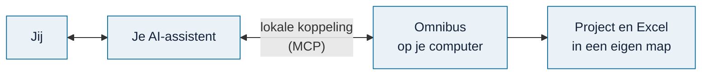
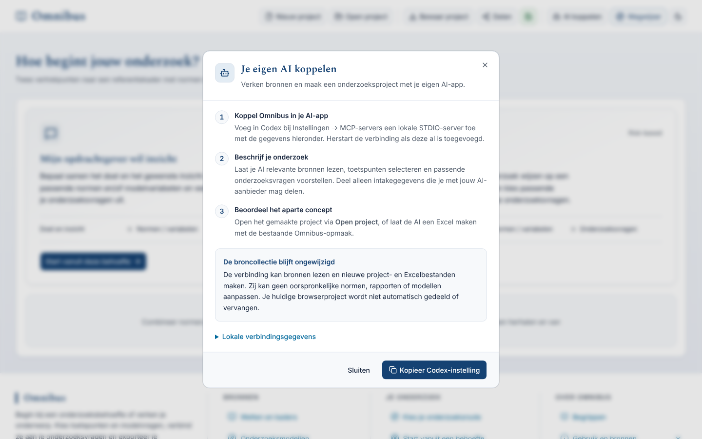

# Je eigen AI-assistent koppelen

<!-- paginatype: taak -->

> **In het kort:** je kunt een AI-assistent (zoals Codex of Claude) laten zoeken in Omnibus en een onderzoeksopzet laten voorbereiden. Dat gaat via een lokale koppeling op je eigen computer. Jij geeft akkoord voordat er iets wordt opgeslagen.

## Wat kan je AI-assistent dan?

- Zoeken in de rapporten, wetten, kaders en modellen in de database.
- Normen, toetspunten en bronpassages opvragen.
- Een onderzoeksopzet voorstellen: centrale vraag, deelvragen en gekozen bouwstenen, met uitleg waarom.
- Na jouw akkoord: het project en de Excel-bestanden opslaan, die je daarna in Omnibus opent met **Open project**.

Wat de assistent **niet** kan: de database aanpassen, bestanden lezen buiten Omnibus, of iets uploaden.

## Hoe werkt het?



De koppeling gebruikt **MCP** (Model Context Protocol), een standaard waarmee AI-assistenten hulpmiddelen kunnen gebruiken. Omnibus start geen AI-model en heeft geen abonnement nodig; dat regelt je AI-assistent zelf.

## Stap voor stap

### 1. Installeer Omnibus

Volg [installeren](installeren.md).

### 2. Bereid de koppeling voor

```text
npm run build:agent -- --settings local-data/runtime/local-build.json
```

### 3. Voeg Omnibus toe in je AI-assistent

Doe dit bij de MCP-instellingen van je assistent:

| Instelling | Waarde |
| --- | --- |
| Naam | `Omnibus` |
| Verbinding | STDIO (lokaal proces) |
| Programma | het pad naar Node op je computer |
| Argument | het pad naar `agent-tools/server.mjs` in je Omnibus-map |

De knop met het robotje rechtsboven in Omnibus (**AI koppelen**) laat de juiste paden voor jouw computer zien.

<picture>
  <source media="(prefers-color-scheme: dark)" srcset="../images/ai-koppelen-donker.png">
  
</picture>

*Het venster AI koppelen toont de juiste paden voor jouw computer.*

Je hebt twee paden nodig: waar Node staat, en waar `agent-tools/server.mjs` staat.

| Pad | Zo vind je het op macOS of Linux | Zo vind je het op Windows |
| --- | --- | --- |
| Node (24.21 of nieuwer) | `which node` | `where.exe node` of `(Get-Command node).Source` |
| De server | `<je Omnibus-map>/agent-tools/server.mjs` | `<je Omnibus-map>\agent-tools\server.mjs` |

**Codex** (de app in de terminal en de uitbreiding voor je editor):

```text
codex mcp add omnibus -- "<pad naar node>" "<pad naar server.mjs>"
codex mcp list
```

Gebruik volledige paden en houd de aanhalingstekens: een mapnaam kan spaties bevatten. `mcp list` toont dat de koppeling **ingesteld** is; dat bewijst nog geen werkende verbinding. `Auth Unsupported` bij deze lokale koppeling is op zichzelf geen fout: Omnibus vraagt hier geen aanmelding.

Het [configuratievoorbeeld](../../agent-tools/codex-connection.example.toml) voor `~/.codex/config.toml` stelt ook de wachttijden en bevestiging voor schrijftools in. De bovenstaande opdracht neemt die extra instellingen niet over. Voeg ze zelf toe volgens het voorbeeld en behoud je andere instellingen. Open daarna een gesprek en controleer de actieve verbinding met `/mcp`.

**Gelukt als:** de [leesproef hieronder](#4-controleer-de-verbinding) slaagt. De [officiële MCP-uitleg](https://learn.chatgpt.com/docs/extend/mcp) beschrijft de configuratie voor Codex en de desktopapp.

**Claude Desktop:**

1. Kies in het menu van Claude **Settings → Developer → Edit Config**. Dat opent `claude_desktop_config.json`.
2. Voeg Omnibus toe onder `mcpServers`, met je eigen volledige paden. Behoud bestaande servers. In JSON schrijf je Windows-paden met `/` of dubbele `\\`, bijvoorbeeld `C:/Program Files/nodejs/node.exe`.

   ```json
   {
     "mcpServers": {
       "omnibus": { "command": "<pad naar node>", "args": ["<pad naar server.mjs>"] }
     }
   }
   ```

3. Sluit Claude Desktop helemaal af en open het opnieuw.

**Gelukt als:** de [leesproef hieronder](#4-controleer-de-verbinding) slaagt. Ontbreekt Omnibus, controleer dan de paden en de komma's in het configuratiebestand.

**Claude Code:**

```text
claude mcp add --transport stdio --scope user omnibus -- "<pad naar node>" "<pad naar server.mjs>"
claude mcp list
```

Met `--scope user` werkt Omnibus in elke map waarin je Claude Code start; zonder alleen in de huidige map. Zie de [officiële Claude Code-uitleg](https://code.claude.com/docs/en/mcp). **Gelukt als:** de lijst **Connected** toont en de leesproef hieronder slaagt.

**ChatGPT:**

- **Desktop met lokale MCP-instellingen:** open **Settings → MCP servers → Add server**, kies STDIO en vul de twee paden uit de tabel in. Bewaar en kies **Restart**. Deze route deelt de configuratie met Codex op dezelfde computer; voeg Omnibus niet nogmaals toe als het er al staat. Controleer daarna met `/mcp` en de leesproef hieronder. Zie de [officiële uitleg per omgeving](https://learn.chatgpt.com/docs/extend/mcp).
- **Web of een omgeving zonder lokale MCP-instellingen:** deze lokale opdracht is daar niet beschikbaar. De Omnibus-route via een online server staat nog open in [#149](https://github.com/Robert-Worm/omnibus/issues/149). Zet de lokale koppeling niet zelf open op internet.

### 4. Controleer de verbinding

Vraag je assistent: *“Gebruik Omnibus: haal eerst `get_workflow_guide` op en daarna `list_sources`. Geef de collectie-identiteit en het aantal bronnen terug. Maak of bewaar nog geen project.”*

**Gelukt als:** beide hulpmiddelen echt zijn uitgevoerd en de collectie overeenkomt met jouw lokale Omnibus. Alleen een servernaam of lijst met hulpmiddelen is niet genoeg. Werkt een aanroep niet, controleer dan de Node-versie, beide paden en stap 2; herstart daarna de verbinding. Voor deze leesproef hoef je niets op te slaan of te publiceren.

Begin daarna met een opdracht als: *"Gebruik Omnibus om voor dit onderwerp een onderzoeksopzet te maken. Bespreek eerst de afbakening, lees de bronbeperkingen en vraag mijn akkoord voordat je iets opslaat."*

## Goed om te weten

> [!WARNING]
> **Let op:** wat je deelt, gaat naar je AI-dienst. Werkt je assistent in de cloud, dan gelden de voorwaarden van die dienst. Deel alleen wat je mag delen.

- **Nieuwe collectie geïnstalleerd?** Bereid de koppeling opnieuw voor met dezelfde database-instellingen als de website. Controleer dat je AI-assistent naar deze installatie verwijst en herstart de MCP-verbinding. Anders kan hij nog de vorige collectie gebruiken. Zie de [technische controle](../../agent-tools/README.md#browser-en-mcp-na-een-nieuwe-collectie-gelijkzetten).
- **Alleen lokaal.** Een AI-omgeving die uitsluitend internetadressen accepteert, kan deze STDIO-koppeling niet gebruiken.
- **Controleer het voorstel.** De assistent kiest bouwstenen op basis van zoekresultaten. Beoordeel zelf of ze passen.

## Samengevat

- Een lokale koppeling laat je AI-assistent zoeken en voorstellen doen.
- De database blijft ongewijzigd; opslaan gebeurt alleen na jouw akkoord.
- Technische details staan in [`agent-tools/`](../../agent-tools/README.md).

## Volgende stap

Probeer het met een klein onderwerp, en open het resultaat met **Open project** in Omnibus.

---

[↑ Omnibus gebruiken](README.md) · [Wegwijzer](../README.md) · [Begrippen](../begrippen.md) · [Routekaart](../routekaart.md)
