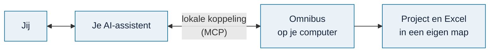

# Je eigen AI-assistent koppelen

> **In het kort:** je kunt een AI-assistent (zoals Codex of Claude) laten zoeken in Omnibus en een onderzoeksopzet laten voorbereiden. Dat gaat via een lokale koppeling op je eigen computer. Jij geeft akkoord voordat er iets wordt opgeslagen.

## Wat kan je AI-assistent dan?

- Zoeken in de rapporten, wetten, kaders en modellen in de database.
- Normen, toetspunten en bronpassages opvragen.
- Een onderzoeksopzet voorstellen: centrale vraag, deelvragen en gekozen bouwstenen, met uitleg waarom.
- Na jouw akkoord: het project en de Excel-bestanden opslaan, die je daarna in Omnibus opent met **Open project**.

Wat de assistent **niet** kan: de database aanpassen, bestanden lezen buiten Omnibus, of iets uploaden.

## Hoe werkt het?



De koppeling gebruikt **MCP** (Model Context Protocol), een standaard waarmee AI-assistenten hulpmiddelen kunnen gebruiken. Omnibus start geen AI-model en heeft geen abonnement nodig; dat regelt je AI-assistent zelf.

## Koppelen in drie stappen

1. **Installeer Omnibus** volgens [installeren](installeren.md).
2. **Bereid de koppeling voor:**

   ```text
   npm run build:agent -- --settings local-data/runtime/local-build.json
   ```

3. **Voeg Omnibus toe in je AI-assistent**, bij de MCP-instellingen:

   | Instelling | Waarde |
   | --- | --- |
   | Naam | `Omnibus` |
   | Verbinding | STDIO (lokaal proces) |
   | Programma | het pad naar Node op je computer |
   | Argument | het pad naar `agent-tools/server.mjs` in je Omnibus-map |

   De knop met het robotje rechtsboven in Omnibus (**AI koppelen**) laat de juiste paden voor jouw computer zien.

Begin daarna met een opdracht als: *"Gebruik Omnibus om voor dit onderwerp een onderzoeksopzet te maken. Bespreek eerst de afbakening, lees de bronbeperkingen en vraag mijn akkoord voordat je iets opslaat."*

## Let op

**Nieuwe collectie geïnstalleerd?** Bereid de koppeling opnieuw voor met dezelfde
database-instellingen als de website. Controleer dat je AI-assistent naar deze
installatie verwijst en herstart de MCP-verbinding. Anders kan hij nog de vorige
collectie gebruiken. Zie de [technische controle](../../agent-tools/README.md#browser-en-mcp-na-een-nieuwe-collectie-gelijkzetten).

- **Wat je deelt, gaat naar je AI-dienst.** Werkt je assistent in de cloud, dan gelden de voorwaarden van die dienst. Deel alleen wat je mag delen.
- **Alleen lokaal.** De koppeling werkt niet met AI-diensten die alleen een internetadres accepteren.
- **Controleer het voorstel.** De assistent kiest bouwstenen op basis van zoekresultaten. Beoordeel zelf of ze passen.

## Samengevat

- Een lokale koppeling laat je AI-assistent zoeken en voorstellen doen.
- De database blijft ongewijzigd; opslaan gebeurt alleen na jouw akkoord.
- Technische details staan in [`agent-tools/`](../../agent-tools/README.md).

## Volgende stap

Probeer het met een klein onderwerp, en open het resultaat met **Open project** in Omnibus.

---

[↑ Wegwijzer](../README.md) · [Begrippen](../begrippen.md) · [Routekaart](../routekaart.md)
