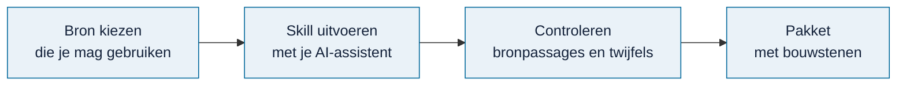

# Eigen documenten gebruiken

<!-- paginatype: taak -->

> **In het kort:** je kunt een eigen rapport, wet of kader omzetten naar bouwstenen voor Omnibus met een AI-skill. Een pdf laad je niet direct in de applicatie; je zet hem eerst om.

## Wat kan er?

- De meegeleverde database gebruiken.
- Een eigen document omzetten naar normen en toetspunten, met een AI-skill.
- Dat document openbaar toevoegen aan de database, via [meedoen](../bijdragen/README.md).

## Hoe zet je een document om?

1. **Kies een bron die je mag verwerken.** Noteer de precieze versie of editie.
2. **Gebruik de passende skill** met je AI-assistent:
   - rapport → [`omnibus-add-report`](../../skills/omnibus-add-report/README.md)
   - wet of kader → [`omnibus-add-framework`](../../skills/omnibus-add-framework/README.md)
   - onderzoeksmodel → [`omnibus-add-model`](../../skills/omnibus-add-model/README.md)
3. **Controleer het resultaat.** De skill laat bij elke norm de bronpassage zien en markeert twijfels.
4. **Je hebt nu een pakket** met normen, toetspunten en bronverwijzingen.

Zo ziet een verwerkte bron er straks uit in Omnibus: links de norm en het toetspunt, rechts de oorspronkelijke tekst met de passage gemarkeerd.

<picture>
  <source media="(prefers-color-scheme: dark)" srcset="../images/bronpassage-donker.png">
  
</picture>

*Een norm met de onderbouwende passage geel gemarkeerd in het rapport.*

Wil je je eigen documenten in Omnibus gebruiken, alleen op je computer? De skill [`omnibus-build-local-database`](../../skills/omnibus-build-local-database/README.md) begeleidt je stap voor stap van pdf tot eigen database.

Wil je dat pakket met anderen delen? Lever het in via [een bron verwerken](../bijdragen/bron-verwerken.md). De beheerder controleert het en neemt het op in de volgende database.

## Goed om te weten

> [!WARNING]
> **Let op:** zet geen vertrouwelijke documenten in GitHub, in een issue of in een pull request.

- **Rechten.** Openbaar beschikbaar is niet hetzelfde als vrij te gebruiken. Wetten en Europese regels mag je gebruiken; voor ISO, COBIT en vergelijkbare normen heb je toestemming van de uitgever nodig. Zie de [werklijst wetten en kaders](../bijdragen/werklijst-wetten-en-kaders.md).
- **AI in de cloud.** Gebruik je een AI-dienst in de cloud, dan verlaat het document je computer. Controleer of dat mag volgens het beleid van je organisatie.
- **AI maakt fouten.** AI kan verplichtingen verkeerd lezen of uitzonderingen missen. Controleer de bronpassages altijd zelf. Een score of technische controle is geen juridisch advies.

## Samengevat

- Een eigen document omzetten kan nu al, met een AI-skill.
- Een pdf laad je niet direct in de applicatie; je zet hem eerst om.
- Let op rechten, vertrouwelijkheid en de grenzen van AI.

## Volgende stap

Bekijk de [AI-skills](../../skills/README.md) en kies de skill die bij je document past.

---

[↑ Omnibus gebruiken](README.md) · [Wegwijzer](../README.md) · [Begrippen](../begrippen.md) · [Routekaart](../routekaart.md)
