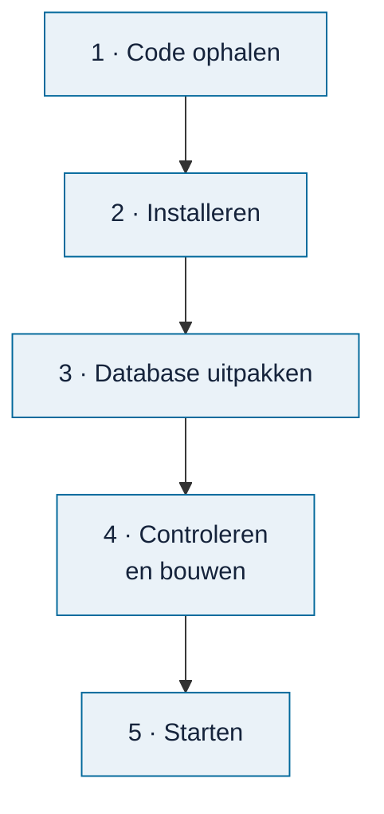

# Omnibus installeren

<!-- paginatype: taak -->

> **In het kort:** probeer Omnibus online, of zet hem op je eigen computer met Docker, met één opdracht of stap voor stap. Op je eigen computer draait alles lokaal.

## Kies je route

| Route | Wat je nodig hebt | Rechten | Tijd |
| --- | --- | --- | --- |
| [Online proberen](#online-proberen) | Alleen een browser | Geen | 1 minuut |
| [Met Docker](#met-docker) | Docker | Installatierechten | 5 minuten, plus 15 voor Docker |
| [Met één opdracht](#met-één-opdracht) | Git en Node.js | Installatierechten | 10 minuten, plus 10 voor Git en Node.js |
| [Stap voor stap](#stap-voor-stap) | Git, Node.js en de database-zip | Installatierechten | 15 minuten, plus 10 voor Git en Node.js |

De extra tijd geldt alleen als Git, Node.js of Docker nog niet op je computer staat.

**Mag je op je werklaptop niets installeren?** Gebruik dan de online versie, of vraag je IT-afdeling om Docker of Node.js 24.21 of hoger. Let op: grote organisaties hebben voor Docker Desktop vaak een betaalde licentie nodig.

Online en met één opdracht krijg je de nieuwste code. Die wordt bij elke wijziging getest en is goed voor gewoon gebruik. Wil je precies de vrijgegeven versie 0.1.0? Kies dan Docker.

Wil je Omnibus gewoon gebruiken? Kies dan Docker of één opdracht. De route *stap voor stap* is voor wie wil zien wat er gebeurt, of zelf aan de code werkt.

Applicatieversie [0.1.0](https://github.com/Robert-Worm/omnibus/releases/tag/v0.1.0) hoort bij de [database van 19 oktober 2026](https://github.com/Robert-Worm/omnibus/releases/tag/database-2026-10-19); die combinatie is samen getest. [GitHub test de installatie](https://github.com/Robert-Worm/omnibus/actions/workflows/installatie.yml) met één opdracht op Windows, macOS en Linux, elke maand en bij elke wijziging. Je hebt geen account of internetverbinding nodig zodra alles is geïnstalleerd.

## Online proberen

Open de [proefversie online](https://omnibus.rijksmap.nl). Je hoeft niets te installeren. Je werk blijft in je eigen browser; de server bewaart niets van je onderzoek. Gebruik **Bewaar project** om het mee te nemen.

De proefversie draait de nieuwste code met de [database van 29 oktober 2026 met de WWKE-aanvulling](https://github.com/Robert-Worm/omnibus/releases/tag/database-2026-10-29-correctie). Werk je met vertrouwelijke stukken? Lees dan eerst [wat lokaal blijft](lokale-privacy.md).

**Gelukt als:** je het startscherm van Omnibus ziet. Laadt de pagina niet? Probeer het over een paar minuten opnieuw, of [vraag om hulp](https://github.com/Robert-Worm/omnibus/discussions/new?category=hulp).

## Nog nooit een terminal gebruikt?

De routes hieronder werken met opdrachten die je in een terminal typt of plakt:

1. **Open de terminal.** Windows: klik op Start, typ `PowerShell` en druk op Enter. macOS: open *Terminal* via Spotlight (Cmd + spatie).
2. **Plak de opdracht** en druk op Enter. Wacht tot er niets meer gebeurt of tot je het adres ziet.
3. **Laat het venster open** zolang je Omnibus gebruikt. Stoppen doe je met Ctrl + C.

Liever geen terminal? Gebruik dan de [online versie](#online-proberen).

## Git, Node.js of Docker installeren

Staat het programma al op je computer? Sla dit dan over.

- **Node.js:** kies op [nodejs.org](https://nodejs.org/) versie 24.21 of hoger. Windows: de *Windows Installer* (`.msi`). macOS: de *macOS Installer* (`.pkg`). Houd de standaardopties aan.
- **Git:** download het bij [git-scm.com](https://git-scm.com/) en houd de standaardopties aan.
- **Docker Desktop:** download het bij [docker.com](https://www.docker.com/products/docker-desktop/). Op Windows vraagt Docker vaak om WSL 2 en een herstart van je computer.

**Gelukt als:** je na het opnieuw openen van de terminal `node --version` typt en `v24.21` of hoger ziet (bijvoorbeeld `v24.22.0`), en `git --version` een versie toont.

## Met Docker

**Wat heb je nodig?** [Docker](https://www.docker.com/products/docker-desktop/). Git, Node.js en de database-zip heb je dan niet nodig. Start Docker Desktop eerst en wacht tot het *Engine running* toont.

```text
docker build -t omnibus -f hosting/container/Dockerfile https://github.com/Robert-Worm/omnibus.git#v0.1.0
docker run --rm -p 8080:8080 omnibus
```

Docker haalt de code van versie 0.1.0 op, downloadt de bijbehorende database, controleert hem en bouwt alles in één keer. Het bouwen duurt ongeveer vijf minuten en toont veel Engelse regels; het is klaar als je weer kunt typen. Laat na `docker run` het venster open. Meer uitleg staat bij [online zetten in een container](../../hosting/container/README.md).

**Gelukt als:** je Omnibus ziet op `http://localhost:8080`. Gebruik precies dit adres; `127.0.0.1:8080` werkt hier niet. Een andere poort? Zie [problemen oplossen](problemen-oplossen.md#de-browser-toont-host-not-allowed).

## Met één opdracht

**Wat heb je nodig?** [Git](https://git-scm.com/) en [Node.js 24.21](https://nodejs.org/). Eén opdracht doet de rest: hij installeert de onderdelen, haalt de database op, controleert hem, bouwt Omnibus en start hem.

Deze route installeert de nieuwste code, niet versie 0.1.0. GitHub test die bij elke wijziging op Windows, macOS en Linux.

**Windows (PowerShell)**

```powershell
git clone https://github.com/Robert-Worm/omnibus.git; cd omnibus; node scripts/installeer.mjs
```

**macOS en Linux (bash)**

```bash
git clone https://github.com/Robert-Worm/omnibus.git && cd omnibus && node scripts/installeer.mjs
```

Onderweg zie je vijf stappen, van `[1/5] Node.js controleren` tot `[5/5] Omnibus starten`. Stap 2 en 4 duren een paar minuten. Gaat er iets mis, dan zegt de opdracht wat je moet doen.

**Gelukt als:** je de regel `Open http://127.0.0.1:4319/ in je browser` ziet, en Omnibus op dat adres opent. `http://localhost:4319/` werkt ook. Kies één van beide en blijf die gebruiken: elk adres heeft zijn eigen opslag in de browser.

**Een volgende keer starten:** open de terminal en typ deze twee regels. Wat al klaar is, slaat de opdracht over.

```text
cd omnibus
node scripts/installeer.mjs
```

## Stap voor stap

Deze route is voor ontwikkelaars, of voor wie precies wil zien wat er gebeurt.

**Wat heb je nodig?**

| Wat | Waarom | Hoe controleer je het |
| --- | --- | --- |
| [Git](https://git-scm.com/) | Om de code op te halen | `git --version` |
| [Node.js 24.21](https://nodejs.org/) met npm 11.19 (zie `.nvmrc`) | Om Omnibus te bouwen en te starten | `node --version` en `npm --version` |
| De database-zip | De inhoud: rapporten, wetten, kaders en modellen | Download bij de [releases](https://github.com/Robert-Worm/omnibus/releases/latest) |



### 1. Haal de code op

```text
git clone https://github.com/Robert-Worm/omnibus.git
cd omnibus
```

### 2. Installeer de onderdelen

```text
npm ci --ignore-scripts --no-audit --no-fund
```

Dit duurt een paar minuten. npm haalt de bibliotheken op die Omnibus gebruikt.

**Gelukt als:** npm eindigt zonder `ERR!`.

### 3. Pak de database uit

Download `omnibus-database-*.zip` bij de [nieuwste release](https://github.com/Robert-Worm/omnibus/releases/latest) (10 MB; uitgepakt ongeveer 90 MB). Maak de map `local-data/runtime/` aan (die zit niet in Git) en pak de zip daarin uit. Let op: Verkenner en Finder maken bij uitpakken vaak een extra map met de naam van de zip. Verplaats de bestanden dan één map omhoog.

```text
mkdir local-data/runtime
```

Daar staan dan:

- `catalogue.sqlite`: de database;
- `local-build.json`: de instellingen, met twee controlegetallen (hashes) die bij deze database horen.

**Gelukt als:** beide bestanden rechtstreeks in `local-data/runtime/` staan, niet in een extra map.

### 4. Controleer en bouw

```text
npm run data:check-runtime -- --settings local-data/runtime/local-build.json
npm run build -- --settings local-data/runtime/local-build.json
```

De eerste opdracht controleert of de database compleet en ongewijzigd is. De tweede bouwt de applicatie.

**Gelukt als:** je na de eerste opdracht `VERIFIED_RUNTIME_DATABASE` ziet, en de tweede zonder foutmelding eindigt.

### 5. Start Omnibus

```text
npm start -- --settings local-data/runtime/local-build.json --port 4319
```

Open daarna <http://127.0.0.1:4319/> in je browser. Stoppen doe je met `Ctrl+C`.

**Gelukt als:** je het startscherm ziet:

<picture>
  <source media="(prefers-color-scheme: dark)" srcset="../images/omnibus-overview-donker.png">
  
</picture>

*Het startscherm na een geslaagde installatie.*

## Bijwerken

Bewaar eerst je onderzoek met **Bewaar project** en stop Omnibus met `Ctrl+C` in het venster waarin hij draait. Gebruik na het bijwerken dezelfde browser, adresnaam en poort. Met **Open project** kun je het bewaarde projectbestand openen.

Nieuwe code verandert de applicatie; een nieuwe database verandert de beschikbare bronnen. Een nieuwe database kan een nieuwere applicatieversie nodig hebben. Gebruik de combinatie die de release noemt, of vraag de beheerder welke combinatie is getest. Een nieuwe database past niet vanzelf bij oudere code. Stop bij een mislukte controle; pas nooit de controlegetallen aan.

| Je wilt… | Lees |
| --- | --- |
| Je Docker-installatie bijwerken | [Docker bijwerken](#docker-bijwerken): opnieuw bouwen met de code en database van de gekozen versie |
| De route met één opdracht bijwerken | [Code bijwerken met Git](#code-bijwerken-met-git), en zo nodig de uitleg **Eén opdracht** bij [database vervangen](#database-vervangen) |
| Een handmatige installatie bijwerken | [Code bijwerken met Git](#code-bijwerken-met-git), en zo nodig de uitleg **Stap voor stap** bij [database vervangen](#database-vervangen) |

### Docker bijwerken

Vervang `<versietag>` door de vrijgegeven versie uit het [overzicht van releases](https://github.com/Robert-Worm/omnibus/releases), bijvoorbeeld `v0.1.0`. Opnieuw bouwen met dezelfde tag kiest geen nieuwere code of database.

```text
docker build -t omnibus -f hosting/container/Dockerfile https://github.com/Robert-Worm/omnibus.git#<versietag>
docker run --rm -p 8080:8080 omnibus
```

Start pas na een geslaagde bouw. Alleen de oude container herstarten neemt de nieuwe code en database niet over. Gebruik je een eigen poort of `PUBLIC_ORIGIN`? Neem die instellingen over uit je vorige startopdracht. Een andere database meegeven bij het bouwen is voor beheerders; zie [de containeruitleg](../../hosting/container/README.md#een-nieuwe-database-online-zetten).

### Code bijwerken met Git

De twee Git-routes hierboven halen de nieuwste code op, die verder kan zijn dan versie 0.1.0. Open een terminal in je bestaande map `omnibus`. Voer de opdrachten één voor één uit; ga alleen door als de vorige is gelukt:

```text
git pull --ff-only
npm ci --ignore-scripts --no-audit --no-fund
```

De tweede opdracht vernieuwt de bibliotheken. De installer slaat aanwezige bibliotheken over, dus alleen de installer opnieuw starten is hiervoor niet genoeg. Gebruik je bewust een vaste release of eigen codewijzigingen? Laat de beheerder de passende versie kiezen als Git weigert.

Vervang zo nodig eerst de database, zoals hieronder beschreven. Daarna controleer, bouw en start je opnieuw:

- **Eén opdracht:** voer `node scripts/installeer.mjs` uit.
- **Stap voor stap:** voer [stap 4](#4-controleer-en-bouw) en [stap 5](#5-start-omnibus) opnieuw uit.

### Database vervangen

**Eén opdracht:** hernoem de map `local-data/runtime` in Verkenner of Finder naar een vrije naam, bijvoorbeeld `runtime-vorig`. Laat die oude map staan. Voer daarna `node scripts/installeer.mjs` uit. Zonder bestaande databasemap haalt de installer de database op die in jouw code is vastgelegd. Dat is niet automatisch de nieuwste database. Met een bestaande map gebruikt hij die opnieuw.

**Stap voor stap:** kies de database die bij jouw code past. Neem de downloadlink en het SHA-256-controlegetal van de zip over uit die release. Vervang `<zip-url>` en `<sha256>` hieronder. De map `local-data/runtime-nieuw` mag nog niet bestaan.

```text
node scripts/fetch-release-database.mjs --url <zip-url> --sha256 <sha256> --out local-data/runtime-nieuw
npm run data:check-runtime -- --settings local-data/runtime-nieuw/local-build.json
```

Ga alleen door na `VERIFIED_RUNTIME_DATABASE`. Hernoem in Verkenner of Finder de oude map `local-data/runtime` naar een vrije naam, bijvoorbeeld `runtime-vorig`. Hernoem daarna `runtime-nieuw` naar `runtime`. Houd `catalogue.sqlite` en `local-build.json` uit hetzelfde pakket bij elkaar. Voer nu [stap 4](#4-controleer-en-bouw) en [stap 5](#5-start-omnibus) opnieuw uit.

**Gelukt als:** de controle en bouw slagen, Omnibus opnieuw start en je bewaarde onderzoek opent. Bewaar de oude databasemap totdat dit gelukt is.

## Goed om te weten

- **Je werk wordt in je browser bewaard.** Dat is geen back-up. Gebruik **Bewaar project** om een projectbestand te downloaden, en **Open project** om het weer te openen.
- **Gebruik altijd hetzelfde adres.** Open het adres dat de terminal toont, en gebruik daarna steeds dat adres. Elk adres heeft eigen browseropslag. Neem je onderzoek mee met **Bewaar project** en **Open project**.
- **Nieuwe code of database?** Volg jouw route in de tabel [Bijwerken](#bijwerken).
- **Iets gaat mis?** Kijk bij [problemen bij installeren en starten](problemen-oplossen.md). Kom je er niet uit? Vraag dan om [hulp](problemen-oplossen.md#kom-je-er-niet-uit).

## Samengevat

Kies je route. Online proberen kan direct, zonder installatie. Docker of één opdracht is de snelste weg naar Omnibus op je eigen computer. Stap voor stap is voor wie wil zien wat er gebeurt: code ophalen, installeren, de database uitpakken in `local-data/runtime/`, controleren, bouwen en starten.

## Volgende stap

Lees [werken met Omnibus](werken-met-omnibus.md) voor een rondleiding door de vier stappen.

---

[↑ Omnibus gebruiken](README.md) · [Wegwijzer](../README.md) · [Begrippen](../begrippen.md) · [Routekaart](../routekaart.md)
