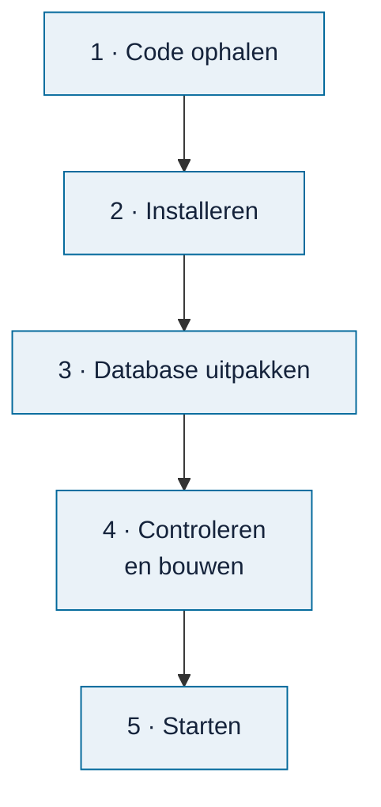

# Omnibus installeren

<!-- paginatype: taak -->

> **In het kort:** probeer Omnibus online, of zet hem op je eigen computer met Docker, met één opdracht of stap voor stap. Op je eigen computer draait alles lokaal.

## Kies je route

| Route | Wat je nodig hebt | Rechten | Tijd |
| --- | --- | --- | --- |
| [Online proberen](#online-proberen) | Alleen een browser | Geen | 1 minuut |
| [Met Docker](#met-docker) | Docker | Installatierechten | 5 minuten |
| [Met één opdracht](#met-één-opdracht) | Git en Node.js | Installatierechten | 10 minuten |
| [Stap voor stap](#stap-voor-stap) | Git, Node.js en de database-zip | Installatierechten | 15 minuten |

**Mag je op je werklaptop niets installeren?** Gebruik dan de online versie, of vraag je IT-afdeling om Docker of Node.js 24. Let op: grote organisaties hebben voor Docker Desktop vaak een betaalde licentie nodig.

Wil je Omnibus gewoon gebruiken? Kies dan Docker of één opdracht. De route *stap voor stap* is voor wie wil zien wat er gebeurt, of zelf aan de code werkt.

Applicatieversie [0.1.0](https://github.com/Robert-Worm/omnibus/releases/tag/v0.1.0) hoort bij de [database van 19 oktober 2026](https://github.com/Robert-Worm/omnibus/releases/tag/database-2026-10-19); die combinatie is samen getest. [GitHub test de installatie](https://github.com/Robert-Worm/omnibus/actions/workflows/installatie.yml) met één opdracht op Windows, macOS en Linux, elke maand en bij elke wijziging. Je hebt geen account of internetverbinding nodig zodra alles is geïnstalleerd.

## Online proberen

Open de [proefversie online](https://omnibus.sliplane.app). Je hoeft niets te installeren. Je werk blijft in je eigen browser; de server bewaart niets van je onderzoek. Gebruik **Bewaar project** om het mee te nemen.

## Nog nooit een terminal gebruikt?

De routes hieronder werken met opdrachten die je in een terminal typt of plakt:

1. **Open de terminal.** Windows: klik op Start, typ `PowerShell` en druk op Enter. macOS: open *Terminal* via Spotlight (Cmd + spatie).
2. **Plak de opdracht** en druk op Enter. Wacht tot er niets meer gebeurt of tot je het adres ziet.
3. **Laat het venster open** zolang je Omnibus gebruikt. Stoppen doe je met Ctrl + C.

Liever geen terminal? Gebruik dan de [online versie](#online-proberen).

## Met Docker

**Wat heb je nodig?** [Docker](https://www.docker.com/products/docker-desktop/). Git, Node.js en de database-zip heb je dan niet nodig. Start Docker Desktop eerst en wacht tot het klaar is.

```text
docker build -t omnibus -f hosting/container/Dockerfile https://github.com/Robert-Worm/omnibus.git#v0.1.0
docker run --rm -p 8080:8080 omnibus
```

Docker haalt de code van versie 0.1.0 op, downloadt de bijbehorende database, controleert hem en bouwt alles in één keer. Meer uitleg staat bij [online zetten in een container](../../hosting/container/README.md).

**Gelukt als:** je Omnibus ziet op `http://localhost:8080`.

## Met één opdracht

**Wat heb je nodig?** [Git](https://git-scm.com/) en [Node.js 24.21](https://nodejs.org/). Eén opdracht doet de rest: hij installeert de onderdelen, haalt de database op, controleert hem, bouwt Omnibus en start hem.

**Windows (PowerShell)**

```powershell
git clone https://github.com/Robert-Worm/omnibus.git; cd omnibus; node scripts/installeer.mjs
```

**macOS en Linux (bash)**

```bash
git clone https://github.com/Robert-Worm/omnibus.git && cd omnibus && node scripts/installeer.mjs
```

Gaat er iets mis, dan zegt de opdracht wat je moet doen.

**Gelukt als:** je Omnibus ziet op `http://127.0.0.1:4319/`. Typ het adres precies zo; `localhost:4319` werkt hier niet.

**Een volgende keer starten:** open de terminal en typ deze twee regels. Wat al klaar is, slaat de opdracht over.

```text
cd omnibus
node scripts/installeer.mjs
```

## Stap voor stap

Deze route is voor ontwikkelaars, of voor wie precies wil zien wat er gebeurt.

**Wat heb je nodig?**

| Wat | Waarom | Hoe controleer je het |
| --- | --- | --- |
| [Git](https://git-scm.com/) | Om de code op te halen | `git --version` |
| [Node.js 24.21](https://nodejs.org/) met npm 11.19 (zie `.nvmrc`) | Om Omnibus te bouwen en te starten | `node --version` en `npm --version` |
| De database-zip | De inhoud: rapporten, wetten, kaders en modellen | Download bij de [releases](https://github.com/Robert-Worm/omnibus/releases/latest) |



### 1. Haal de code op

```text
git clone https://github.com/Robert-Worm/omnibus.git
cd omnibus
```

### 2. Installeer de onderdelen

```text
npm ci --ignore-scripts --no-audit --no-fund
```

Dit duurt een paar minuten. npm haalt de bibliotheken op die Omnibus gebruikt.

**Gelukt als:** npm eindigt zonder `ERR!`.

### 3. Pak de database uit

Download `omnibus-database-*.zip` bij de [nieuwste release](https://github.com/Robert-Worm/omnibus/releases/latest) (10 MB; uitgepakt ongeveer 90 MB). Maak de map `local-data/runtime/` aan (die zit niet in Git) en pak de zip daarin uit:

```text
mkdir local-data/runtime
```

Daar staan dan:

- `catalogue.sqlite`: de database;
- `local-build.json`: de instellingen, met twee controlegetallen (hashes) die bij deze database horen.

**Gelukt als:** beide bestanden rechtstreeks in `local-data/runtime/` staan, niet in een extra map.

### 4. Controleer en bouw

```text
npm run data:check-runtime -- --settings local-data/runtime/local-build.json
npm run build -- --settings local-data/runtime/local-build.json
```

De eerste opdracht controleert of de database compleet en ongewijzigd is. De tweede bouwt de applicatie.

**Gelukt als:** je na de eerste opdracht `VERIFIED_RUNTIME_DATABASE` ziet, en de tweede zonder foutmelding eindigt.

### 5. Start Omnibus

```text
npm start -- --settings local-data/runtime/local-build.json --port 4319
```

Open daarna <http://127.0.0.1:4319/> in je browser. Stoppen doe je met `Ctrl+C`.

**Gelukt als:** je het startscherm ziet:

<picture>
  <source media="(prefers-color-scheme: dark)" srcset="../images/omnibus-overview-donker.png">
  
</picture>

*Het startscherm na een geslaagde installatie.*

## Goed om te weten

- **Je werk wordt in je browser bewaard.** Dat is geen back-up. Gebruik **Bewaar project** om een projectbestand te downloaden, en **Open project** om het weer te openen.
- **Gebruik altijd hetzelfde adres.** Op je eigen computer is dat `http://127.0.0.1:4319/`; `localhost` weigert Omnibus. Een andere poort heeft een eigen opslag. Met Docker is het juist `http://localhost:8080/`.
- **Nieuwe database?** Pak de nieuwe zip uit, en voer stap 4 en 5 opnieuw uit.
- **Iets gaat mis?** Kijk bij [problemen bij installeren en starten](problemen-oplossen.md). Kom je er niet uit? Vraag dan om [hulp](problemen-oplossen.md#kom-je-er-niet-uit).

## Samengevat

Kies je route. Online proberen kan direct, zonder installatie. Docker of één opdracht is de snelste weg naar Omnibus op je eigen computer. Stap voor stap is voor wie wil zien wat er gebeurt: code ophalen, installeren, de database uitpakken in `local-data/runtime/`, controleren, bouwen en starten.

## Volgende stap

Lees [werken met Omnibus](werken-met-omnibus.md) voor een rondleiding door de vier stappen.

---

[↑ Omnibus gebruiken](README.md) · [Wegwijzer](../README.md) · [Begrippen](../begrippen.md) · [Routekaart](../routekaart.md)
