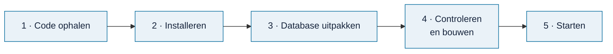

# Omnibus installeren

> **In het kort:** je haalt de code op, downloadt de database, bouwt de applicatie en opent hem in je browser. Alles draait op je eigen computer.

## Wat heb je nodig?

| Wat | Waarom | Hoe controleer je het |
| --- | --- | --- |
| [Git](https://git-scm.com/) | Om de code op te halen | `git --version` |
| [Node.js 24.17](https://nodejs.org/) met npm 11.13 | Om Omnibus te bouwen en te starten | `node --version` en `npm --version` |
| De database-zip | De inhoud: rapporten, wetten, kaders en modellen | Download bij de [releases](https://github.com/Robert-Worm/omnibus/releases/latest) |

Omnibus werkt op Windows, macOS en Linux. Je hebt geen account of internetverbinding nodig zodra alles is geïnstalleerd.

## Stap voor stap



### 1. Haal de code op

```text
git clone https://github.com/Robert-Worm/omnibus.git
cd omnibus
```

### 2. Installeer de onderdelen

```text
npm ci --workspaces=false --ignore-scripts --no-audit --no-fund
```

Dit duurt een paar minuten. npm haalt de bibliotheken op die Omnibus gebruikt.

### 3. Pak de database uit

Download `omnibus-database-*.zip` bij de [nieuwste release](https://github.com/Robert-Worm/omnibus/releases/latest). Pak de zip uit in de map `local-data/runtime/`. Daar staan dan:

- `catalogue.sqlite`: de database;
- `local-build.json`: de instellingen, met twee controlegetallen (hashes) die bij deze database horen.

### 4. Controleer en bouw

```text
npm run data:check-runtime -- --settings local-data/runtime/local-build.json
npm run build -- --settings local-data/runtime/local-build.json
```

De eerste opdracht controleert of de database compleet en ongewijzigd is. Je ziet dan `VERIFIED_RUNTIME_DATABASE`. De tweede bouwt de applicatie.

### 5. Start Omnibus

```text
npm start -- --settings local-data/runtime/local-build.json --port 4319
```

Open daarna <http://127.0.0.1:4319/> in je browser. Stoppen doe je met `Ctrl+C`.

## Goed om te weten

- **Je werk wordt in je browser bewaard.** Dat is geen back-up. Gebruik **Bewaar project** om een projectbestand te downloaden, en **Open project** om het weer te openen.
- **Elk adres heeft zijn eigen opslag.** `127.0.0.1:4319` en `localhost:4319` zien elkaars projecten niet. Gebruik steeds hetzelfde adres.
- **Nieuwe database?** Pak de nieuwe zip uit, en voer stap 4 en 5 opnieuw uit.
- **Iets gaat mis?** Kijk bij [problemen oplossen](../bijdragen/ontwikkelen.md#problemen-oplossen), of stel je vraag in [Discussions](https://github.com/Robert-Worm/omnibus/discussions).

## Samengevat

1. Code ophalen en installeren.
2. Database-zip uitpakken in `local-data/runtime/`.
3. Controleren, bouwen en starten.
4. Openen op <http://127.0.0.1:4319/>.

## Volgende stap

Lees [werken met Omnibus](werken-met-omnibus.md) voor een rondleiding door de vier stappen.
