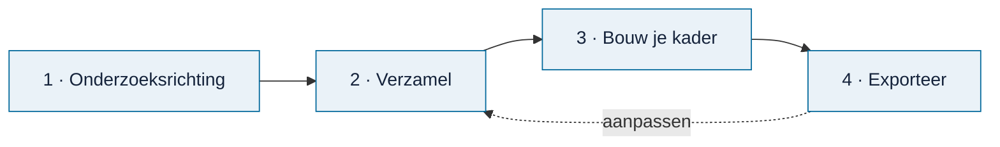

# Werken met Omnibus

> **In het kort:** Omnibus leidt je in vier stappen van een onderzoeksvraag naar een toetsingskader in Excel. Je kunt steeds terug naar een eerdere stap; je werk blijft bewaard.

## Wat maak je?

Een **toetsingskader** (in Omnibus: *referentiekader*). Dat is de set normen en toetspunten waarmee je een organisatie, proces of onderwerp onderzoekt, gekoppeld aan je onderzoeksvragen.

Een paar begrippen:

| Begrip | Betekenis |
| --- | --- |
| **Norm** | Waar de organisatie aan zou moeten voldoen. Bijvoorbeeld: *vertrouwelijke informatie wordt alleen via goedgekeurde kanalen gedeeld*. |
| **Toetspunt** | Een concrete controle die bij een norm hoort: wat je bekijkt om te beoordelen of de norm wordt gehaald. |
| **Bouwsteen** | Verzamelnaam voor alles wat je kunt kiezen: normen, toetspunten en modelvragen. |
| **Bron** | Waar een bouwsteen vandaan komt: een rapport, een wet, een kader of een onderzoeksmodel. |

## De vier stappen

### 1. Onderzoeksrichting

Kies hoe je begint:

- **Vraaggestuurd:** je opdrachtgever wil iets weten. Je bepaalt samen het doel en het gewenste inzicht.
- **Risk-based:** er zijn signalen of zorgen. Je verkent eerst het thema of proces en de risico's.

Beide routes komen uit bij hetzelfde kader. Je kunt later van route wisselen.

### 2. Verzamel

Blader door de bronnen en kies wat je nodig hebt:

- **Wetten en kaders:** wettelijke eisen en normenkaders.
- **Onderzoeksmodellen:** bekende modellen, zoals COM-B of de Fraud Diamond, met interviewvragen.
- **Thema's en processen:** normen uit alle bronnen, geordend per onderwerp.
- **Rapportbibliotheek:** de oorspronkelijke rapporten, met hun normen en toetspunten.

Bij elke norm zie je de samenhang tussen doel, risico, beheersdoelstelling en beheersmaatregel. Je kiest losse toetspunten, een hele norm of een hele groep.

Twijfel je over een norm? Open de bron. Je leest dan de oorspronkelijke tekst, met de passage gemarkeerd.

### 3. Bouw je kader

Schrijf je centrale onderzoeksvraag en deelvragen. Koppel de gekozen bouwstenen aan de vraag waarbij ze horen. Dat kan op twee manieren:

- **Zelf formuleren:** je schrijft de vragen, met voorbeelden als hulp.
- **Vanuit je selectie:** Omnibus doet een voorstel op basis van wat je hebt gekozen. Jij past het aan.

### 4. Exporteer

Kies een werkvorm voor je Excel-bestand:

| Werkvorm | Wanneer |
| --- | --- |
| **Normtoetsing** | Je toetst normen, legt bewijs vast en vormt een oordeel. |
| **Risico-controlmatrix** | Je werkt van doel en risico naar beheersing en toetsing. |
| **Interviewleidraad** | Je verkent een onderwerp met vragen, voorbeelden en doorvragen. |

Alleen de indeling van het Excel-bestand verschilt. Je vragen en koppelingen blijven hetzelfde.

## Je werk bewaren en delen

| Knop | Wat het doet |
| --- | --- |
| **Bewaar project** | Downloadt je project als bestand. Doe dit regelmatig: browseropslag is geen back-up. |
| **Open project** | Opent een eerder bewaard projectbestand. |
| **Delen** | Maakt een bestand dat je naar een collega kunt sturen. |
| **Nieuw project** | Begint opnieuw. Bewaar eerst je huidige project. |

## Samengevat

- Kies een route, verzamel bouwstenen, koppel ze aan je vragen en exporteer.
- Bij elke bouwsteen kun je de bron lezen.
- Bewaar je project als bestand; de browser is geen back-up.
- Het oordeel of een norm geldt, en of eraan wordt voldaan, blijft bij jou.

## Volgende stap

Wil je met je eigen rapporten of kaders werken? Lees [eigen documenten](eigen-documenten.md).
