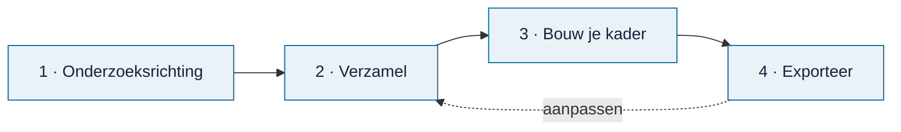
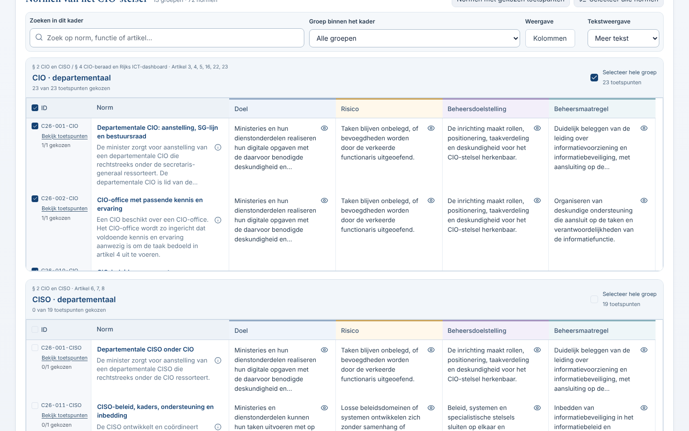
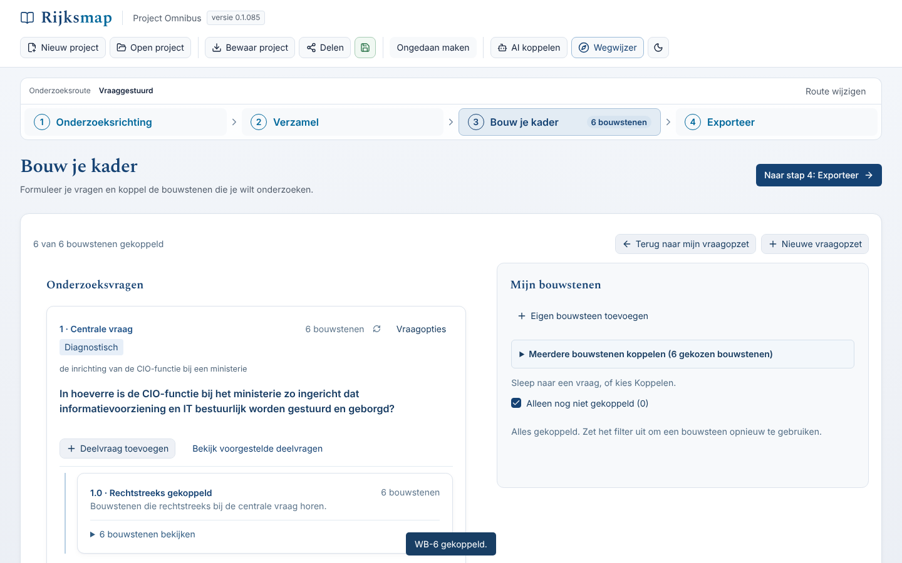

# Werken met Omnibus

<!-- paginatype: taak -->

> **In het kort:** Omnibus leidt je in vier stappen van een onderzoeksvraag naar een referentiekader in Excel. Je kunt steeds terug naar een eerdere stap; je werk blijft bewaard.

## Wat maak je?

Een **referentiekader**. Dat is de set normen en toetspunten waarmee je een organisatie, proces of onderwerp onderzoekt, gekoppeld aan je onderzoeksvragen.

Een paar begrippen:

| Begrip | Betekenis |
| --- | --- |
| Norm | Waar de organisatie aan zou moeten voldoen. Bijvoorbeeld: *vertrouwelijke informatie wordt alleen via goedgekeurde kanalen gedeeld*. |
| Toetspunt | Een concrete controle die bij een norm hoort: wat je bekijkt om te beoordelen of de norm wordt gehaald. |
| Bouwsteen | Verzamelnaam voor alles wat je kunt kiezen: normen, toetspunten en modelvragen. |
| Bron | Waar een bouwsteen vandaan komt: een rapport, een wet, een kader of een onderzoeksmodel. |

## Stap voor stap

Omnibus werkt in vier stappen. De koppen hieronder volgen de stappen in Omnibus.

### 1. Kies je onderzoeksrichting

Kies hoe je begint:

- **Vraaggestuurd:** je opdrachtgever wil iets weten. Je bepaalt samen het doel en het gewenste inzicht.
- **Risk-based:** er zijn signalen of zorgen. Je verkent eerst het thema of proces en de risico's.

Beide routes komen uit bij hetzelfde kader. Je kunt later van route wisselen.

<picture>
  <source media="(prefers-color-scheme: dark)" srcset="../images/omnibus-overview-donker.png">
  
</picture>

*Het startscherm met de twee routes.*

Na je keuze geef je de onderzoeksrichting en het onderwerp op:

<picture>
  <source media="(prefers-color-scheme: dark)" srcset="../images/stap-1-onderzoeksrichting-donker.png">
  
</picture>

*Stap 1: kies de onderzoeksrichting en vul het onderwerp in.*

### 2. Verzamel

Blader door de bronnen en kies wat je nodig hebt:

- **Wetten en kaders:** wettelijke eisen en normenkaders.
- **Onderzoeksmodellen:** bekende modellen, zoals COM-B of de Fraud Diamond, met interviewvragen.
- **Thema's en processen:** normen uit alle bronnen, geordend per onderwerp.

Elk overzicht heeft twee weergaven; je kiest ze rechts in de kop, ook in stap 1. Je keuze geldt voor alle overzichten. Met **Tegels** blader je per categorie. Met **Lijst** zie je alles in één tabel: je kunt zoeken, filteren, groeperen en sorteren op een kolomkop. Bij wetten en kaders zie je in de lijst ook de familie (bronnen die bij elkaar horen, zoals DORA), de soort, de vaste ID, de uitgever en vanaf wanneer de bron geldt. In de kolom **Voor wie** staat per doelgroep een symbool, bijvoorbeeld voor de rijksdienst, de financiële sector of toezichthouders. Wijs een symbool aan om de uitleg te lezen; met het filter *Voor wie* toon je alleen de bronnen voor één doelgroep. Een vinkje kiest alle toetspunten van een bron; open de bron als je er een paar wilt kiezen. Op een smal scherm, zoals een telefoon, zie je alleen de tegels.

Bij thema's en processen zie je in de lijst twee dingen in één oogopslag. **Soort proces** laat met een symbool zien of het om een primair proces gaat (dikke rand, bijvoorbeeld beleid, uitvoering of toezicht) of om een ondersteunend proces (dunne rand, bijvoorbeeld financiën, inkoop of ICT). **Rapporten** toont met streepjes uit hoeveel rapporten de bouwstenen komen; wijs het aan om te zien welke rapporten dat zijn en bij welke ministeries is onderzocht. Bij modellen laat **Helpt bij** met symbolen zien waarvoor je het model kunt gebruiken, bijvoorbeeld gedrag begrijpen of verandering begeleiden. De indelingen zijn bedoeld als oriëntatie.
- **Rapportbibliotheek:** de oorspronkelijke rapporten, met hun normen en toetspunten.

Bij elke norm zie je de samenhang tussen doel, risico, beheersdoelstelling en beheersmaatregel. Je kiest losse toetspunten, een hele norm of een hele groep.

<picture>
  <source media="(prefers-color-scheme: dark)" srcset="../images/stap-2-verzamel-donker.png">
  
</picture>

*Stap 2: normen uit het Besluit CIO-stelsel, met gekozen toetspunten.*

Twijfel je over een norm? Open de bron. Je leest dan de oorspronkelijke tekst, met de passage gemarkeerd.

### 3. Bouw je kader

Schrijf je centrale onderzoeksvraag en deelvragen. Koppel de gekozen bouwstenen aan de vraag waarbij ze horen. Dat kan op twee manieren:

- **Zelf formuleren:** je schrijft de vragen, met voorbeelden als hulp.
- **Vanuit je selectie:** Omnibus doet een voorstel op basis van wat je hebt gekozen. Jij past het aan.

<picture>
  <source media="(prefers-color-scheme: dark)" srcset="../images/stap-3-bouw-je-kader-donker.png">
  
</picture>

*Stap 3: de centrale onderzoeksvraag met zes gekoppelde bouwstenen.*

### 4. Exporteer

Kies een werkvorm voor je Excel-bestand:

| Werkvorm | Wanneer |
| --- | --- |
| Normtoetsing | Je toetst normen, legt bewijs vast en vormt een oordeel. |
| Risico-controlmatrix | Je werkt van doel en risico naar beheersing en toetsing. |
| Interviewleidraad | Je verkent een onderwerp met vragen, voorbeelden en doorvragen. |

Alleen de indeling van het Excel-bestand verschilt. Je vragen en koppelingen blijven hetzelfde. Bekijk de drie werkvormen in het [voorbeeld](https://github.com/Robert-Worm/omnibus/releases/download/database-2026-10-19/omnibus-voorbeeld.zip); het projectbestand daarin open je met **Open project**.

Bij een kader met normen staat standaard het blad **Verantwoording referentiekader** aan. Daarop vul je vier vragen in: welke criteria de organisatie zelf had, waarom dit kader adequaat is, met wie het is afgestemd en wie het heeft goedgekeurd. Bij elke vraag staat de eis uit de Global Internal Audit Standards (standaard 13.4 en 13.6). Je kunt het blad uitzetten onder **Extra blad**.

<picture>
  <source media="(prefers-color-scheme: dark)" srcset="../images/stap-4-exporteer-donker.png">
  
</picture>

*Stap 4: kies een werkvorm en download je referentiekader.*

**Gelukt als:** je Excel-bestand is gedownload.

## Je werk bewaren en delen

| Knop | Wat het doet |
| --- | --- |
| Bewaar project | Downloadt je project als bestand. Doe dit regelmatig: browseropslag is geen back-up. |
| Open project | Opent een eerder bewaard projectbestand. |
| Delen | Legt uit hoe je een kopie aan een collega geeft: het projectbestand, zonder de app en brondocumenten. Jullie werken daarna in aparte kopieën. |
| Nieuw project | Begint opnieuw. Bewaar eerst je huidige project. |

## Samengevat

- Kies een route, verzamel bouwstenen, koppel ze aan je vragen en exporteer.
- Bij elke bouwsteen kun je de bron lezen.
- Bewaar je project als bestand; de browser is geen back-up.
- Het oordeel of een norm geldt, en of eraan wordt voldaan, blijft bij jou.

## Volgende stap

Wil je met je eigen rapporten of kaders werken? Lees [eigen documenten](eigen-documenten.md).

---

[↑ Omnibus gebruiken](README.md) · [Wegwijzer](../README.md) · [Begrippen](../begrippen.md) · [Routekaart](../routekaart.md)
