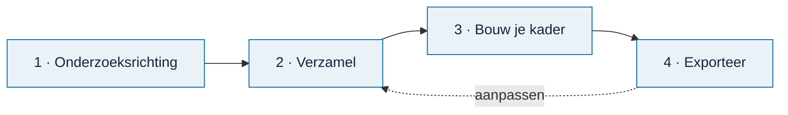
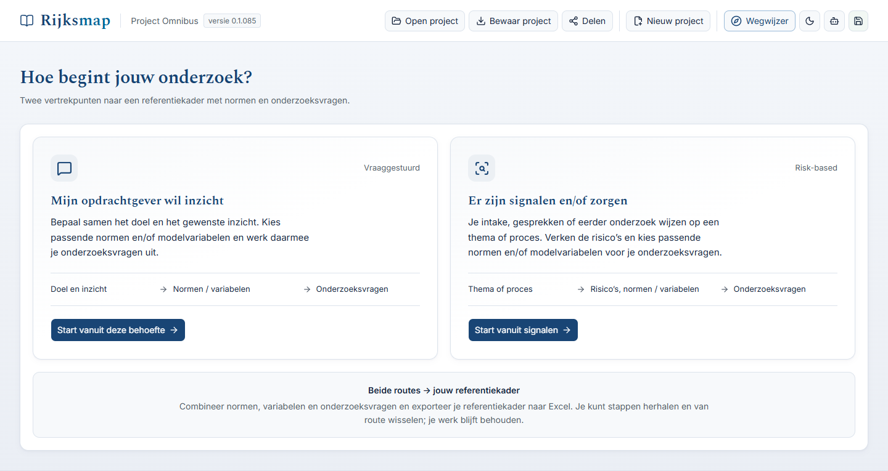
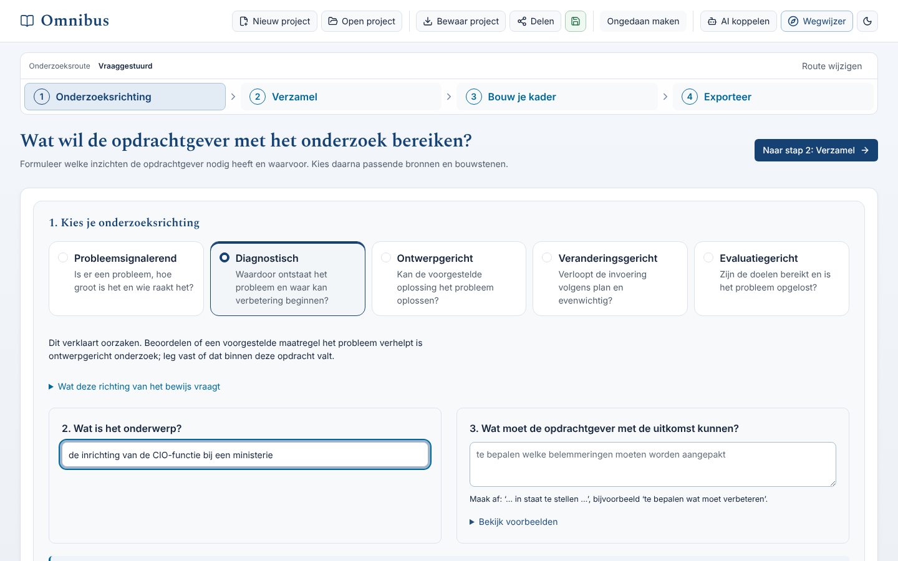
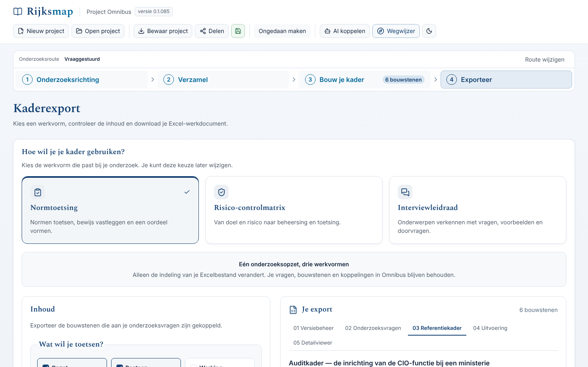

# Werken met Omnibus

<!-- paginatype: taak -->

> **In het kort:** Omnibus leidt je in vier stappen van een onderzoeksvraag naar een referentiekader in Excel. Je kunt steeds terug naar een eerdere stap; je werk blijft bewaard.

## Wat maak je?

Een **referentiekader**. Dat is de set normen en toetspunten waarmee je een organisatie, proces of onderwerp onderzoekt, gekoppeld aan je onderzoeksvragen.

Een paar begrippen:

| Begrip | Betekenis |
| --- | --- |
| Norm | Waar de organisatie aan zou moeten voldoen. Bijvoorbeeld: *vertrouwelijke informatie wordt alleen via goedgekeurde kanalen gedeeld*. |
| Toetspunt | Een concrete controle die bij een norm hoort: wat je bekijkt om te beoordelen of de norm wordt gehaald. |
| Bouwsteen | Wat je gekozen hebt voor je kader: een toetspunt, modelvraag of eigen bouwsteen. Een gekozen toetspunt is een bouwsteen. |
| Bron | Een document waaruit je normen of vragen kiest, zoals een wet, kader, rapport of model. Wet en kader zijn soorten bronnen. |

## Stap voor stap

Omnibus werkt in vier stappen. De koppen hieronder volgen de stappen in Omnibus.

### 1. Kies je onderzoeksrichting

Kies hoe je begint:

- **Vraaggestuurd:** je opdrachtgever wil iets weten. Je bepaalt samen het doel en het gewenste inzicht.
- **Risk-based:** er zijn signalen of zorgen. Je verkent eerst het thema of proces en de risico's.

Beide routes komen uit bij hetzelfde kader. Je kunt later van route wisselen.

<picture>
  <source media="(prefers-color-scheme: dark)" srcset="../images/omnibus-overview-donker.png">
  
</picture>

*Het startscherm met de twee routes.*

Na je keuze geef je de onderzoeksrichting en het onderwerp op:

<picture>
  <source media="(prefers-color-scheme: dark)" srcset="../images/stap-1-onderzoeksrichting-donker.png">
  
</picture>

*Stap 1: kies de onderzoeksrichting en vul het onderwerp in.*

### 2. Verzamel

Blader door de bronnen en kies wat je nodig hebt:

- **Wetten en kaders:** wettelijke eisen en normenkaders.
- **Onderzoeksmodellen:** bekende modellen, zoals COM-B of de Fraud Diamond, met interviewvragen.
- **Thema's en processen:** normen uit alle bronnen, geordend per onderwerp.

Elk overzicht heeft twee weergaven; je kiest ze rechts in de kop, ook in stap 1. Je keuze geldt voor alle overzichten. Met **Tegels** blader je per categorie. Met **Lijst** zie je alles in één tabel: je kunt zoeken, filteren, groeperen en sorteren op een kolomkop. Bij wetten en kaders zie je in de lijst ook de familie (bronnen die bij elkaar horen, zoals DORA), de soort, de vaste ID, de uitgever en vanaf wanneer de bron geldt. In de kolom **Voor wie** staat per doelgroep een symbool, bijvoorbeeld voor de rijksdienst, de financiële sector of toezichthouders. Wijs een symbool aan om de uitleg te lezen; met het filter *Voor wie* toon je alleen de bronnen voor één doelgroep. Een vinkje kiest alle toetspunten van een bron; open de bron als je er een paar wilt kiezen. Op een smal scherm, zoals een telefoon, zie je alleen de tegels.

Bij thema's en processen zie je in de lijst twee dingen in één oogopslag. **Soort proces** laat met een symbool zien of het om een primair proces gaat (dikke rand, bijvoorbeeld beleid, uitvoering of toezicht) of om een ondersteunend proces (dunne rand, bijvoorbeeld financiën, inkoop of ICT). **Rapporten** toont met streepjes uit hoeveel rapporten de bouwstenen komen; wijs het aan om te zien welke rapporten dat zijn en bij welke ministeries is onderzocht. Bij modellen laat **Helpt bij** met symbolen zien waarvoor je het model kunt gebruiken, bijvoorbeeld gedrag begrijpen of verandering begeleiden. Onder de naam van een model staat de auteur; **Soort model** zegt of het uit de wetenschappelijke literatuur komt of uit de praktijk (bedrijfskundig) en **Sinds** noemt het jaar van de eerste publicatie. Thema's en processen staan standaard gegroepeerd op soort proces, eerst de primaire en dan de ondersteunende. Wijs in de lijst een naam aan om de omschrijving te lezen. Elk model, thema en proces heeft een vaste ID onder de naam, bijvoorbeeld MOD-KAD, TH-03 of PR-12, net als wetten (bijvoorbeeld EU 2024/1773). Je kunt op zo'n ID zoeken; "pr12" of "PR 12" werkt ook. Wetten en kaders staan standaard gegroepeerd op categorie; via **Groeperen op** kies je ook familie. De indelingen zijn bedoeld als oriëntatie.
- **Rapportbibliotheek:** de oorspronkelijke rapporten als compacte lijst, nieuwste bovenaan. Klik op een titel om het rapport te lezen; met **Normen bekijken** zie je de normen en toetspunten.

Bij elke norm zie je de samenhang tussen doel, risico, beheersdoelstelling en beheersmaatregel. Je kiest losse toetspunten, een hele norm of een hele groep.

<picture>
  <source media="(prefers-color-scheme: dark)" srcset="../images/stap-2-verzamel-donker.png">
  
</picture>

*Stap 2: normen uit het Besluit CIO-stelsel, met gekozen toetspunten.*

Twijfel je over een norm? Open de bron. Je leest dan de oorspronkelijke tekst, met de passage gemarkeerd.

### 3. Bouw je kader

Schrijf je centrale onderzoeksvraag en deelvragen. Koppel de gekozen bouwstenen aan de vraag waarbij ze horen. Dat kan op twee manieren:

- **Zelf formuleren:** je schrijft de vragen, met voorbeelden als hulp.
- **Vanuit je selectie:** Omnibus doet een voorstel op basis van wat je hebt gekozen. Jij past het aan.

<picture>
  <source media="(prefers-color-scheme: dark)" srcset="../images/stap-3-bouw-je-kader-donker.png">
  
</picture>

*Stap 3: de centrale onderzoeksvraag met zes gekoppelde bouwstenen.*

### 4. Exporteer

Kies een werkvorm voor je Excel-bestand:

| Werkvorm | Wanneer |
| --- | --- |
| Normtoetsing | Je toetst normen, legt bewijs vast en vormt een oordeel. |
| Risico-controlmatrix | Je werkt van doel en risico naar beheersing en toetsing. |
| Interviewleidraad | Je verkent een onderwerp met vragen, voorbeelden en doorvragen. |

Alleen de indeling van het Excel-bestand verschilt. Je vragen en koppelingen blijven hetzelfde. Bekijk de drie werkvormen in het [voorbeeld](https://github.com/Robert-Worm/omnibus/releases/download/database-2026-10-19/omnibus-voorbeeld.zip); het projectbestand daarin open je met **Open project**.

Bouwstenen die je niet aan een vraag hebt gekoppeld, gaan standaard mee: Omnibus zet ze bij een verwante deelvraag of onder je centrale vraag. Wil je dat niet, zet dan in stap 4 onder **Inhoud** het vinkje **Koppel bouwstenen zonder onderzoeksvraag automatisch** uit. Onder **Excel-opties** kies je de toetslabels (Nederlands of Engels) en of het blad *Verantwoording referentiekader* meekomt.

Een **risico-controlmatrix** kun je ook zonder onderzoeksvragen exporteren, bijvoorbeeld direct na stap 2. Alle gekozen bouwstenen gaan dan mee en het blad *Onderzoeksvragen* vervalt. Voor een normtoetsing of interviewleidraad maak je eerst vragen in stap 3.

Bij een kader met normen kun je onder **Excel-opties** het blad **Verantwoording referentiekader** aanzetten. Het staat standaard uit. Daarop vul je vier vragen in: welke criteria de organisatie zelf had, waarom dit kader adequaat is, met wie het is afgestemd en wie het heeft goedgekeurd. Bij elke vraag staat de eis uit de Global Internal Audit Standards (standaard 13.4 en 13.6). Het blad is alleen nodig als je volgens die standaarden werkt. Welke bouwstenen meegaan, kies je in stap 3; de kleuren en het lettertype staan onder **Vormgeving**, dat je openklapt.

<picture>
  <source media="(prefers-color-scheme: dark)" srcset="../images/stap-4-exporteer-donker.png">
  
</picture>

*Stap 4: kies een werkvorm en download je referentiekader.*

**Gelukt als:** je Excel-bestand is gedownload.

## DORA per onderwerp

Wil je één onderwerp tegen DORA toetsen, bijvoorbeeld incidentmanagement? De eisen staan dan in de verordening en in meerdere uitvoeringsregelingen. Het filter **Onderwerp** zet ze bij elkaar.

1. Zoek of filter zo dat je vooral DORA-bronnen ziet, bijvoorbeeld **Voor wie**: Financiële sector, of zoeken op *incident*. Het filter **Onderwerp** verschijnt dan in de balk, in de **Lijst** en boven de **Tegels**. Kies je een onderwerp, dan is dat de selectie: de lijst toont de bronnen van dat onderwerp; **Uitgever** en **Voor wie** blijven staan, alleen de zoekterm gaat uit. Wissel je tussen **Lijst** en **Tegels**, dan blijven je filters staan; met een onderwerp tonen de tegels de bronnen van dat onderwerp. Zet je het onderwerp terug op *Alle onderwerpen*, dan zie je weer alles binnen je andere filters, en boven de tegels springt Omnibus naar de lijst. Zit je in de viewer van één DORA-bron en kies je daar een onderwerp, dan brengt de link **Bekijk dit onderwerp in alle … DORA-bronnen** je naar dat onderwerp in alle bronnen. In het onderwerp zelf vertelt het tabblad **Over dit onderwerp** wat erin zit en wat niet, en uit welke bronnen.
2. Kies een onderwerp. Het getal erachter is het aantal toetspunten. De lijst toont de wetten en kaders met normen voor dat onderwerp; de kolom **Gekozen toetspunten** telt alleen dat onderwerp. Klik nog een keer op het onderwerp om het filter uit te zetten.
3. Klik op **Kies alle toetspunten** boven de lijst, of zet een vinkje bij de bronnen die je wilt.
4. Klik op **Open in viewer** om alle normen van het onderwerp onder elkaar te lezen, per bron een sectie. Het onderwerp staat dan onder **Open wetten & kaders**, naast de bronnen die je los opent. Wat je daar kiest, is ook in de bron zelf gekozen.

Na je keuze staan onder de onderwerpen de opties:

- **Vereenvoudigd kader (art. 16)**: voor de kleine instellingen uit artikel 16. Het vervangt het volledige kader van de artikelen 5 tot en met 15.
- **Ook verwante normen**: normen die bij een ander onderwerp horen maar hier ook over gaan.
- **Ook sectorspecifieke normen**: normen voor één soort instelling, zoals een centrale tegenpartij of handelsplatform. Het vinkje staat er alleen als het onderwerp zulke normen heeft.
- **NOREA in plaats van de wet**: neem NOREA DORA in Control als toetsgrondslag. **Kies alle toetspunten** kiest dan NOREA. Had je voor dit onderwerp al toetspunten uit de wet gekozen, dan vraagt Omnibus of die vervangen moeten worden; beide kiezen geeft dubbele toetspunten.

Zit je al in een bron? Kies daar bij **Onderwerp** wat je zoekt en klik naast **Selectie** op **Kies toetspunten van dit onderwerp**. Ga je terug naar de lijst, dan staat het onderwerp daar ook. Achter elke groepsnaam staat een i-icoon met de artikelen waaruit de groep komt.

Het volledige en het vereenvoudigde kader gaan niet samen. Kies je een onderwerp onder het ene kader, dan vervallen de normen van dat onderwerp die alleen onder het andere gelden.

In de export staat het onderwerp voorop in de kolom *Element*. Bij een toetspunt uit NOREA noemt de kolom *Artikel / pagina* ook de verwante normen uit de wet, met het artikel als de koppeling dat noemt; bij een toetspunt uit de wet staat daar de verwante NOREA-norm.

Koos je een onderwerp, dan krijg je in stap 3 als eerste het vraagvoorstel van dat onderwerp: één centrale vraag met brede en specifieke deelvragen. Elk toetspunt hoort bij één specifieke deelvraag. Een paar toetspunten blijven bewust los, omdat ze onder geen van de vragen passen; dat zijn vooral verwante normen, sectornormen en enkele NOREA-punten. Je ziet ze in stap 3 als niet gekoppeld en kunt ze zelf aan een vraag hangen. De voorstellen per bron en per thema staan nog onder *Ander voorstel*.

Koos je twee of meer onderwerpen, bijvoorbeeld *Detectie, incidenten en melden* en *ICT-dienstverleners en uitbesteding*, dan krijg je één voorstel voor de combinatie. De centrale vraag is dan breder; de brede deelvragen zijn de centrale vragen van de gekozen onderwerpen, de specifieke deelvragen die van de onderwerpen zelf. Onder de vraag staat welke onderwerpen samen gekozen zijn. Een onderwerp telt mee als je minstens een kwart van zijn toetspunten koos.

De indeling is een selectiehulp. Zij is nagekeken door AI, niet door een jurist. De bronnen over het toezicht op kritieke ICT-dienstverleners hebben geen onderwerp; die kies je in de gewone lijst.

## Op telefoon of tablet

Op een telefoon of tablet zie je dezelfde weergave als op een computer. De pagina past bij openen in je scherm; de tekst is dan klein.

- Zoom in met twee vingers en schuif naar het deel dat je wilt lezen.
- Draai je scherm voor een groter beeld.
- Een venster opent altijd in het deel dat je op dat moment ziet, op een leesbare grootte. Je kunt er daarna gewoon in- en uitzoomen.
- Wil je de uitleg bij een symbool lezen, tik er dan op.

In stap 3 kun je bouwstenen ook met je vinger slepen. Houd een bouwsteen of een groep even vast tot er een kopie onder je vinger verschijnt, beweeg naar een vraag en laat los. Beweeg je meteen, dan schuif je gewoon de pagina. De knop **Koppelen** blijft ook werken.

## Je werk bewaren en delen

| Knop | Wat het doet |
| --- | --- |
| Bewaar project | Downloadt je project als bestand. Doe dit regelmatig: browseropslag is geen back-up. |
| Open project | Opent een eerder bewaard projectbestand. |
| Delen | Legt uit hoe je een kopie aan een collega geeft: het projectbestand, zonder de app en brondocumenten. Jullie werken daarna in aparte kopieën. |
| Nieuw project | Begint opnieuw. Bewaar eerst je huidige project. |

## Samengevat

- Kies een route, verzamel bouwstenen, koppel ze aan je vragen en exporteer.
- Bij elke bouwsteen kun je de bron lezen.
- Bewaar je project als bestand; de browser is geen back-up.
- Het oordeel of een norm geldt, en of eraan wordt voldaan, blijft bij jou.

## Volgende stap

Wil je met je eigen rapporten of kaders werken? Lees [eigen documenten](eigen-documenten.md).

---

[↑ Omnibus gebruiken](README.md) · [Wegwijzer](../README.md) · [Begrippen](../begrippen.md) · [Routekaart](../routekaart.md)
