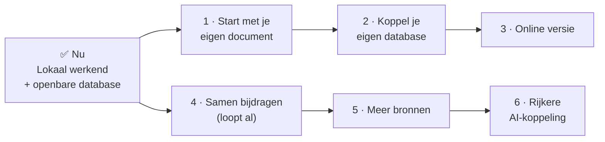

# Routekaart

> **In het kort:** Omnibus werkt nu lokaal, met een openbare database. De volgende stappen maken het makkelijker om met je eigen bronnen te werken, en om samen de database te laten groeien.

Dit zijn voornemens, geen beloftes. Volgorde en details kunnen veranderen. Ideeën en reacties zijn welkom in [Discussions](https://github.com/Robert-Worm/omnibus/discussions).

## Overzicht

## Wat er nu is

- Een werkende applicatie op je eigen computer, met de vier stappen van onderzoeksrichting tot Excel-export.
- Een openbare [database](https://github.com/Robert-Worm/omnibus/releases/latest) met 27 rapporten, 7 wetten en kaders en 14 onderzoeksmodellen.
- Zes [AI-skills](../skills/README.md) om bronnen te verwerken en te controleren.
- Een [lokale AI-koppeling](gebruiken/ai-koppeling.md) voor je eigen AI-assistent.
- Een [claimsysteem](bijdragen/README.md) waarmee iedereen kan zien wie aan welke bron werkt.

## Volgende stappen

### 1. Start met je eigen document

**Doel:** een eigen rapport of kader direct in Omnibus kunnen gebruiken, zonder tussenkomst van de beheerder.

Nu kun je een document al met een AI-skill omzetten, maar het resultaat komt pas via de beheerder in de database. Straks laad je het resultaat zelf, voor gebruik op je eigen computer.

### 2. Koppel je eigen database

**Doel:** naast de openbare database ook een eigen database gebruiken, met een knop in de applicatie.

Denk aan een organisatie met eigen, vertrouwelijke rapporten of interne kaders. Die wil de openbare bronnen gebruiken, aangevuld met eigen materiaal dat de eigen computer of het eigen netwerk niet verlaat. Omnibus laat dan meerdere databases naast elkaar zien.

### 3. Online versie

**Doel:** Omnibus gebruiken zonder iets te installeren.

De applicatie is al voorbereid op hosting, maar draait nog nergens online. Eerst moeten opslag, back-up, herstel en snelheid in de praktijk werken. Gebruikers testen de online versie voordat die definitief wordt.

### 4. Samen bijdragen

**Doel:** zo makkelijk mogelijk maken om een bron te verwerken en in te leveren.

Het claimsysteem werkt al: [claimen, verwerken en inleveren](bijdragen/README.md). Volgende verbeteringen:

- duidelijkere voorbeelden van een goed ingeleverd pakket;
- automatische controle van een ingeleverd pakket, zodat bijdragers sneller horen of het compleet is;
- vaker kleine databasereleases, zodat bijdragen snel zichtbaar worden.

### 5. Meer bronnen

**Doel:** een database die het grootste deel van het auditwerk bij de rijksoverheid dekt.

- Eerst de [542 aanbevolen rapporten](bijdragen/werklijst-aanbevolen.csv) van de Auditdienst Rijk.
- Daarna de overige [9.116 rapporten](bijdragen/werklijst-rapporten.csv) van de Rijksmap.
- Alle wetten en kaders die openbaar mogen worden verwerkt; zie de [werklijst](bijdragen/werklijst-wetten-en-kaders.md). Voor kaders met auteursrecht zoeken we afspraken met de uitgevers.

### 6. Rijkere AI-koppeling

**Doel:** je AI-assistent meer laten doen met Omnibus.

Bijvoorbeeld koppelingen met andere open datasets, zoals de [Rijksmap](https://github.com/Robert-Worm/rijksmap).

## Bewust niet

- **Accounts, inloggen en rollen.** Omnibus werkt zonder account.
- **Projecten in de cloud.** Je werk blijft op je eigen computer.
- **Betaalde functies.** Omnibus blijft niet-commercieel.

Dat verandert alleen na een nieuw, bewust besluit.

## Samengevat

Eerst je eigen documenten en databases, dan online. Ondertussen groeit de openbare database met hulp van bijdragers.

## Volgende stap

Wil je helpen? Lees [meedoen](bijdragen/README.md).
