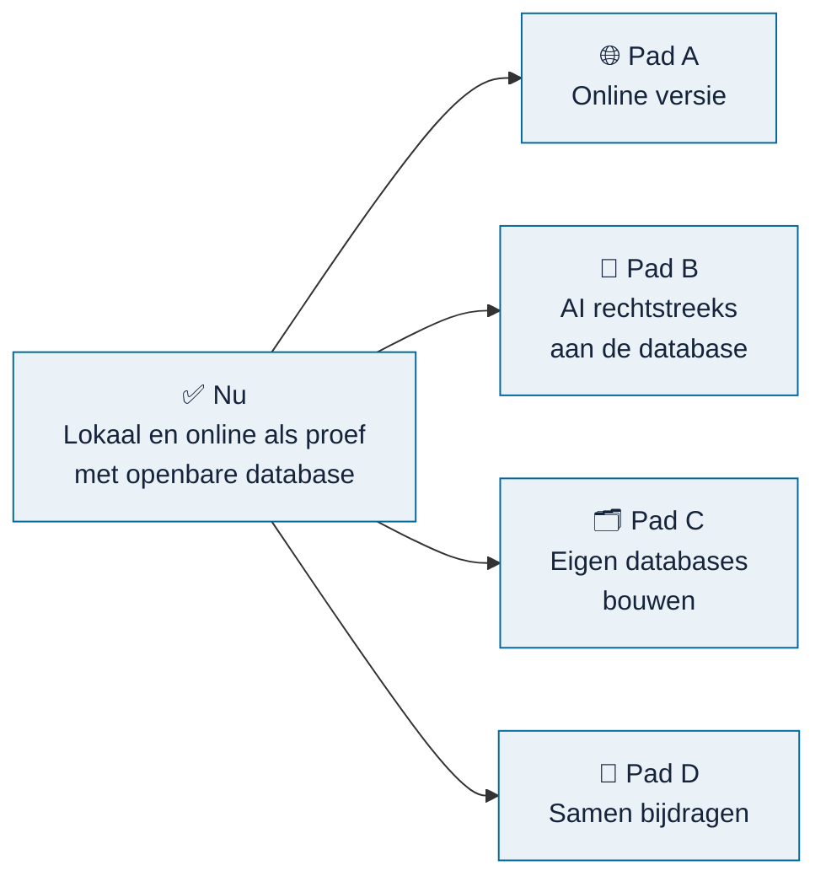

# Routekaart

<!-- paginatype: naslag -->

> **In het kort:** Omnibus werkt op je eigen computer en als proefversie online, met een openbare database. Vanaf hier lopen vier paden naast elkaar. Een online versie, AI die rechtstreeks met de database werkt, eigen databases bouwen en samen de openbare database laten groeien.

Dit zijn voornemens, geen beloftes. Volgorde en details kunnen veranderen. Ideeën en reacties zijn welkom in [Discussions](https://github.com/Robert-Worm/omnibus/discussions).

## Overzicht

| Pad | Doel | Status | Toelichting |
| --- | --- | --- | --- |
| [🌐 A · Online versie](#pad-a--online-versie) | Omnibus gebruiken zonder iets te installeren | 🔄 Bezig | Proefversie online |
| [🤖 B · AI aan de database](#pad-b--ai-rechtstreeks-aan-de-database) | Je AI-assistent laat zoeken en een onderzoeksopzet voorbereiden | ✅ Klaar | Lokaal werkend |
| [🗂️ C · Eigen databases](#pad-c--eigen-databases-bouwen) | Eigen documenten en een eigen database gebruiken, naast de openbare | 🔄 Bezig | Deels mogelijk |
| [🤝 D · Samen bijdragen](#pad-d--samen-bijdragen) | De openbare database samen uitbreiden | ✅ Klaar | Claimsysteem werkt |

## Het vertrekpunt: wat er nu is

- Een werkende applicatie op je eigen computer, met de vier stappen van onderzoeksrichting tot Excel-export. Zie [installeren](gebruiken/installeren.md), of probeer de [proefversie online](https://omnibus.sliplane.app).
- Een openbare [database](https://github.com/Robert-Worm/omnibus/releases/latest) met <!--n:rapporten-->27<!--/n--> rapporten, <!--n:kaders-->7<!--/n--> wetten en kaders en <!--n:modellen-->14<!--/n--> onderzoeksmodellen.
- Zes [AI-skills](../skills/README.md) om bronnen te verwerken en te controleren.

## Pad A · Online versie

**Doel:** Omnibus in de browser gebruiken, zonder installatie. Als eerste mijlpaal een online demo, met als streefdatum 1 december 2026.

| Stap | Status | Toelichting |
| --- | --- | --- |
| Applicatie verpakken als zelfstandig [runtimepakket](beheer/runtime-pakket.md) | ✅ Klaar | – |
| Container (image) maken en lokaal testen met fictieve gegevens, zie [`hosting/`](../hosting/release-delivery/README.md) | ✅ Klaar | – |
| Database gecontroleerd meebouwen in de image ([container-route](../hosting/container/README.md)) | ✅ Klaar | – |
| Proefversie online op [omnibus.sliplane.app](https://omnibus.sliplane.app), met beveiligde verbinding en gezondheidscontrole | ✅ Klaar | – |
| Snelheid online aantoonbaar ([#84](https://github.com/Robert-Worm/omnibus/issues/84)) | 🔄 Bezig | – |
| Online proef: logs, back-up en herstel | ⬜ Gepland | – |
| Onafhankelijke beveiligings- en overdrachtsreview | ⬜ Gepland | – |
| Gebruikers testen de demo | ⬜ Gepland | – |
| Generale repetitie met dezelfde code en database, plus terugvalroute | ⬜ Gepland | – |
| Online demo | ⬜ Gepland | – |

Wat er per stap nog moet gebeuren, staat in de [checklist live demo](beheer/live-demo-checklist.md). Een test met schermlezer en in desktop-Excel hoort bewust niet bij deze demo (besluit 20 oktober 2026). Deze tabel en de checklist volgen dezelfde demomijlpaal; de bredere kwaliteitsbacklog is geen extra verplichte bouwronde vóór 1 december.

## Pad B · AI rechtstreeks aan de database

**Doel:** je eigen AI-assistent laten zoeken in alle bronnen en een onderzoeksopzet laten voorbereiden, die je daarna in Omnibus afmaakt.

| Stap | Status | Toelichting |
| --- | --- | --- |
| Lokale koppeling via MCP: zoeken, bronnen lezen, opzet voorstellen, Excel maken | ✅ Klaar | [AI-koppeling](gebruiken/ai-koppeling.md) |
| Koppeling met andere open datasets, zoals de [Rijksmap](https://www.rijksmap.nl) | ⬜ Gepland | – |
| Koppeling met de online versie, zodat ook AI-diensten in de cloud kunnen aansluiten | ⬜ Gepland | Na pad A |

## Pad C · Eigen databases bouwen

**Doel:** met je eigen documenten werken en je eigen database gebruiken, naast de openbare. Denk aan een organisatie met interne rapporten of eigen kaders die de eigen computer of het eigen netwerk niet mogen verlaten.

| Stap | Status | Toelichting |
| --- | --- | --- |
| Een eigen document omzetten naar bouwstenen met een AI-skill | ✅ Klaar | [Eigen documenten](gebruiken/eigen-documenten.md) |
| Dat resultaat zelf in je lokale Omnibus laden, zonder tussenkomst van de beheerder | ⬜ Gepland | – |
| Een eigen database maken met de publicatiehulpmiddelen | 🔄 Bezig | Kan nu alleen via de [beheerroute](beheer/database-publiceren.md) |
| Meerdere databases naast elkaar gebruiken, met een knop in de applicatie | ⬜ Gepland | – |

## Pad D · Samen bijdragen

**Doel:** de openbare database samen laten groeien, met bronnen die goed zijn verwerkt en gecontroleerd.

| Stap | Status | Toelichting |
| --- | --- | --- |
| Claimsysteem: bronnen op je naam zetten, inleveren en volgen | ✅ Klaar | [Meedoen](bijdragen/README.md) |
| Werklijsten: <!--n:alle-->9.116<!--/n--> rapporten, <!--n:aanbevolen-->542<!--/n--> aanbevolen, wetten en kaders met hun rechten | ✅ Klaar | [Voortgang](bijdragen/voortgang.md) |
| Vastleggen met welk AI-model een bron is verwerkt | ✅ Klaar | – |
| Eerst de [<!--n:aanbevolen-->542<!--/n--> aanbevolen rapporten](bijdragen/werklijst-aanbevolen.md) van de Auditdienst Rijk | 🔄 Bezig | <!--n:aanbevolenInDatabase-->27<!--/n--> in de database |
| Alle wetten en kaders die openbaar mogen; afspraken met uitgevers van beschermde kaders | ⬜ Gepland | [Werklijst](bijdragen/werklijst-wetten-en-kaders.md) |
| Automatische controle van een ingeleverd pakket, zodat bijdragers sneller horen of het compleet is | ✅ Klaar | – |
| Vaker kleine databasereleases, zodat bijdragen snel zichtbaar worden | ⬜ Gepland | – |

## Hoe de paden samenhangen

- **Pad D vult de database** die alle andere paden gebruiken.
- **Pad A en pad B** maken die database beter bereikbaar: via de browser en via AI.
- **Pad C** is voor wie (ook) met eigen, niet-openbare bronnen werkt. Het gebruikt dezelfde skills en controles als pad D, maar het resultaat blijft bij jou.

## Bewust niet

- **Accounts, inloggen en rollen.** Omnibus werkt zonder account.
- **Projecten in de cloud.** Je onderzoek blijft op je eigen computer.
- **Betaalde functies.** Omnibus blijft niet-commercieel.

Dat verandert alleen na een nieuw, bewust besluit.

## Samengevat

Vier paden vanaf een werkende versie, lokaal en online: online, AI, eigen databases en samen bijdragen. Pad D voedt de rest.

## Volgende stap

Wil je helpen? Begin bij [meedoen](bijdragen/README.md).

---

[↑ Wegwijzer](README.md) · [Begrippen](begrippen.md)
