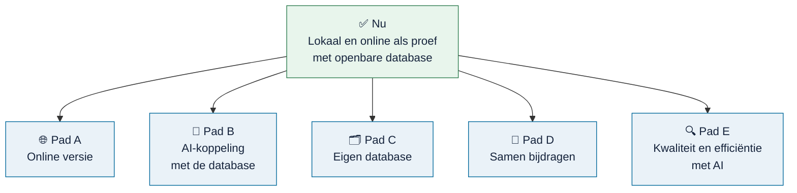

# Routekaart

<!-- paginatype: naslag -->

> **In het kort:** Omnibus werkt op je eigen computer en als proefversie online, met een openbare database. Vanaf hier lopen vijf paden. Het zwaartepunt ligt bij pad E: betere en goedkopere skills, en AI die de kwaliteit bewaakt.

Elke geplande stap is een user story op GitHub, onder een epic per pad. Volgorde en details kunnen veranderen. Ideeën en reacties zijn welkom in [Discussions](https://github.com/Robert-Worm/omnibus/discussions).

## Overzicht

| Pad | Status | Epic |
| --- | --- | --- |
| [🌐 A · Online versie](#pad-a--online-versie) | 🔄 Bezig | [#140](https://github.com/Robert-Worm/omnibus/issues/140) |
| [🤖 B · AI-koppeling](#pad-b--ai-rechtstreeks-aan-de-database) | 🔄 Bezig | [#144](https://github.com/Robert-Worm/omnibus/issues/144) |
| [🗂️ C · Eigen database](#pad-c--eigen-databases-bouwen) | 🔄 Bezig | [#152](https://github.com/Robert-Worm/omnibus/issues/152) |
| [🤝 D · Samen bijdragen](#pad-d--samen-bijdragen) | 🔄 Bezig | [#175](https://github.com/Robert-Worm/omnibus/issues/175) · [#178](https://github.com/Robert-Worm/omnibus/issues/178) |
| [🔍 E · Kwaliteit en efficiëntie](#pad-e--kwaliteit-en-efficiëntie-met-ai) | 🔄 Bezig | [#158](https://github.com/Robert-Worm/omnibus/issues/158) · [#165](https://github.com/Robert-Worm/omnibus/issues/165) · [#169](https://github.com/Robert-Worm/omnibus/issues/169) · [#181](https://github.com/Robert-Worm/omnibus/issues/181) |

## Het vertrekpunt: wat er nu is

- Een werkende applicatie op je eigen computer, met de vier stappen van onderzoeksrichting tot Excel-export. Zie [installeren](gebruiken/installeren.md), of probeer de [proefversie online](https://omnibus.sliplane.app).
- Een openbare [database](https://github.com/Robert-Worm/omnibus/releases/latest) met <!--n:rapporten-->27<!--/n--> rapporten, <!--n:kaders-->7<!--/n--> wetten en kaders en <!--n:modellen-->14<!--/n--> onderzoeksmodellen.
- Zes [AI-skills](../skills/README.md) om bronnen te verwerken en te controleren.

## Pad A · Online versie

**Doel:** Omnibus in de browser gebruiken, zonder installatie, met een online versie die je kunt beheren en herstellen. Epic [#140](https://github.com/Robert-Worm/omnibus/issues/140).

| Stap | Status |
| --- | --- |
| Applicatie verpakken als zelfstandig [runtimepakket](beheer/runtime-pakket.md) | ✅ Klaar |
| Container (image) maken en lokaal testen met fictieve gegevens, zie [`hosting/`](../hosting/release-delivery/README.md) | ✅ Klaar |
| Database gecontroleerd meebouwen in de image ([container-route](../hosting/container/README.md)) | ✅ Klaar |
| Proefversie online op [omnibus.sliplane.app](https://omnibus.sliplane.app), met beveiligde verbinding en gezondheidscontrole | ✅ Klaar |
| Snelheid online aantoonbaar · [#84](https://github.com/Robert-Worm/omnibus/issues/84) | 🔄 Bezig |
| Logboek van de online versie bekijken · [#141](https://github.com/Robert-Worm/omnibus/issues/141) | ⬜ Gepland |
| Online terug naar de vorige werkende versie · [#142](https://github.com/Robert-Worm/omnibus/issues/142) | ⬜ Gepland |
| AI-review van beveiliging en overdracht · [#143](https://github.com/Robert-Worm/omnibus/issues/143) | ⬜ Gepland |

## Pad B · AI rechtstreeks aan de database

**Doel:** je eigen AI-assistent werkt via de koppeling (MCP) met de hele Omnibus-database: zoeken, bronnen lezen en een onderzoeksopzet voorstellen. Epic [#144](https://github.com/Robert-Worm/omnibus/issues/144).

| Stap | Status |
| --- | --- |
| Lokale koppeling: zoeken, bronnen lezen, opzet voorstellen, Excel maken · [AI-koppeling](gebruiken/ai-koppeling.md) | ✅ Klaar |
| Vastleggen wat de koppeling kan, met tests · [#145](https://github.com/Robert-Worm/omnibus/issues/145) | ⬜ Gepland |
| Zoeken en lezen in alle soorten bronnen · [#146](https://github.com/Robert-Worm/omnibus/issues/146) | ⬜ Gepland |
| Onderzoeksopzet die de vraagcontrole haalt · [#147](https://github.com/Robert-Worm/omnibus/issues/147) | ⬜ Gepland |
| Handleiding per AI-app, getest door een AI-agent · [#148](https://github.com/Robert-Worm/omnibus/issues/148) | ⬜ Gepland |
| Koppeling via de online versie, alleen lezen · [#149](https://github.com/Robert-Worm/omnibus/issues/149) | ⬜ Gepland |

Een koppeling met de Rijksmap kan pas als die als database en applicatie even sterk is als Omnibus. Die voorwaarden staan in [#150](https://github.com/Robert-Worm/omnibus/issues/150).

## Pad C · Eigen databases bouwen

**Doel:** met de skills je eigen documenten verwerken en ze in een eigen database gebruiken, naast de openbare. Er verlaat niets je computer of netwerk. Epic [#152](https://github.com/Robert-Worm/omnibus/issues/152).

| Stap | Status |
| --- | --- |
| Een eigen document omzetten naar bouwstenen met een AI-skill · [Eigen documenten](gebruiken/eigen-documenten.md) | ✅ Klaar |
| Een eigen database maken via de [beheerroute](beheer/database-publiceren.md) | ✅ Klaar |
| Een verwerkt eigen document lokaal laden · [#153](https://github.com/Robert-Worm/omnibus/issues/153) | ⬜ Gepland |
| Een eigen database bouwen met één opdracht · [#154](https://github.com/Robert-Worm/omnibus/issues/154) | ⬜ Gepland |
| Meerdere databases naast elkaar · [#155](https://github.com/Robert-Worm/omnibus/issues/155) | ⬜ Gepland |
| Skill die begeleidt van eigen pdf tot eigen database · [#156](https://github.com/Robert-Worm/omnibus/issues/156) | ⬜ Gepland |
| Aantonen dat niets je computer verlaat · [#157](https://github.com/Robert-Worm/omnibus/issues/157) | ⬜ Gepland |

## Pad D · Samen bijdragen

**Doel:** de openbare database laten groeien met de bronnen die er voor overheidsaudit het meest toe doen, in kleine, regelmatige releases. Epics [#175](https://github.com/Robert-Worm/omnibus/issues/175) en [#178](https://github.com/Robert-Worm/omnibus/issues/178).

| Stap | Status |
| --- | --- |
| Claimsysteem: bronnen op je naam zetten, inleveren en volgen · [Meedoen](bijdragen/README.md) | ✅ Klaar |
| Werklijsten: <!--n:alle-->9.116<!--/n--> rapporten, <!--n:aanbevolen-->542<!--/n--> aanbevolen, wetten en kaders met hun rechten · [Voortgang](bijdragen/voortgang.md) | ✅ Klaar |
| Vastleggen met welk AI-model een bron is verwerkt | ✅ Klaar |
| Automatische controle van een ingeleverd pakket | ✅ Klaar |
| De [<!--n:aanbevolen-->542<!--/n--> aanbevolen rapporten](bijdragen/werklijst-aanbevolen.md) van de Auditdienst Rijk · <!--n:aanbevolenInDatabase-->27<!--/n--> in de database | 🔄 Bezig |
| Volgorde van wetten en kaders voor overheidsaudit · [#176](https://github.com/Robert-Worm/omnibus/issues/176) | ⬜ Gepland |
| Kaders die je als IIA-lid moet toepassen · [#177](https://github.com/Robert-Worm/omnibus/issues/177) | ⬜ Gepland |
| Vaste regel voor een nieuwe database · [#179](https://github.com/Robert-Worm/omnibus/issues/179) | ⬜ Gepland |
| Een release met minder handwerk · [#180](https://github.com/Robert-Worm/omnibus/issues/180) | ⬜ Gepland |

## Pad E · Kwaliteit en efficiëntie met AI

**Doel:** skills die sneller en goedkoper werken zonder kwaliteitsverlies, en AI die de kwaliteit van vragen en inhoud bewaakt. Liever geen vraag dan een slechte vraag. Tests die op een tweede persoon wachtten, doen een AI-agent of GitHub. Epics [#158](https://github.com/Robert-Worm/omnibus/issues/158), [#165](https://github.com/Robert-Worm/omnibus/issues/165), [#169](https://github.com/Robert-Worm/omnibus/issues/169) en [#181](https://github.com/Robert-Worm/omnibus/issues/181).

| Stap | Status |
| --- | --- |
| [Kwaliteitsbeoordeling](../skills/omnibus-review-audit-quality/README.md) van normen en toetspunten met een skill | ✅ Klaar |
| [Wat maakt een goede vraag?](../skills/omnibus-review-questions/references/criteria.md) · [#159](https://github.com/Robert-Worm/omnibus/issues/159) | ✅ Klaar |
| [Skill die vragen beoordeelt](../skills/omnibus-review-questions/README.md) · [#160](https://github.com/Robert-Worm/omnibus/issues/160) | ✅ Klaar |
| Alle vragen in de database controleren met `npm run check:questions` · [#161](https://github.com/Robert-Worm/omnibus/issues/161) | ✅ Klaar |
| Afgekeurde vragen schrappen of herschrijven · [#162](https://github.com/Robert-Worm/omnibus/issues/162) | ⬜ Gepland |
| De applicatie toont alleen goedgekeurde vragen; bedachte vragen zijn al weg · [#163](https://github.com/Robert-Worm/omnibus/issues/163) | 🔄 Bezig |
| Nieuwe pakketten op [vraagkwaliteit controleren](beheer/inhoud-toevoegen.md) · [#164](https://github.com/Robert-Worm/omnibus/issues/164) | ✅ Klaar |
| Kwaliteit van de hele database en de bronpassages nalopen · [#166](https://github.com/Robert-Worm/omnibus/issues/166) · [#167](https://github.com/Robert-Worm/omnibus/issues/167) · [#168](https://github.com/Robert-Worm/omnibus/issues/168) | ⬜ Gepland |
| [Meten wat een skill kost en oplevert](beheer/skill-meting.md): testset en nulmeting van de leeskosten klaar, eerste gemeten runs nog niet · [#170](https://github.com/Robert-Worm/omnibus/issues/170) | 🔄 Bezig |
| [Leren van bestaande skillverzamelingen](beheer/skill-lessen.md) · [#171](https://github.com/Robert-Worm/omnibus/issues/171) | ✅ Klaar |
| Leanere instructies, en rapporten in een reeks verwerken · [#172](https://github.com/Robert-Worm/omnibus/issues/172) · [#173](https://github.com/Robert-Worm/omnibus/issues/173) | ⬜ Gepland |
| Geen optimalisatie die de kwaliteit verlaagt: [B-018](beheer/besluiten.md#b-018) · [#174](https://github.com/Robert-Worm/omnibus/issues/174) | ✅ Klaar |
| Installeren op Windows, macOS en Linux getest door GitHub · [#182](https://github.com/Robert-Worm/omnibus/issues/182) | ✅ Klaar |
| Overdracht en skills getest door AI of GitHub · [#183](https://github.com/Robert-Worm/omnibus/issues/183) · [#184](https://github.com/Robert-Worm/omnibus/issues/184) | ⬜ Gepland |

## Hoe de paden samenhangen

- **Pad D vult de database** die alle andere paden gebruiken.
- **Pad E maakt dat vullen goedkoper en beter**, en bewaakt de kwaliteit van wat erin zit.
- **Pad A en pad B** maken de database beter bereikbaar: via de browser en via AI.
- **Pad C** is voor wie (ook) met eigen, niet-openbare bronnen werkt. Het gebruikt dezelfde skills en controles als pad D, maar het resultaat blijft bij jou.

## Bewust niet

- **Accounts, inloggen en rollen.** Omnibus werkt zonder account.
- **Projecten in de cloud.** Je onderzoek blijft op je eigen computer.
- **Betaalde functies.** Omnibus blijft niet-commercieel.

Dat verandert alleen na een nieuw, bewust besluit.

## Samengevat

Vijf paden vanaf een werkende versie, lokaal en online: online, AI-koppeling, eigen database, samen bijdragen, en kwaliteit en efficiëntie met AI. Pad D vult de database; pad E maakt dat beter en goedkoper.

## Volgende stap

Wil je helpen? Begin bij [meedoen](bijdragen/README.md).

---

[↑ Wegwijzer](README.md) · [Begrippen](begrippen.md)
