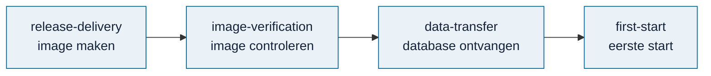

# Hosting (`hosting/`)

> **In het kort:** alles voor de [online versie](../docs/routekaart.md#pad-a--online-versie). De proefversie draait via de [container-route](container/README.md) op [omnibus.sliplane.app](https://omnibus.sliplane.app). De andere mappen beschrijven een uitgebreidere route met de database op een aparte schijf; die is nodig zodra er een niet-openbare database online moet.

## Zo draait de proefversie nu

De proefversie draait via [`container/`](container/README.md): één Dockerfile met de openbare database erin, voor één app bij een containerhost (Sliplane). Je vindt hem op [omnibus.sliplane.app](https://omnibus.sliplane.app).

Begin hier als je de online versie wilt bijwerken of herstellen.

## Klaarliggend: de route met een aparte database

Deze route is nodig zodra er een niet-openbare database online moet. De vier mappen volgen elkaar op:

| Map | Wat het doet |
| --- | --- |
| [`release-delivery/`](release-delivery/README.md) | Het runtimepakket in een container (image) zetten, met de database apart ernaast |
| [`image-verification/`](image-verification/README.md) | De image lokaal bouwen en controleren met fictieve gegevens |
| [`data-transfer/`](data-transfer/README.md) | Een database op de server ontvangen en tegen vaste controlegetallen controleren |
| [`first-start/`](first-start/README.md) | De allereerste start op de server, voordat de database er staat |

## Samengevat

De proefversie draait via één Dockerfile met de openbare database erin. De vier andere mappen (image maken, controleren, database ontvangen, eerste start) blijven klaarliggen voor een route met een aparte database.

## Volgende stap

Begin bij [online zetten in een container](container/README.md), of bekijk wat er voor de demo nog moet gebeuren in de [checklist live demo](../docs/beheer/live-demo-checklist.md).

---

[↑ Wegwijzer](../docs/README.md) · [Runtimepakket](../docs/beheer/runtime-pakket.md) · [Routekaart](../docs/routekaart.md)
