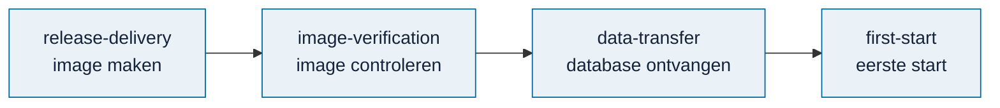

# Hosting (`hosting/`)

> **In het kort:** voorbereiding van de [online versie](../docs/routekaart.md#pad-a--online-versie). Niets hiervan is al online gezet; alles is lokaal getest met fictieve gegevens.

## Wat staat hier?

| Map | Wat het doet |
| --- | --- |
| [`release-delivery/`](release-delivery/README.md) | Het runtimepakket in een container (image) zetten, met de database apart ernaast |
| [`image-verification/`](image-verification/README.md) | De image lokaal bouwen en controleren met fictieve gegevens |
| [`data-transfer/`](data-transfer/README.md) | Een database op de server ontvangen en tegen vaste controlegetallen controleren |
| [`first-start/`](first-start/README.md) | De allereerste start op de server, voordat de database er staat |
| [`container/`](container/README.md) | De eenvoudigste route: één Dockerfile met de openbare database erin, voor één app bij een containerhost (Sliplane) |

## Samengevat

Vier stappen, elk met een eigen hulpmiddel: de image maken, de image controleren, de database ontvangen en de eerste start. Alles is lokaal getest met fictieve gegevens; de afspraken met de hostingpartij volgen nog.

## Volgende stap

Begin bij [de online versie voorbereiden](release-delivery/README.md), of bekijk wat er voor de demo nog moet gebeuren in de [checklist live demo](../docs/beheer/live-demo-checklist.md).

---

[↑ Wegwijzer](../docs/README.md) · [Runtimepakket](../docs/beheer/runtime-pakket.md) · [Routekaart](../docs/routekaart.md)
