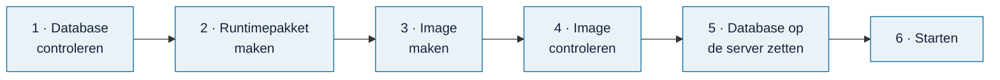

# De online versie voorbereiden (`hosting/release-delivery/`)

> **In het kort:** hier staat hoe Omnibus later in een container (een *image*) online gaat, met de database apart ernaast. Alles is lokaal getest met fictieve gegevens. Deze route is nodig zodra er een niet-openbare database online moet; de proefversie gebruikt de [container-route](../container/README.md).

## Waar staat dit?

| Onderdeel | Status | Toelichting |
| --- | --- | --- |
| Het runtimepakket in een image zetten | ✅ Klaar | Lokaal getest met fictieve gegevens |
| De image controleren | ✅ Klaar | Zie de [imagecontrole](../image-verification/README.md) |
| De database veilig op de server krijgen | 🔄 Bezig | Hulpmiddel klaar ([ontvangen](../data-transfer/README.md)); de route bij de hostingpartij is nog niet bevestigd |
| De eerste start op de server | ⬜ Open | Voorstel klaar ([eerste start](../first-start/README.md)); wacht op de hostingpartij |
| Online | ➖ Niet van toepassing | De proefversie draait via de [container-route](../container/README.md) bij Sliplane |

## Hoe werkt het?



1. **Database controleren.** De beheerder controleert de goedgekeurde database tegen vaste controlegetallen.
2. **Runtimepakket maken.** Omnibus wordt gebouwd en verpakt, zonder database.
3. **Image maken.** Alleen dat pakket gaat in de image. De database, instellingen en wachtwoorden gaan er nooit in.
4. **Image controleren.** Met fictieve gegevens wordt gecontroleerd of de image doet wat hij moet doen.
5. **Database op de server zetten.** De database komt apart op een vaste schijf bij de hostingpartij, met alleen leesrechten voor Omnibus.
6. **Starten.** Omnibus start pas als database, instellingen en image bij elkaar horen. Anders weigert hij te starten.

## Wanneer stop je?

- Als de hostingpartij niet heeft bevestigd hoe de database er vóór de eerste start op komt.
- Als een controlegetal (hash) niet klopt, of een controle mislukt. Gebruik dan niets van de gedeeltelijke uitvoer.
- Als er geen besluit is over de inhoud, de opslag, de verantwoordelijke of de back-up.

Schakel nooit een controle uit en pas nooit een controlegetal aan om verder te kunnen.

## Technische details

Hieronder staan de onderbouwing, de opdrachten (voor Windows én voor macOS/Linux) en alle grenzen.

<details><summary><b>Alle technische details en opdrachten</b></summary>

> [!NOTE]
> **Stand:** deze route is uitgewerkt voor Sevalla, met de database op een aparte schijf. De proefversie gebruikt nu de eenvoudigere [container-route](../container/README.md) bij Sliplane. Deze route blijft nodig zodra er een niet-openbare database online moet.

**De aanbevolen route in het kort:**

1. Bouw de bestaande *portable runtime* op een gecontroleerde releasewerkplek. Gebruik daarbij een aparte, goedgekeurde SQLite-publicatie.
2. Maak met de bestaande pakketmaker het runtimepakket.
3. Zet alleen dat pakket in een `linux/amd64`-image. Lever die image later aan Sevalla via een goedgekeurde privé-registry, vastgezet op digest (een vast controlegetal van de image).
4. Lever de SQLite-database en de instellingen apart aan, op één vaste schijf.

De gewone kopie van de code in Git blijft zonder data.

Deze route voegt alleen twee dingen toe: een hulp die lokaal de context voor de image maakt, en een Dockerfile-template. De runtime, de pakketmaker, de pins, de manier van publiceren en de werkwijzen blijven gelijk. Een Dockerfile ín de gecontroleerde pakketmap zou de bestaande inventaris breken. Daarom staan de template en `.dockerignore` erbuiten. Er komt geen nieuwe backend, downloadfunctie, hulpmiddel om online te zetten, extra afhankelijkheid of automatische publicatie bij.

### Waar dit op steunt, en wat nog open is

Officiële documentatie, geraadpleegd op 19 oktober 2026:

| Bron | Wat erin staat, en wat dat voor ons betekent |
| --- | --- |
| [Sevalla Docker images](https://docs.sevalla.com/applications/docker-images) | Een kant-en-klare image draait zonder dat de hostingpartij hem bouwt. `linux/amd64`, een tag of digest en inloggegevens voor een privé-registry worden ondersteund. Kies per release een digest, geen `latest` die kan veranderen. |
| [Sevalla Dockerfile](https://docs.sevalla.com/applications/builds/dockerfile) | De route via Git bouwt uit de repository of context. Een eigen startopdracht vervangt zowel ENTRYPOINT als CMD, en draait via `/bin/sh -l -c`. `PORT` is de ingestelde webpoort. Een volledige `exec node ... --port "$PORT"` past bij onze bestaande startopdracht. |
| [Sevalla disks](https://docs.sevalla.com/applications/disks) | SQLite kan op een schijf bij één proces in één instantie. Een nieuwe schijf is leeg en verbergt de bestanden uit de image op hetzelfde pad. Jobs en cronjobs kunnen geen schijf krijgen; schijven zijn niet te delen. Bevestig ontvangst en rechten vóór de eerste start van de app. |
| [Sevalla webterminal](https://docs.sevalla.com/applications/web-terminal) | Werkt alleen als er een instantie draait en gereed is. Het Files-menu kan bestanden tot 100 MB uploaden of downloaden, met updatebevoegdheid. Zie het [voorstel voor de eerste start](../first-start/README.md); daarmee is de werkwijze bij de hostingpartij nog niet bewezen. |
| [Docker build context](https://docs.docker.com/build/concepts/context/) en [Dockerfile](https://docs.docker.com/reference/dockerfile/) | De context bepaalt wat COPY kan kopiëren; `.dockerignore` filtert vóór het overzetten. De template gebruikt een expliciet gecontroleerde context, een exec-entrypoint en een gebruiker zonder rootrechten, met een nummer. |

**Wat dat betekent voor Omnibus:** een build vanuit Git mist de aparte SQLite-database die onze webcompiler nodig heeft. Een vooraf gebouwd pakket lost dat op. Deze route gebruikt de schijf nergens tijdens het bouwen van de image. Dat is een ontwerpkeuze. We beweren niet dat een build bij Sevalla bij die schijf zou kunnen.

**De eerste vulling van de schijf blijft een harde voorwaarde.** De webterminal werkt alleen als er een instantie draait en gereed is. Maar onze pakketstart stopt zonder database. Laat de hostingpartij daarom bevestigen:

- hoe de eigenaar de schijf vóór de eerste start van Omnibus kan vullen en de rechten kan instellen;
- hoe beheer toegang krijgt zonder eerst Omnibus-inhoud openbaar te tonen;
- met welke UID/GID de terminal werkt;
- hoe de bestanden buiten logs en de shellgeschiedenis blijven.

Een aparte job kan volgens deze documentatie niet bij dezelfde schijf. Er is hier bewust niets toegevoegd om dat te omzeilen: geen opstartserver, geen download bij de start, geen extra worker, geen start als root en geen lege vervangdatabase. Is er geen bevestigde en goedgekeurde manier om te beginnen? Stop dan voordat iets online gaat.

### Wat waar staat

| Plaats | Wat er mag staan, en waarvoor |
| --- | --- |
| Code-Git | De bestaande code en deze voorbereiding. Geen gegenereerde context en geen echte pinbestanden. |
| Privé-releasewerkplek, buiten de context | De ontvangen SQLite, het instellingenbestand met precies `database`, `release` en `publication`, de inhoudsreview, de ontvangstcontrole, de back-up en de privé-verwerking van bronnen. |
| Nieuwe lokale imagecontext | Alleen `Dockerfile`, `.dockerignore` en `runtime/` met precies de gecontroleerde pakketbestanden. |
| Image `/app/omnibus-runtime` | De bestaande Node-server en de gebouwde webbestanden. Geen SQLite, instellingen, inloggegevens, privé-auteursmodules, Workbench, MCP-service of bronarchief. De webbestanden bevatten wél gepubliceerde gegevens voor de voorkant en de start. Daarvoor zijn dus ook rechten op de inhoud nodig. |
| Vaste schijf `/var/lib/omnibus` | `releases/<publicatie-sha256>/catalogue.sqlite` en `local-build.json`. Koppel de schijf nooit over het pakket of de webroot heen. Bewaar vorige versies, en overschrijf geen database die open is. |
| Instellingen bij de hostingpartij | De image-digest, één webproces, een expliciete HTTPS-origin, de webpoort, het pad van de schijf en de inloggegevens voor de registry. Die laatste beheert de eigenaar. Inloggegevens komen nooit in de image, in buildargumenten of in Git. |

De template maakt de pakketbestanden eigendom van root, zonder schrijfrechten. De app draait als UID/GID `1000:1000`. Dat is lokaal bevestigd in een proef met een fictieve Linux-image, maar nog niet bij Sevalla.

Die gebruiker moet de versiemap kunnen doorzoeken en de SQLite en de instellingen kunnen lezen. Schrijfrechten heeft de app niet nodig. Laat de beheerder de rechten instellen, buiten de app om. Een `chmod` in de image verandert niets aan een schijf die later wordt gekoppeld.

Het instellingenbestand bij elke database bevat alleen dit:

```json
{
  "database": "catalogue.sqlite",
  "release": "<exacte-release-sha256>",
  "publication": "<exacte-publicatie-sha256>"
}
```

Dit voorbeeld werkt pas als je beide plaatshouders hebt ingevuld.

> [!NOTE]
> **Goed om te weten:** dit zijn allemaal **verschillende** identiteiten: de releasepin, de publicatiepin, de hash van het runtimecontract, de hash van het SQLite-bestand, de hash van `runtime-package.json` en de uiteindelijke image-digest. Leg vast hoe ze bij de beoordeelde codecommit horen, buiten Git. De hash van het pakketmanifest is geen digitale handtekening. De hulp voor de context beoordeelt geen inhoud en scant de basis-image niet.

### Stappen voor de operator, alleen met toestemming

De stappen hieronder, met echte inhoud bij de release en de hostingpartij, zijn **niet uitgevoerd**. Gebruik nieuwe uitvoermappen, een vertrouwde codecommit en een rustige releasewerkplek. Publiceer niets automatisch, en verander de actieve database of de bestaande runtime-build niet. Stop na elke mislukte opdracht; gebruik halve uitvoer niet.

1. **Ontvang de database.** Ontvang de goedgekeurde SQLite-publicatie via het bestaande privé-proces, met de verwachte pins en bestandshash. Controleer de hash op de gesloten kopie die je overzette. Kopieer nooit een SQLite die in gebruik is, met open WAL-bestanden.

   Bevestig de rechten op de inhoud: voor de webbestanden, de geregistreerde bronnen en de volledige documenten die bereikbaar zijn. De eigenaar kiest de registry, de verantwoordelijke, de regio, het budget en de doelen voor back-up en herstel. Hier is niets gekozen en geen dienst aangezet.
2. **Controleer, bouw en verpak.** Voer op de releasewerkplek de bestaande ontvangstcontrole, de portable build en de pakketmaker uit. Je hebt Node 24 en de bestaande, gecontroleerde bouwomgeving voor de voorkant nodig. De image zelf hoeft npm niet te installeren. Werk vanuit de kopie van de code, met een eigen, al bestaande uitvoermap.

   Windows (PowerShell):

   ```powershell
   $settingsFile = '<absoluut-pad-naar-goedgekeurd-local-build.json>'
   $databaseFile = '<absoluut-pad-naar-dezelfde-catalogue.sqlite>'
   $deliveryRoot = '<bestaande-aparte-private-uitvoermap>'
   node scripts/check-runtime-database.mjs --settings "$settingsFile"
   if ($LASTEXITCODE -ne 0) { throw 'Databasecontrole mislukt' }
   npm run build:runtime -- --settings "$settingsFile" --out "$deliveryRoot/web"
   if ($LASTEXITCODE -ne 0) { throw 'Runtimebuild mislukt' }
   node scripts/package-runtime.mjs --web-root "$deliveryRoot/web" --database "$databaseFile" --out "$deliveryRoot/runtime"
   if ($LASTEXITCODE -ne 0) { throw 'Pakketcontrole mislukt' }
   ```

   macOS en Linux (bash); `set -e` stopt bij de eerste fout:

   ```bash
   set -e
   settingsFile='<absoluut-pad-naar-goedgekeurd-local-build.json>'
   databaseFile='<absoluut-pad-naar-dezelfde-catalogue.sqlite>'
   deliveryRoot='<bestaande-aparte-private-uitvoermap>'
   node scripts/check-runtime-database.mjs --settings "$settingsFile"
   npm run build:runtime -- --settings "$settingsFile" --out "$deliveryRoot/web"
   node scripts/package-runtime.mjs --web-root "$deliveryRoot/web" --database "$databaseFile" --out "$deliveryRoot/runtime"
   ```

   Vergelijk de ontvangen pins met de identiteiten van het pakket. Voer de bestaande pakketcontrole en korte startproef uit die bij de release horen. Bewijs dat niet is veranderd, mag je hergebruiken. De hulp voor de context vervangt die releasecontrole niet.
3. **Maak de context voor de image.** Laat de eigenaar eerst een precieze officiële Node 24-versie voor `bookworm-slim` goedkeuren, met de bijbehorende digest die past bij `linux/amd64`. Laat daarbij ook beveiliging en onderhoud beoordelen. De [officiële bron van de image](https://github.com/nodejs/docker-node/tree/main/24/bookworm-slim) bestaat. Een actuele tag of digest wordt hier niet verzonnen of gedownload. Maak dan de lokale context; deze opdracht gebruikt alleen Node en bestaande bestanden.

   Windows (PowerShell):

   ```powershell
   $nodeImage = 'node:24.<minor>.<patch>-bookworm-slim@sha256:<goedgekeurde-digest>'
   node hosting/release-delivery/prepare-image-context.mjs --package "$deliveryRoot/runtime" --node-image "$nodeImage" --out "$deliveryRoot/image-context"
   if ($LASTEXITCODE -ne 0) { throw 'Imagecontext geweigerd' }
   ```

   macOS en Linux (bash):

   ```bash
   nodeImage='node:24.<minor>.<patch>-bookworm-slim@sha256:<goedgekeurde-digest>'
   node hosting/release-delivery/prepare-image-context.mjs --package "$deliveryRoot/runtime" --node-image "$nodeImage" --out "$deliveryRoot/image-context"
   ```

   De hulp weigert in deze gevallen: pins die niet compleet zijn, extra of beschadigde pakketbestanden, mappen die overlappen en een uitvoerpad dat al bestaat. Hij controleert de gekopieerde bytes opnieuw. Hij schrijft een `.dockerignore` met alleen precieze uitzonderingen per bestand. Voeg later geen bestanden toe en ook geen eigen ignore-bestand voor de Dockerfile; de context moet gelijk blijven. De hulp vraagt geen pad naar een database en gebruikt het netwerk niet. Zijn uitkomst `imageBuilt: false` klopt letterlijk: hij bouwt geen image.
4. **Voorwaarde: de image.** Een bevoegde operator bouwt en bekijkt de image, in een goedgekeurde omgeving om containers te bouwen. Gebruik de [imagecontrole met fictieve gegevens](../image-verification/README.md). Herhaal de controles die ertoe doen bij een nieuwe basis-image of een nieuw runtimepakket. Het voorbeeld hieronder vervangt die volledige controle niet. Bouw alleen vanuit de map met de context, nooit vanuit de kopie van de code of de map met data.

   Windows (PowerShell):

   ```powershell
   $imageTag = 'omnibus-reviewed:local'
   docker build --platform linux/amd64 --network none --tag "$imageTag" "$deliveryRoot/image-context"
   if ($LASTEXITCODE -ne 0) { throw 'Imagebuild mislukt' }
   docker image inspect --format '{{.Os}}/{{.Architecture}} {{.Config.User}}' "$imageTag"
   if ($LASTEXITCODE -ne 0) { throw 'Image-inspectie mislukt' }
   docker run --rm --network none --entrypoint node "$imageTag" --input-type=module -e "import {verifyRuntimePackage} from './local-data/runtime-package.mjs'; verifyRuntimePackage(process.cwd());"
   if ($LASTEXITCODE -ne 0) { throw 'Pakketcontrole in image mislukt' }
   ```

   macOS en Linux (bash):

   ```bash
   imageTag='omnibus-reviewed:local'
   docker build --platform linux/amd64 --network none --tag "$imageTag" "$deliveryRoot/image-context"
   docker image inspect --format '{{.Os}}/{{.Architecture}} {{.Config.User}}' "$imageTag"
   docker run --rm --network none --entrypoint node "$imageTag" --input-type=module -e "import {verifyRuntimePackage} from './local-data/runtime-package.mjs'; verifyRuntimePackage(process.cwd());"
   ```

   `--network none` geldt voor RUN-instructies, niet voor het ophalen van de basis-image. Bewijs met fictieve data, voordat je echte inhoud gebruikt: Linux/amd64, gebruiker `1000:1000`, ondersteuning voor Node en SQLite, de bytes van het pakket, wat buiten de context blijft, de rechten op de schijf en netjes afsluiten. Bekijk ook de lagen en de inhoud van de image; een geslaagde test van de context is geen controle van de image. Bewaar het bewijs buiten Git. De template installeert geen software en bouwt geen database.
5. **Voorwaarde: overdracht.** Zet de gecontroleerde image pas na vrijgave in de gekozen privé-registry. Leg de digest vast die de registry teruggeeft; een lokaal image-ID is niet vanzelf dezelfde digest. Kies in Sevalla `Docker image` met `registry/naam@sha256:<digest>` en de aparte inloggegevens voor de registry. Gebruik bij elke volgende release weer de expliciete digest, ook in de instelling van de bron. Volgens de documentatie van de hostingpartij is een losse wijziging bij het online zetten geen blijvende wijziging van de bron. Automatische CI is niet nodig.
6. **Vóór de eerste start van Omnibus:** laat de bevestigde manier van overzetten de schijf van het webproces vullen, onder de nieuwe versie.
   - Controleer de hash van het ontvangen SQLite-bestand tegen de privé-overdracht.
   - Leg het instellingenbestand vast met dezelfde release en publicatie.
   - Controleer dat de app niet meer dan leesrechten heeft.

   De [ontvangsthulp](../data-transfer/README.md) controleert vier pins die je vooraf vertrouwt. Hij zet niets over via het netwerk en activeert niets. Het [voorstel voor de eerste start](../first-start/README.md) noemt de open vragen over de hostingpartij en de rechten. De precieze opdracht om over te zetten blijft open tot kanaal, toegangsbeheer en eerste toegang tot de schijf zijn bevestigd. Een download-URL of inloggegevens worden niet verzonnen.
7. **Starten.** Na die voorwaarde en de gezamenlijke vrijgave van het inkomende verkeer: één instantie, de schijf op `/var/lib/omnibus`, een gekozen webpoort en één volledige startopdracht in het webproces bij Sevalla. Dit is een opdracht voor de Linux-shell van de hostingpartij, niet voor je eigen computer. Vul de vrijgegeven versie en origin in:

   ```sh
   exec node /app/omnibus-runtime/scripts/start-runtime-package.mjs --settings /var/lib/omnibus/releases/<publicatie-sha256>/local-build.json --public-origin https://<vrijgegeven-domein> --listen-host 0.0.0.0 --port "$PORT"
   ```

   De shell geeft `PORT` expliciet door. De runtime gebruikt geen standaardwaarde uit de omgeving, en weigert een lege of ongeldige waarde. De volledige opdracht is nodig, omdat de eigen startopdracht van de hostingpartij ENTRYPOINT én CMD vervangt. De bestaande pakketstart controleert inventaris, contract en databasepins voordat hij gaat luisteren. Stel probes pas in als bewezen is hoe Host en proxy zich gedragen. Deze template voegt geen aparte route voor probes toe.
8. **Bewijs op de server** elk vrijgavepunt apart: TLS, Host, Origin/CORS, probes, logs, grens tegen misbruik, leesrechten, herstart, wisselen van release en herstel. Bewaar de vorige image-digest én de database en instellingen die erbij horen. Terugzetten vraagt dat je beide expliciet kiest; alleen de code terugzetten herstelt de SQLite niet. Gebruik de bestaande [herstelroute](../../docs/beheer/storingen-en-herstel.md).

### Wanneer je stopt

- **Geen bevestigde eerste vulling van de schijf, of te weinig rechten voor `1000:1000`:** niet online zetten. Geef geen extra rechten en pas het runtimecontract niet aan om het te omzeilen.
- **Iets ontbreekt:** vrijgave van de inhoud, pin van image of database, besluit over de registry, een beheerder, of een onafhankelijke afspraak over back-up en herstel. Dan geen overdracht en geen openbare start.
- **Iets klopt niet:** een verkeerde hash, een veranderde context, een fout in pakket of database, een tweede instantie die nodig blijkt, of probes of proxy die zich anders gedragen dan het bestaande contract. Stop en leg het gericht terug bij de ontwikkelaar. Schakel geen controles uit.

### Voor de ontwikkelaar

Voor deze route hoef je de contracten van runtime, server en pakketmaker niet aan te passen. Wil je de testopdracht in de centrale testplanning opnemen? Dat mag; `package.json` blijft hier gelijk. Voegt ander werk runtimebestanden toe aan de lijst van toegestane pakketbestanden? Dan neemt de hulp voor de context die over via de gecontroleerde inventaris. Maak daarna nieuwe pakketten. Kopieer nooit nieuwe servercode in een pakket dat al is gecontroleerd.

Controle op je eigen computer, zonder Docker:

```text
node --test --test-reporter=tap --test-concurrency=1 --test-timeout=120000 hosting/release-delivery/prepare-image-context.test.mjs
```

Deze tests gebruiken alleen fictieve SQLite en tijdelijke mappen. Ze controleren het klaarzetten, dat bytes gelijk blijven, de foutmeldingen en de Node-expressie uit de template, op je eigen computer. Ze draaien geen Docker-parser, image, proef met Linux-rechten, HTTP-listener of proef bij de hostingpartij. Ze zijn geen inhoudelijke of menselijke acceptatie.

</details>

## Samengevat

Omnibus gaat online als image zonder database. De database staat apart op een vaste schijf en wordt bij elke start gecontroleerd. De lokale proeven zijn gedaan; de afspraken met de hostingpartij nog niet.

## Volgende stap

Lees hoe de image wordt [gecontroleerd](../image-verification/README.md), of bekijk wat er voor de demo nog moet gebeuren in de [checklist live demo](../../docs/beheer/live-demo-checklist.md).

---

[↑ Hosting](../README.md) · [Wegwijzer](../../docs/README.md) · [Routekaart](../../docs/routekaart.md)
