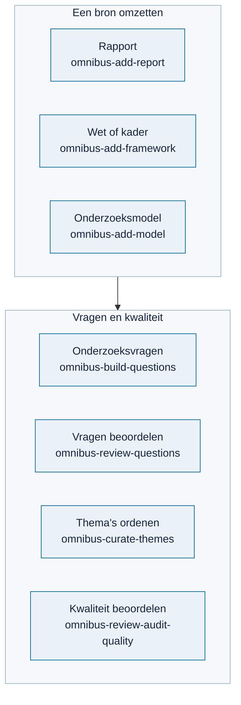

# AI-skills (`skills/`)

> **In het kort:** zeven werkwijzen voor je AI-assistent. Drie zetten een bron om naar bouwstenen voor Omnibus, vier helpen bij vragen en kwaliteit. Je installeert alleen wat je nodig hebt.

## Wat is een skill?

Een skill is een map met instructies (`SKILL.md`) en naslag die een AI-assistent stap voor stap volgt. Het is geen programma of getraind model: de kwaliteit hangt af van je assistent en van jouw controle.

## De zeven skills



| Je wilt… | Skill |
| --- | --- |
| [Een auditrapport omzetten naar normen en toetspunten](omnibus-add-report/README.md) | `omnibus-add-report` |
| [Een wet of normenkader omzetten](omnibus-add-framework/README.md) | `omnibus-add-framework` |
| [Een onderzoeksmodel met interviewvragen toevoegen](omnibus-add-model/README.md) | `omnibus-add-model` |
| [Onderzoeks- en interviewvragen ontwerpen](omnibus-build-questions/README.md) | `omnibus-build-questions` |
| [Vragen beoordelen: behouden, herschrijven of schrappen](omnibus-review-questions/README.md) | `omnibus-review-questions` |
| [Te grote thema's ordenen en overlap vinden](omnibus-curate-themes/README.md) | `omnibus-curate-themes` |
| [De kwaliteit van bouwstenen beoordelen](omnibus-review-audit-quality/README.md) | `omnibus-review-audit-quality` |

## Installeren

Voor Codex, vanuit de repository:

```text
npm run skills:check -- --skill omnibus-add-report
npm run skills:install -- --skill omnibus-add-report
```

- `skills:check` controleert alleen; `skills:install` installeert.
- Laat `--skill` weg om alle zeven te installeren.
- Een bestaande skill die je zelf hebt aangepast, wordt nooit overschreven.
- Andere bestemming? Gebruik `--target <map>`.
- `skills:check` meldt ook afwijkingen van de vaste controlelijst voor skills. Alleen die controle: `npm run skills:regels`.

Gebruik je Claude Code, de Claude-app of ChatGPT? Zie [skills gebruiken met je AI-assistent](../docs/bijdragen/skills-gebruiken.md).

Gebruik je een andere AI-assistent? Geef hem de hele map van de skill (niet alleen `SKILL.md`) en vraag hem `SKILL.md` te volgen.

## Goed om te weten

- **Controleer altijd zelf.** Een skill markeert twijfels als HOLD. Een AI-review is geen menselijke goedkeuring.
- **Rechten en vertrouwelijkheid.** Stuur alleen documenten naar je AI-dienst die je mag delen.
- **Opnemen in de database** loopt via [meedoen](../docs/bijdragen/README.md): de beheerder voegt de laatste controles toe.

## Licentie

De skills vallen onder de [PolyForm Noncommercial License 1.0.0](../LICENSE). Elke skill heeft een eigen kopie, zodat je hem los kunt delen. De licentie geeft geen rechten op de documenten die je verwerkt.

## Verder lezen

[Een bron verwerken](../docs/bijdragen/bron-verwerken.md) · [Eigen documenten](../docs/gebruiken/eigen-documenten.md)

---

[↑ Omnibus](../README.md) · [Wegwijzer](../docs/README.md) · [Begrippen](../docs/begrippen.md) · [Routekaart](../docs/routekaart.md)
